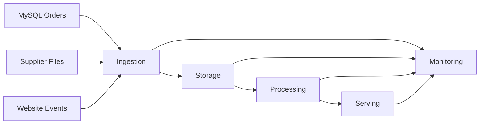

# Week 2 — Day 1: Data Engineering Fundamentals — Lab

## Part 1 — Data Engineering and Source Systems

### Q. 1 — Build a Source Inventory

BritMart operates with four primary source systems:
1. MySQL order database
2. CSV product file from a supplier
3. JSON events from the website
4. Excel stock report from a store

#### Completed Inventory Table

| Source | Type of data | How often it may change | One check before using it |
| :--- | :--- | :--- | :--- |
| **MySQL orders** | Structured | Frequently | Check row count and required columns / primary key uniqueness |
| **Supplier CSV** | Structured text file | When supplier sends a new file | Check header and data types |
| **Website JSON** | Semi-structured | Frequently / Continuously | Check expected fields and JSON syntax |
| **Excel stock report** | Structured business file | Daily or when store sends it | Check sheet, columns, and missing values |

---

### Q. 2 — Decide What the Data Engineer Must Do

For each requirement, classify whether it is mainly a data engineering, data analytics, or data science task:

- **A. Build a daily process that copies orders into analytical storage.** -> **Data engineering**
- **B. Create a chart showing sales by city.** -> **Data analytics**
- **C. Train a model to predict customer churn.** -> **Data science**
- **D. Remove duplicate order records before reporting.** -> **Data engineering**
- **E. Make sure a failed pipeline can be rerun safely.** -> **Data engineering**

```text
A -> Data engineering
B -> Data analytics
C -> Data science
D -> Data engineering
E -> Data engineering
```

---

### Q. 3 — Inspect Three Small Input Batches

```python
import pandas as pd

batch_1 = pd.DataFrame({
    "order_id": [101, 102],
    "city": ["London", "Manchester"],
    "amount_gbp": [45.50, 18.00],
})

batch_2 = pd.DataFrame({
    "order_id": [103, 104],
    "city": ["Bristol", "London"],
    "amount_gbp": [62.25, 27.40],
})

batch_3 = pd.DataFrame({
    "order_id": [105, 106],
    "city": ["Leeds", "Manchester"],
    "amount_gbp": [34.80, 51.10],
})

print("Batch 1:", len(batch_1))
print("Batch 2:", len(batch_2))
print("Batch 3:", len(batch_3))

all_orders = pd.concat([batch_1, batch_2, batch_3], ignore_index=True) # --> Combine these tables, but don't keep their original row indexes. Create new ones.

print("Total rows:", len(all_orders))
print("Total sales:", all_orders["amount_gbp"].sum())
```

#### Output

```text
Batch 1: 2
Batch 2: 2
Batch 3: 2
Total rows: 6
Total sales: 239.05
```

---

### Q. 4 — MCQ: Data Engineering

Which task is most clearly a data-engineering responsibility?

- A. Choosing colours for a sales dashboard
- B. Building a reliable process that moves and cleans order data
- C. Writing a business presentation about monthly revenue
- D. Designing a customer survey

**Correct answer: B**

---

## Part 2 — Pipeline Lifecycle: Ingestion, Storage, Processing, and Serving

### Q. 5 — Put the Pipeline Steps in Order

```text
Read new order records
        ↓
Store the received records
        ↓
Clean invalid values
        ↓
Create daily sales summary
        ↓
Make the summary available to analysts
        ↓
Check that the run completed
```

---

### Q. 6 — Design a Small Pipeline for Daily Orders

BritMart receives one CSV file every night.

| Pipeline step | What happens? | Simple check |
| :--- | :--- | :--- |
| **Source** | Supplier sends order file | Did the expected file arrive? |
| **Ingestion** | Read the file | Can it be read, and are the required columns present? |
| **Storage** | Keep received data | Does the stored row count match the received count? |
| **Processing** | Clean and transform data | Do valid and rejected row counts add up to the input count? |
| **Serving** | Create useful sales output | Business totals are checked |
| **Monitoring** | Record whether the run succeeded | Did every required step complete successfully? |

---

### Q. 7 — Process Three Batches and Keep the Counts

```python
import pandas as pd

batch_1 = pd.DataFrame({
    "order_id": [101, 102],
    "city": ["London", "Manchester"],
    "amount_gbp": [45.50, 18.00],
})

batch_2 = pd.DataFrame({
    "order_id": [103, 104],
    "city": ["Bristol", "London"],
    "amount_gbp": [62.25, 27.40],
})

batch_3 = pd.DataFrame({
    "order_id": [105, 106],
    "city": ["Leeds", "Manchester"],
    "amount_gbp": [34.80, 51.10],
})

batch_1["batch_id"] = "batch_1"
batch_2["batch_id"] = "batch_2"
batch_3["batch_id"] = "batch_3"

all_orders = pd.concat([batch_1, batch_2, batch_3], ignore_index=True)

summary = (
    all_orders
    .groupby("batch_id", as_index=False)
    .agg(
        row_count=("order_id", "count"),
        sales_gbp=("amount_gbp", "sum"),
    )
)

print(summary)
```

#### Output

```text
  batch_id  row_count  sales_gbp
0  batch_1          2      63.50
1  batch_2          2      89.65
2  batch_3          2      85.90
```

---

### Q. 8 — MCQ: Ingestion

What does ingestion mean in a data pipeline?

- A. Moving data from a source into the data platform
- B. Creating the final dashboard colours
- C. Deleting every raw record after reading it
- D. Training a prediction model

**Correct answer: A**

---

## Part 3 — Transformation, Batch Processing, and Streaming Processing

### Q. 9 — Clean a Batch of Orders

Rules:
- city must not be missing
- amount must be greater than 0
- trim spaces from valid city names

```python
import pandas as pd

orders = pd.DataFrame({
    "order_id": [201, 202, 203, 204],
    "city": [" London ", "Manchester", "Leeds", None],
    "amount_gbp": [45.50, -5.00, 30.00, 20.00],
})

invalid_mask = (
    orders["city"].isna()
    | (orders["amount_gbp"] <= 0)
)

rejected_orders = orders[invalid_mask].copy()

valid_orders = orders[~invalid_mask].copy()
valid_orders["city"] = valid_orders["city"].str.strip()

print("Valid orders:")
print(valid_orders)

print("\nRejected orders:")
print(rejected_orders)
```

#### Output

```text
Valid orders:
   order_id    city  amount_gbp
0       201  London        45.5
2       203   Leeds        30.0

Rejected orders:
   order_id        city  amount_gbp
1       202  Manchester        -5.0
3       204        None        20.0
```

---

### Q. 10 — Batch or Streaming?

| Requirement | Choice | Reason |
| :--- | :--- | :--- |
| **Daily supplier file at midnight** | Batch | File arrives as a complete set |
| **Payment events needed within seconds** | Streaming | Low delay is important |
| **Monthly finance report** | Batch | Work is periodic |
| **Live website activity feed** | Streaming | Events arrive continuously |

---

### Q. 11 — Simulate Three Batch Runs

```python
batches = [
    [10, 20, 30],
    [40, 50],
    [60, 70, 80, 90],
]

cumulative_total = 0

for batch_number, batch in enumerate(batches, start=1):
    batch_total = sum(batch)
    cumulative_total += batch_total

    print(
        batch_number,
        len(batch),
        batch_total,
        cumulative_total,
    )
```

#### Output

```text
1 3 60 60
2 2 90 150
3 4 300 450
```

---

### Q. 12 — MCQ: Streaming

Which requirement is the strongest reason to use streaming rather than a daily batch?

- A. A report that is needed once per month
- B. A file that arrives only once each night
- C. Fraud events that must be checked within seconds
- D. A yearly archive export

**Correct answer: C**

---

## Part 4 — OLTP, OLAP, ETL, ELT, and Platform Design

### Q. 13 — OLTP or OLAP?
### OLTP: Online Transaction Processing. Handles everyday business transactions.
### OLAP: Online Analytical Processing. Analyses data to answer broader questions.

- A. Record a new customer order. -> **OLTP**
- B. Update the payment status of one order. -> **OLTP**
- C. Calculate sales by city for the last 12 months. -> **OLAP**
- D. Compare average order value across product categories. -> **OLAP**

```text
A -> OLTP
B -> OLTP
C -> OLAP
D -> OLAP
```

---

### Q. 14 — ETL or ELT?

- **Design A**:
  - Extract source data
  - Clean it before loading
  - Load only cleaned data to the target
  - **Answer: ETL**

- **Design B**:
  - Extract source data
  - Load the source data to the target platform
  - Transform it inside the target
  - **Answer: ELT**

```text
Design A -> ETL
Design B -> ELT
```

---

### Q. 15 — Draw a Small Modern Data Platform



- **Sources**: MySQL Orders, Supplier Files, Website Events
- **Ingestion**: Moves data from the source systems into the platform
- **Storage**: Retains the incoming raw and intermediate data
- **Processing**: Cleans and transforms data for analysis
- **Serving**: Delivers curated datasets to reporting and analysts
- **Monitoring**: Observes status, row counts, and health across all stages

---

### Q. 16 — MCQ: OLAP

Which workload is an OLAP workload?

- A. Insert one new payment record
- B. Change one customer's phone number
- C. Cancel one order
- D. Calculate three years of sales by region

**Correct answer: D**

---

## Optional Practice

### Q. 17 — Design Recovery for a Failed Batch

Three daily batches should arrive:
- `batch_1` -> received and processed
- `batch_2` -> received but processing failed
- `batch_3` -> not started

#### Steps to follow:
1. Check logs to understand why `batch_2` failed.
2. Confirm whether any partial output was written and remove it to avoid duplicates.
3. Correct the problem (e.g. data issue or code fix).
4. Rerun `batch_2`.
5. Verify input and output counts match.
6. Continue with `batch_3`.
7. Keep the batch status and counts logged so the execution is fully tracked.

---

### Q. 18 — Compare Two Pipeline Designs

- **Design A**: `Source -> Clean -> Final report`
- **Design B**: `Source -> Store received data -> Clean -> Final report`

**Answer: Design B**

**Why:** Design B stores the raw received data before the cleaning step. If business rules change, we can rerun the cleaning process directly on the stored data without needing the source system to resend it.

---

### Q. 19 — Reconcile Three Batches

```python
expected = [100, 120, 80]
processed = [100, 118, 80]

for index in range(len(expected)):
    difference = expected[index] - processed[index]
    print(f"Batch {index + 1}: difference = {difference}")
```

#### Output

```text
Batch 1: difference = 0
Batch 2: difference = 2
Batch 3: difference = 0
```

`batch_2` needs investigation (difference = 2).

---

### Q. 20 — Choose the Processing Style

1. Store sends stock file every evening. -> **Batch** (file arrives as a single batch once per day)
2. Website sends click events all day. -> **Streaming** (continuous stream of events)
3. Finance needs a report at the end of each month. -> **Batch** (periodic monthly process)
4. Payment team needs alerts within a few seconds. -> **Streaming** (requires low latency)
5. Supplier sends one price file every Monday. -> **Batch** (periodic weekly delivery)

```text
1. Batch
2. Streaming
3. Batch
4. Streaming
5. Batch
```
