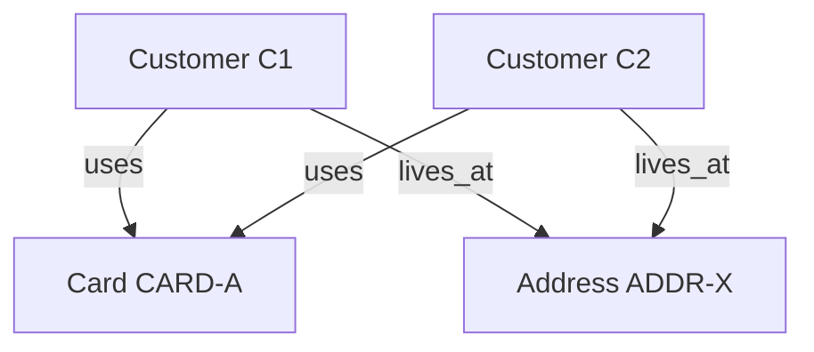

# Week 2 — Day 2: Relational and NoSQL Database Fundamentals

## Practice Workbook: BritMart Database Designs


> **Concepts covered here:**
> - **Relational Databases:** Structured tables, rows, columns, Primary Keys (PK), Foreign Keys (FK), and ACID transaction guarantees.
> - **NoSQL Databases:** Non-relational systems designed for specific access patterns:
>   - **Document Store:** JSON-like records, flexible schema, nested fields (e.g., product catalogues).
>   - **Key-Value Store:** High-speed lookup by unique key (e.g., user sessions, caches).
>   - **Column-Family:** Wide rows grouped by keys for massive write throughput.
>   - **Graph Database:** Nodes and edges for heavily connected data (e.g., fraud networks, social graphs).
> - **Consistency Models:** **ACID** (Atomicity, Consistency, Isolation, Durability) vs. **BASE** (Basically Available, Soft state, Eventual consistency).
> - **Polyglot Persistence:** Using the right database model for each business workload.

---

## Part 1 — Relational Databases and NoSQL

### Q. 1 — Build a Small Relational Model

BritMart has:
- **Customers**: `customer_id`, `customer_name`, `city`
- **Orders**: `order_id`, `customer_id`, `amount_gbp`, `status`

#### Requirements:
- A primary key on each table.
- A foreign key from `orders.customer_id` to `customers.customer_id`.

#### SQL Solution:

```sql
CREATE DATABASE IF NOT EXISTS britmart_db_types;
USE britmart_db_types;

-- 1. Create the customers table 
CREATE TABLE customers (
    customer_id INT PRIMARY KEY,
    customer_name VARCHAR(100) NOT NULL,
    city VARCHAR(50) NOT NULL
);

-- 2. Create the orders table 
CREATE TABLE orders (
    order_id INT PRIMARY KEY,
    customer_id INT NOT NULL,
    amount_gbp DECIMAL(10,2) NOT NULL,
    status VARCHAR(20) NOT NULL,
    FOREIGN KEY (customer_id) REFERENCES customers(customer_id)
);
```

> **Notes & Explanations:**
> - **Primary Key (`PRIMARY KEY`)**: Uniquely identifies each record in a table. It cannot contain `NULL` values and guarantees uniqueness.
> - **Foreign Key (`FOREIGN KEY`)**: Enforces **referential integrity**. It guarantees that an order cannot be created with a `customer_id` that does not exist in the `customers` table.
> - **`DECIMAL(10,2)`**: Recommended for monetary values (e.g., GBP) to avoid floating-point rounding errors.
> - **`NOT NULL`**: Prevents missing mandatory data from being stored.

---

### Q. 2 — Insert and Join the Relational Data

Insert the provided data and write a join that displays:
`order_id`, `customer_name`, `city`, `amount_gbp`, `status`.

#### SQL Solution:

```sql
-- Insert data into customers
INSERT INTO customers (customer_id, customer_name, city) VALUES
(1, 'Amelia Clarke', 'London'),
(2, 'Oliver Bennett', 'Manchester'),
(3, 'Aisha Khan', 'Leeds');

-- Insert data into orders
INSERT INTO orders (order_id, customer_id, amount_gbp, status) VALUES
(101, 1, 45.50, 'complete'),
(102, 2, 18.00, 'cancelled'),
(103, 1, 62.25, 'complete'),
(104, 3, 30.00, 'complete');

-- Query to join orders with customers
SELECT 
    o.order_id,
    c.customer_name,
    c.city,
    o.amount_gbp,
    o.status
FROM orders AS o
INNER JOIN customers AS c 
    ON o.customer_id = c.customer_id;
```

#### Query Result Table:

| order_id | customer_name | city | amount_gbp | status |
| :--- | :--- | :--- | :--- | :--- |
| **101** | Amelia Clarke | London | 45.50 | complete |
| **102** | Oliver Bennett | Manchester | 18.00 | cancelled |
| **103** | Amelia Clarke | London | 62.25 | complete |
| **104** | Aisha Khan | Leeds | 30.00 | complete |


> **Notes & Explanations:**
> - **`INNER JOIN`**: Combines rows from both tables whenever the condition `orders.customer_id = customers.customer_id` matches.
> - Notice that customer `1` (Amelia Clarke) appears twice in the result because she placed two separate orders (`101` and `103`). This illustrates a classic **one-to-many relationship**.

---

### Q. 3 — Represent the Same Customer as a Flexible Document

Use a Python dictionary to represent this customer:
- `customer_id = 1`
- `name = Amelia Clarke`
- `city = London`
- `email = amelia@example.com`
- `preferences = newsletter: True, language: en`

Then create a second customer without an email field. Explain what this shows about flexible document structure.

#### Python Code:

```python
# Customer 1: Has full profile including email
customer_1 = {
    "customer_id": 1,
    "name": "Amelia Clarke",
    "city": "London",
    "email": "amelia@example.com",
    "preferences": {
        "newsletter": True,
        "language": "en"
    }
}

# Customer 2: Has no email field
customer_2 = {
    "customer_id": 2,
    "name": "Oliver Bennett",
    "city": "Manchester",
    "preferences": {
        "newsletter": False,
        "language": "en"
    }
}

print("Customer 1:", customer_1)
print("Customer 2:", customer_2)
```

**Terminal Output:**
```text
Customer 1: {'customer_id': 1, 'name': 'Amelia Clarke', 'city': 'London', 'email': 'amelia@example.com', 'preferences': {'newsletter': True, 'language': 'en'}}
Customer 2: {'customer_id': 2, 'name': 'Oliver Bennett', 'city': 'Manchester', 'preferences': {'newsletter': False, 'language': 'en'}}
```

#### Data Table Representation:

| `customer_id` | `name` | `city` | `email` | `preferences` |
| :--- | :--- | :--- | :--- | :--- |
| `1` | Amelia Clarke | London | `amelia@example.com` | `{"newsletter": True, "language": "en"}` |
| `2` | Oliver Bennett | Manchester | *None* / `NULL` | `{"newsletter": False, "language": "en"}` |

#### Comparison: Relational Table vs. Document Store:

| Feature | Relational Table (SQL) | Document Store (NoSQL / Dict) |
| :--- | :--- | :--- |
| **Missing Field (`email`)** | Column must exist; set to `NULL` for Customer 2 | Field is simply omitted entirely from Customer 2 |
| **Nested Data (`preferences`)** | Requires a separate table with a Foreign Key, or JSON column | Stored directly inside the record as an embedded object |
| **Schema Flexibility** | **Rigid schema** — adding new fields requires an `ALTER TABLE` query | **Schema-less** — documents in the same collection can have different keys |

#### Explanation:
In a relational database, all records in a table must conform to the exact same predefined columns (requiring `NULL` values when data is absent). In contrast, **flexible document structures (NoSQL Document Stores)** allow:
1. Different records within the same collection to have different fields (e.g., `customer_2` does not need an `email` field at all).
2. Hierarchical / nested data (e.g., `preferences` is a dictionary inside a dictionary) without creating separate tables or joining them.

---

### Q. 4 — MCQ: Relational Database

Which requirement strongly supports a relational design?
- A. Records may have many different optional fields and no important relationships.
- B. Data is always accessed by one key and no joins are needed.
- C. Orders must reference valid customers and transaction consistency is important.
- D. The main task is relationship traversal across a graph.

**Correct answer: C**


> **Why C is correct:** Relational databases are built specifically to maintain strict integrity constraints (foreign keys between orders and customers) and ACID transaction guarantees (consistency during financial transactions).

---

## Part 2 — Document, Key-Value, and Column-Family Designs

### Q. 5 — Choose the Better NoSQL Model

Match each requirement to **document**, **key-value**, or **column-family**:

- **A. Product records have different optional attributes.** -> **Document**
- **B. Session ID must return session data very quickly.** -> **Key-value**
- **C. Large event data is grouped by a known key and may contain many columns.** -> **Column-family**
- **D. Customer profile contains nested addresses and preferences.** -> **Document**

```text
A -> Document
B -> Key-value
C -> Column-family
D -> Document
```


> **Explanations:**
> - **Document**: Fits data where records vary in fields or have nested structures (products, profiles).
> - **Key-Value**: Optimised for the fastest possible retrieval given a single unique key (web sessions).
> - **Column-Family**: Optimised for distributed scalability across massive write streams keyed by partition/row keys (event logging).

---

### Q. 6 — Build a Key-Value Example

Use a Python dictionary as a simple key-value representation.
Store:
- `SESSION-1001 -> customer 1, cart_count 3`
- `SESSION-1002 -> customer 2, cart_count 1`
- `SESSION-1003 -> customer 3, cart_count 5`

Look up `SESSION-1002`.

#### Python Code:

```python
# Key-Value Store represented via Python Dictionary
session_store = {
    "SESSION-1001": {"customer_id": 1, "cart_count": 3},
    "SESSION-1002": {"customer_id": 2, "cart_count": 1},
    "SESSION-1003": {"customer_id": 3, "cart_count": 5}
}

# Fast lookup by key
target_session = "SESSION-1002"
session_data = session_store[target_session]

print(f"Lookup for {target_session}:", session_data)
```

#### Output:
```text
Lookup for SESSION-1002: {'customer_id': 2, 'cart_count': 1}
```


> **Notes & Explanations:**
> The Key is simply a unique label, ticket number, or ID used to find something instantly. In this case, the key would be the SESSION.Python goes straight to the target session, without checking the others.
---

### Q. 7 — Design Three Product Documents

Create three JSON-like product documents:
- **Product 1**: `product_id = P101`, `name = Office Chair`, `colour = Black`, `material = Mesh`
- **Product 2**: `product_id = P102`, `name = Laptop Stand`, `colour = Silver`, `height_adjustable = True`
- **Product 3**: `product_id = P103`, `name = Notebook Set`, `page_count = 200`, `paper_size = A5`

#### Documents Representation:

```json
[
  {
    "product_id": "P101",
    "name": "Office Chair",
    "colour": "Black",
    "material": "Mesh"
  },
  {
    "product_id": "P102",
    "name": "Laptop Stand",
    "colour": "Silver",
    "height_adjustable": true
  },
  {
    "product_id": "P103",
    "name": "Notebook Set",
    "page_count": 200,
    "paper_size": "A5"
  }
]
```

#### Explain why forcing every product to contain every possible field could be awkward:
- **Sparse tables with excessive `NULL` values**: In a relational table, you would have to define columns for `material`, `height_adjustable`, `page_count`, and `paper_size`. For a chair, `paper_size` is irrelevant and would be `NULL`. For a notebook, `material` and `height_adjustable` would be `NULL`.
- **Rigid schema migrations**: Every time a new product category is added (e.g., electronics requiring `voltage` and `battery_life`), the database schema would have to be altered with `ALTER TABLE`, adding unnecessary complexity.
- **Natural fit for Document Stores**: Document databases allow each product to store only its relevant attributes without cluttering the schema for others.

---

### Q. 8 — MCQ: Key-Value Database

Which access pattern is the best fit for a key-value database?
- A. Find a session directly from its session ID.
- B. Join five related tables for a finance report.
- C. Traverse a network of connected customer accounts.
- D. Analyse every column of a large historical table.

**Correct answer: A**


> **Note:** Key-value databases are specifically engineered for point lookups where an application provides a known key and retrieves the associated payload immediately. They do not support joins (B), graph traversals (C), or multi-column analytical scans (D).

---

## Part 3 — Graph Data, ACID, and BASE

### Q. 9 — Model Connected Data

BritMart is checking possible fraud links using these nodes:
- `Customer C1`
- `Customer C2`
- `Card CARD-A`
- `Address ADDR-X`

Relationships:
- `C1 uses CARD-A`
- `C2 uses CARD-A`
- `C1 lives_at ADDR-X`
- `C2 lives_at ADDR-X`

#### Text Arrows Representation:
```text
C1 ---- uses -----> CARD-A <----- uses ---- C2
 |                                            |
 +--- lives_at ---> ADDR-X <--- lives_at ---+
```

#### Mermaid Diagram:




> **Notes & Explanations:**
> In graph databases (like Neo4j), entities are **nodes** and relationships are **edges (first-class citizens)**. Here, the graph immediately reveals that customer `C1` and customer `C2` share both the same payment card and the same billing address, pointing directly to potential fraud or linked accounts without needing complex multi-table self-joins.

> What is Neo4j?
Neo4j is the most popular and widely used Graph Database (a type of NoSQL database). 
> While a relational database (like MySQL) stores data in tables with rows and columns, Neo4j stores data as a network of nodes and relationships.

---

### Q. 10 — Identify the ACID Property

Match each example to **Atomicity**, **Consistency**, **Isolation**, or **Durability**:

- **A. An order and its payment should not be half-completed.** -> **Atomicity**
- **B. A successful commit remains stored after a restart.** -> **Durability**
- **C. Two transactions should not see unsafe partial work from each other.** -> **Isolation**
- **D. A transaction must leave the database in a valid state.** -> **Consistency**

```text
A -> Atomicity
B -> Durability
C -> Isolation
D -> Consistency
```


> **ACID Definitions:**
> - **Atomicity (All-or-Nothing)**: The transaction either finishes completely or rolls back entirely.
> - **Consistency (Valid State Transition)**: Guarantees rules, constraints (foreign keys, types, checks) are maintained before and after the transaction.
> - **Isolation (No Interference)**: Concurrent transactions execute independently without leaking in-progress data to one another.
> - **Durability (Permanent)**: Once committed, data will not be lost even if power is lost or the server crashes.

---

### Q. 11 — ACID or BASE?

Choose the stronger fit for each requirement:

| Requirement | ACID or BASE? | Reason |
| :--- | :--- | :--- |
| **Bank-like payment update** | **ACID** | Financial transactions require strict correctness; balances cannot be partially deducted or temporarily lost. |
| **Social activity count can be briefly out of date** | **BASE** | High availability and fast performance are prioritized; temporary inconsistency in likes/views has no severe business impact. |
| **Order and stock update must remain consistent** | **ACID** | Inventory count and order placement must stay strictly synchronized to prevent overselling or stock mismatch. |
| **Very high availability is more important than immediate consistency** | **BASE** | The system must always accept reads/writes even during network partitions, with data converging eventually across nodes. |

---

### Q. 12 — MCQ: BASE

Which statement best describes a BASE-style design?
- A. Every read must always return the newest value immediately.
- B. Temporary inconsistency may be accepted to support availability and scale.
- C. Every record must be stored in related SQL tables.
- D. Every operation must use a foreign key.

**Correct answer: B**


> **Why B is correct:** BASE stands for:
> - **B**asically **A**vailable (system remains operational).
> - **S**oft state (data state may change over time without user action).
> - **E**ventual consistency (replicas will synchronize and converge over time).
> It accepts brief periods of divergence to provide extreme scalability and availability.

---

## Part 4 — Fixed vs Flexible Schema and Choosing a Database Model

### Q. 13 — Fixed or Flexible Schema?

Choose the better starting approach:

| Data | Fixed or flexible? | Reason |
| :--- | :--- | :--- |
| **Payment transaction with required fields** | **Fixed** | Demands strict data types, required constraints (amount, status), and auditing guarantees. |
| **Product catalogue with category-specific attributes** | **Flexible** | Different product categories have vastly different attributes; flexible schemas avoid sparse tables with many NULLs. |
| **Customer order line with required quantity and price** | **Fixed** | Calculations and business integrity require non-null numeric types and structured relations. |
| **Event payload where optional fields may change** | **Flexible** | Tracking events constantly evolve with new tracking tags and diverse metadata payloads. |

---

### Q. 14 — Choose Relational or NoSQL

For each requirement, choose a starting model and explain why:

1. **Customer orders with strong foreign-key relationships**:
   - **Model**: **Relational Database**
   - **Why**: Relational tables enforce foreign-key constraints to guarantee each order links to an existing customer and supports ACID transactions across orders and items.

2. **Product descriptions with many optional attributes**:
   - **Model**: **NoSQL (Document Database)**
   - **Why**: Allows each product document to have distinct optional attributes without requiring empty/null columns or database schema migrations.

3. **User session lookup by session ID**:
   - **Model**: **NoSQL (Key-Value Database)**
   - **Why**: Highly optimized for low-latency point lookups using a single primary key without requiring joins.

4. **Fraud investigation based on many connected entities**:
   - **Model**: **NoSQL (Graph Database)**
   - **Why**: Relationships (edges) between customers, payment cards, phone numbers, and addresses are first-class citizens, allowing fast multi-hop traversal to uncover fraud rings.

---

### Q. 15 — Review a Poor Design Choice

BritMart stores payment transactions as flexible documents with no required fields. Some records contain `payment_id`, but no `order_id`, `amount_gbp`, or `status`.

#### Explain two risks:
1. **Loss of Data Integrity & Orphan Payments**: Without requiring `order_id`, payments cannot be reconciled with orders or linked to customers, making financial accounting, refunds, and order fulfilment impossible.
2. **Downstream Pipeline Failures & Reporting Errors**: Analytical queries, reporting dashboards, and payment verification jobs will crash or produce incorrect totals when encountering missing amounts or statuses.

#### Suggest a better starting design based only on today's concepts:
- Use a **Relational Database with a fixed schema**.
- Define non-null constraints (`NOT NULL`) on essential fields (`payment_id`, `order_id`, `amount_gbp`, `status`).
- Enforce a **Foreign Key constraint** from `payments.order_id` to `orders.order_id` to guarantee that every payment belongs to a valid, existing order.
- Wrap payment operations in **ACID transactions** to ensure consistency.

---

### Q. 16 — MCQ: Choosing a Database

BritMart must store orders, customers, and payments with strong relationships and transaction correctness. Which is the strongest starting choice?
- A. Graph database
- B. Key-value database
- C. Flexible document database with no required fields
- D. Relational database

**Correct answer: D**


> **Why D is correct:** Core transactional commerce workloads (customers, orders, payments) require structured relations, referential integrity via foreign keys, and ACID transactional safety.

---

## Optional Practice

### Q. 17 — Design the Same Product Two Ways

Model this product:
- `product_id = P200`
- `name = Smart Desk`
- `price_gbp = 450`
- `colour = White`
- `motor_count = 2`
- `height_min_cm = 70`
- `height_max_cm = 120`

#### 1. Relational Table Row:
In a relational model, all columns must be declared in advance in the table schema:

```sql
CREATE TABLE products (
    product_id VARCHAR(10) PRIMARY KEY,
    name VARCHAR(100) NOT NULL,
    price_gbp DECIMAL(10,2) NOT NULL,
    colour VARCHAR(30),
    motor_count INT,
    height_min_cm INT,
    height_max_cm INT,
    page_count INT,
    paper_size VARCHAR(10)
);

INSERT INTO products VALUES ('P200', 'Smart Desk', 450.00, 'White', 2, 70, 120, NULL, NULL);
```

#### 2. Document Model:

```json
{
  "product_id": "P200",
  "name": "Smart Desk",
  "price_gbp": 450.00,
  "colour": "White",
  "motor_count": 2,
  "height_min_cm": 70,
  "height_max_cm": 120
}
```

#### Adding the Second Product:
- `product_id = P201`
- `name = Notebook`
- `price_gbp = 5`
- `page_count = 200`
- `paper_size = A5`

In Relational Table:
```sql
INSERT INTO products VALUES ('P201', 'Notebook', 5.00, NULL, NULL, NULL, NULL, 200, 'A5');
```

In Document Model:
```json
{
  "product_id": "P201",
  "name": "Notebook",
  "price_gbp": 5.00,
  "page_count": 200,
  "paper_size": "A5"
}
```

#### Which model handles the different optional attributes more naturally?
**The Document model.** 
- In the relational model, every time a new product type is created with distinct attributes, the table must add new columns that remain `NULL` for most items.
- In the document model, each document only contains the fields relevant to that specific product, keeping data clean and self-contained.

---

### Q. 18 — Find Shared Fraud Links

Use this data:
```python
relationships = [
    ("C1", "CARD-A"),
    ("C2", "CARD-A"),
    ("C1", "ADDR-X"),
    ("C2", "ADDR-X"),
    ("C3", "CARD-B"),
]
```

Find the values shared by both `C1` and `C2` using Python lists, sets, and loops already covered in Week 1.

#### Python Code:

```python
relationships = [
    ("C1", "CARD-A"),
    ("C2", "CARD-A"),
    ("C1", "ADDR-X"),
    ("C2", "ADDR-X"),
    ("C3", "CARD-B"),
]

# Step 1: Collect entities associated with each customer
c1_entities = set()
c2_entities = set()

for customer, entity in relationships:
    if customer == "C1":
        c1_entities.add(entity)
    elif customer == "C2":
        c2_entities.add(entity)

# Step 2: Find the shared entities using set intersection
shared_entities = c1_entities.intersection(c2_entities)

print("Entities connected to C1:", c1_entities)
print("Entities connected to C2:", c2_entities)
print("Shared entities between C1 and C2:", shared_entities)
```

#### Output:
```text
Entities connected to C1: {'ADDR-X', 'CARD-A'}
Entities connected to C2: {'ADDR-X', 'CARD-A'}
Shared entities between C1 and C2: {'ADDR-X', 'CARD-A'}
```


> **Week 1 Concept Review:**
> - `set()` stores unique elements.
> - `.intersection()` returns the common elements present in both sets.

---

### Q. 19 — Database Choice Review

BritMart has these four systems:
1. `checkout orders`
2. `product catalogue`
3. `website sessions`
4. `fraud relationship investigation`

#### Completed Review Table:

| System | Database Model | Schema Style | Consistency Need | Main Access Pattern |
| :--- | :--- | :--- | :--- | :--- |
| **Checkout orders** | Relational | Fixed schema | Strong consistency (ACID) | Multi-row transactional queries, joins |
| **Product catalogue** | Document | Flexible schema | Eventual / Read-optimized | Fetch product by ID, query nested attributes |
| **Website sessions** | Key-Value | Flexible / Key-based | High speed / Eventual consistency (BASE) | Fast point lookup by session ID |
| **Fraud relationship investigation** | Graph | Flexible / Graph schema | Graph traversal consistency | Multi-hop traversal across connected nodes |

---

### Q. 20 — Explain the Trade-Off

A team says:
> *"NoSQL is always faster, so all BritMart data should move to NoSQL."*

#### Short Response using today's concepts:

> **Response:**
> "This statement is a common misconception. There is no single database model that is universally best or fastest for all workloads. 
> 
> While NoSQL systems excel at horizontal scale, flexible records, and rapid single-key lookups, they often sacrifice immediate multi-table transactional consistency and native join capabilities. For mission-critical transactional workloads like BritMart's orders, payments, and inventory, a **relational database** is essential because it guarantees **ACID properties** and enforces **referential integrity** (foreign keys). 
> 
> Moving all data to NoSQL would force developers to write complex integrity and transaction checks in application code. Instead, BritMart should practice **polyglot persistence**: using relational databases where transaction correctness matters, and NoSQL databases where flexible schemas, low-latency key lookups, or graph traversals are genuinely needed."

---


