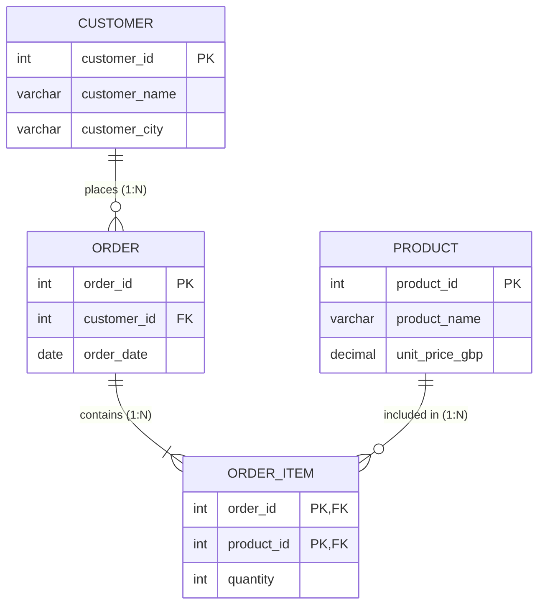
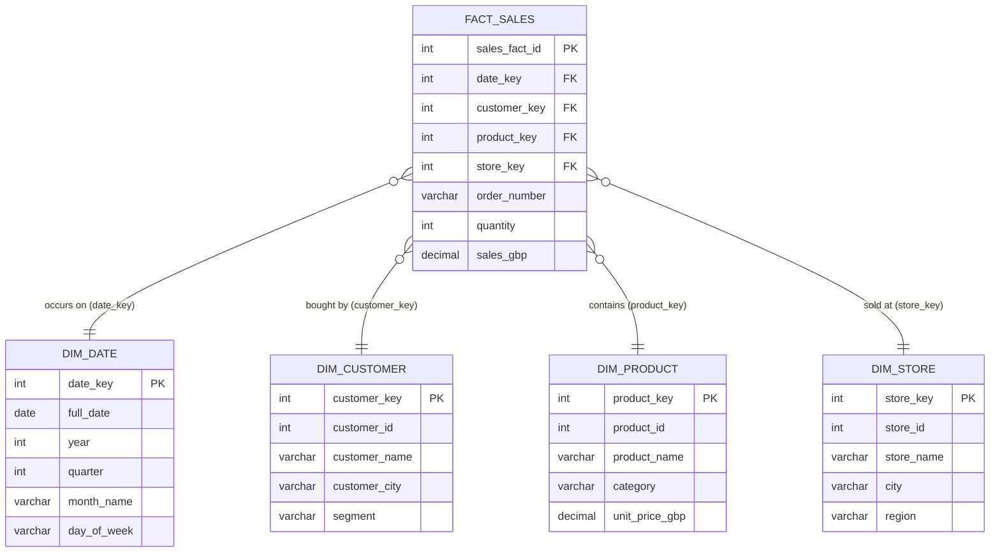

# Week 2 — Day 3: Schema Design, Normalisation, and Denormalisation

## Practice Workbook: BritMart Database Designs

> **Concepts covered here:**
> - **Entity-Relationship Fundamentals:** Identifying entities, attributes, primary keys (PK), foreign keys (FK), and cardinality (1:1, 1:N, M:N).
> - **Normalisation (OLTP):**
>   - **1NF (First Normal Form):** Atomic values in every cell; no repeating groups or comma-separated lists.
>   - **2NF (Second Normal Form):** In 1NF and no partial dependencies (all non-key columns depend on the entire composite primary key).
>   - **3NF (Third Normal Form):** In 2NF and no transitive dependencies (non-key columns do not depend on other non-key columns; "depend on the key, the whole key, and nothing but the key").
>   - **Anomalies avoided by normalisation:** Insertion, Update, and Deletion anomalies.
> - **Denormalisation & Analytical Modelling (OLAP):**
>   - Why analytical systems deliberately denormalise: faster queries, fewer expensive joins, easier reporting.
> - **Dimensional Modelling / Star Schema:**
>   - **Fact Tables:** Contain numerical business measures (facts) and foreign keys to dimensions.
>   - **Dimension Tables:** Contain context and descriptive attributes (who, what, where, when) for grouping and filtering.
>   - **Grain:** The lowest level of detail represented by a single row in the fact table.

---

## Part 1 — Entities, Attributes, Keys, and Relationships

### Q. 1 — Find the Entities

BritMart gives you this list of attributes:
- `customer_id`
- `customer_name`
- `customer_city`
- `order_id`
- `order_date`
- `product_id`
- `product_name`
- `quantity`
- `unit_price_gbp`

Group the attributes into these entities:
- **Customer**
- **Order**
- **Product**
- **Order Item**

#### Solution:

| Entity | Primary Key (PK) | Attributes & Foreign Keys (FK) |
| :--- | :--- | :--- |
| **Customer** | `customer_id` | `customer_name`, `customer_city` |
| **Order** | `order_id` | `order_date`, `customer_id` (FK to Customer) |
| **Product** | `product_id` | `product_name`, `unit_price_gbp` |
| **Order Item** | `(order_id, product_id)` *(Composite PK)* | `order_id` (FK to Order), `product_id` (FK to Product), `quantity` |

```text
1. Customer:
   - customer_id (PK)
   - customer_name
   - customer_city

2. Order:
   - order_id (PK)
   - order_date
   - customer_id (FK -> Customer)

3. Product:
   - product_id (PK)
   - product_name
   - unit_price_gbp

4. Order Item:
   - order_id (FK -> Order)
   - product_id (FK -> Product)
   - quantity
```

> **Notes & Explanations:**
> - **Entity:** A distinct real-world thing, person, or concept that exists independently (e.g., a *Customer*, a *Product*, an *Order*).
> - **Attribute:** A specific property or characteristic describing an entity (e.g., `customer_name` describes a customer; `unit_price_gbp` describes a product).
> - **Order Item as an Associative / Junction Entity:** An order can contain multiple products, and a product can appear in multiple orders (a many-to-many relationship). In relational modeling, many-to-many relationships cannot be represented directly with a single foreign key; they must be resolved using a junction entity (**`Order Item`**) containing `order_id`, `product_id`, and transaction-specific attributes like `quantity`.

---

### Q. 2 — Draw the Relationships

Using the four entities from Q. 1, draw these relationships:
- One customer can place many orders.
- One order can contain many products.
- One product can appear in many orders.

Use text arrows or Mermaid.

#### Mermaid Diagram:



#### Text Representation:

```text
[Customer] (1)  ──────< places >─────── (N) [Order]
                                              │
                                             (1)
                                              │
                                         < contains >
                                              │
                                             (N)
                                              ▼
                                       [Order Item]
                                              ▲
                                             (N)
                                              │
                                         < belongs to >
                                              │
                                             (1)
[Product] (1)  ───────────────────────────────┘
```

> **Notes & Explanations:**
> - **One-to-Many (`1:N`) between Customer and Order:** A single customer may place zero, one, or multiple orders over time. Each order belongs to exactly one customer. The foreign key `customer_id` lives on the "Many" side (`Order`).
> - **Many-to-Many (`M:N`) between Order and Product:** One order contains multiple products; one product is ordered across many different customer orders.
> - **Resolving `M:N` with `Order Item`:** Relational databases cannot store arrays or lists in a single field without violating 1NF. The junction entity `Order Item` decomposes the `M:N` relationship into two clean `1:N` relationships:
>   - 1 Order $\rightarrow$ Many Order Items
>   - 1 Product $\rightarrow$ Many Order Items

---

### Q. 3 — Create the Base Tables

Create MySQL tables for:
- `customers`
- `products`
- `orders`
- `order_items`

Use suitable primary and foreign keys.

#### SQL Solution:

```sql
CREATE DATABASE IF NOT EXISTS britmart_schema_lab;
USE britmart_schema_lab;

-- 1. Create the customers table
CREATE TABLE customers (
    customer_id INT PRIMARY KEY,
    customer_name VARCHAR(100) NOT NULL,
    customer_city VARCHAR(50) NOT NULL
);

-- 2. Create the products table
CREATE TABLE products (
    product_id INT PRIMARY KEY,
    product_name VARCHAR(100) NOT NULL,
    unit_price_gbp DECIMAL(10, 2) NOT NULL
);

-- 3. Create the orders table
CREATE TABLE orders (
    order_id INT PRIMARY KEY,
    customer_id INT NOT NULL,
    order_date DATE NOT NULL,
    CONSTRAINT fk_orders_customer
        FOREIGN KEY (customer_id) REFERENCES customers(customer_id)
        ON UPDATE CASCADE
        ON DELETE RESTRICT
);

-- 4. Create the order_items junction table
CREATE TABLE order_items (
    order_id INT NOT NULL,
    product_id INT NOT NULL,
    quantity INT NOT NULL,
    PRIMARY KEY (order_id, product_id),
    CONSTRAINT fk_order_items_order
        FOREIGN KEY (order_id) REFERENCES orders(order_id)
        ON UPDATE CASCADE
        ON DELETE CASCADE,
    CONSTRAINT fk_order_items_product
        FOREIGN KEY (product_id) REFERENCES products(product_id)
        ON UPDATE CASCADE
        ON DELETE RESTRICT
);
```

> **Notes & Explanations:**
> - **Creation Order Matters:** Tables with no dependencies (`customers`, `products`) must be created first. Dependent child tables (`orders`, then `order_items`) are created afterward because their `FOREIGN KEY` constraints reference existing parent tables.
> - **Primary Key (`PRIMARY KEY`):** Enforces uniqueness and guarantees no null values. In `order_items`, the composite primary key `PRIMARY KEY (order_id, product_id)` ensures the same product cannot be listed twice within the exact same order (any additional units should simply increase the `quantity`).
> - **Foreign Key (`FOREIGN KEY`):** Enforces **referential integrity**, ensuring an order cannot refer to a non-existent customer or product.
> - **`DECIMAL(10, 2)`:** The standard datatype for financial currency figures (GBP) to prevent floating-point rounding errors.

---

### Q. 4 — MCQ: Entity

Which item is most clearly an entity in this model?
- A. customer_name
- B. quantity
- C. Product
- D. order_date

**Correct Answer: C. Product**

> **Notes & Explanations:**
> - **Why C is correct:** An **Entity** is an independent business noun or concept about which an organisation collects and stores data. A *Product* has its own identity, lifecycle, and multiple descriptive properties.
> - **Why A, B, and D are incorrect:** `customer_name`, `quantity`, and `order_date` are **attributes** (properties or columns) describing an entity, not independent entities themselves.

---

## Part 2 — 1NF, 2NF, and 3NF

### Q. 5 — Fix a 1NF Problem

This table stores more than one product in one cell:

| order_id | customer_id | products |
| :--- | :--- | :--- |
| 101 | 1 | P1, P2 |
| 102 | 2 | P3 |

Explain why this is a problem for 1NF.  
Rewrite the data so each stored value is atomic.

#### Why this is a problem for 1NF:
**First Normal Form (1NF)** requires that:
1. Every column must hold **atomic (indivisible) values** — meaning only a single value per cell.
2. There must be no repeating groups or lists stored inside a single attribute.

Storing `'P1, P2'` in the `products` column violates 1NF because two separate values are packed into a single string. This causes critical database problems:
- **Query difficulty:** You cannot easily run `WHERE product_id = 'P1'` without costly and error-prone string pattern matching (`LIKE '%P1%'`).
- **Joining difficulty:** You cannot link `products` to a parent product catalogue table using an index or foreign key.
- **Aggregation impossible:** You cannot run `COUNT(product_id)` or aggregate revenue per product.

#### Rewritten Data (1NF Atomic Structure):

| order_id | customer_id | product_id |
| :--- | :--- | :--- |
| **101** | 1 | P1 |
| **101** | 1 | P2 |
| **102** | 2 | P3 |

*(In production, this is split into `orders(order_id, customer_id)` and `order_items(order_id, product_id)`).*

> **Notes & Explanations:**
> - In the 1NF table, each row now represents a single product ordered within an order.
> - Every cell contains exactly one indivisible piece of information (atomic value).

---

### Q. 6 — Find the 2NF Problem

Consider:
- `order_id`
- `product_id`
- `product_name`
- `quantity`

Assume the row is uniquely identified by the composite key: `(order_id, product_id)`.  
`product_name` depends only on `product_id`.

Why is that a problem, and where should `product_name` be stored?

#### Why this is a problem (Partial Dependency):
**Second Normal Form (2NF)** requires that:
1. The table is already in **1NF**.
2. There are **no partial dependencies** — meaning every non-key column must depend on the **entire composite primary key**, not just a part of it.

Here, the composite key is `(order_id, product_id)`.
- `quantity` depends on the whole key `(order_id, product_id)` because it tells us *how many units of that specific product were ordered in that specific order*.
- `product_name` depends **only on `product_id`**, which is just one part of the primary key.

#### Problems caused by this partial dependency:
1. **Redundancy:** If product `10` ("Desk Lamp") is purchased in 50,000 different orders, the string `"Desk Lamp"` is duplicated 50,000 times.
2. **Update Anomaly:** If the name changes to "Ergonomic Desk Lamp", all 50,000 rows must be updated. If any row is missed, data becomes contradictory.
3. **Insertion Anomaly:** You cannot store the name of a new product BritMart bought until a customer places an order for it.
4. **Deletion Anomaly:** If you delete the only order containing a rare product, the record of that product's name is permanently lost.

#### Where should `product_name` be stored?
`product_name` should be stored in a dedicated **`products`** table:
- **`products`**: `(product_id [PK], product_name, unit_price_gbp)`
- **`order_items`**: `(order_id [FK], product_id [FK], quantity)` with composite PK `(order_id, product_id)`

> **Notes & Explanations:**
> - Notice the golden rule of 2NF: If a table has a **single-column primary key**, it is automatically in 2NF! 2NF only becomes a concern when a table has a **composite primary key** (multiple columns forming the key).

---

### Q. 7 — Find the 3NF Problem

Consider:
- `customer_id`
- `customer_name`
- `postcode`
- `city`

Assume:
- `customer_id -> postcode`
- `postcode -> city`

Why can storing `city` in the same customer row create repeated data?  
Suggest a 3NF-style split.

#### Why storing `city` creates repeated data (Transitive Dependency):
**Third Normal Form (3NF)** requires that:
1. The table is already in **2NF**.
2. There are **no transitive dependencies** — non-key columns must not depend on other non-key columns ("every attribute must depend on the key, the whole key, and nothing but the key").

Here, `customer_id` is the primary key.
- `customer_id` determines `postcode` (`customer_id -> postcode`).
- `postcode` determines `city` (`postcode -> city`).
- Therefore, `city` depends on `customer_id` *transitively* through `postcode`.

#### The Problem:
Every customer living in the same postal district (e.g., `SW1A 1AA`) causes the city name (`London`) to be repeated again and again.
- **Update Anomaly:** If a postcode boundary or naming convention changes, you have to update multiple customer records instead of one single master record.
- **Inconsistency Risk:** If someone types `Manchester` for an `SW1` postcode, the database allows conflicting data.

#### 3NF-style Split:
Split into two tables:

1. **`customers` table:**
   - `customer_id` (PK)
   - `customer_name`
   - `postcode` (FK referencing `postcodes.postcode`)

2. **`postcodes` (or `locations`) table:**
   - `postcode` (PK)
   - `city`

```text
Table: customers
├── customer_id (PK)
├── customer_name
└── postcode (FK) ────────┐
                          ▼
Table: postcodes
├── postcode (PK)
└── city
```

> **Notes & Explanations:**
> - In 3NF, non-key columns must depend **directly and solely** on the primary key. Moving `city` to a separate `postcodes` reference table ensures each postcode-city mapping exists exactly once.

---

### Q. 8 — MCQ: Normalisation

What is the main aim of normalisation in an OLTP-style model?
- A. Put every business field into one wide table.
- B. Reduce repeated facts and keep relationships clear.
- C. Remove all foreign keys.
- D. Store several values inside one column.

**Correct Answer: B. Reduce repeated facts and keep relationships clear.**

> **Notes & Explanations:**
> - **Why B is correct:** Online Transaction Processing (OLTP) systems process frequent inserts, updates, and deletes. Normalisation structures relational tables to eliminate redundant duplicate data, prevent anomalies, preserve referential integrity, and ensure transactions are fast and safe.
> - **Why A is incorrect:** Putting every field into one wide table is *denormalisation* (common in analytical reporting/OLAP, but undesirable for transactional OLTP).
> - **Why C and D are incorrect:** Normalisation *relies* on foreign keys to link tables and strictly forbids storing multiple values in a single column (1NF).

---

## Part 3 — Normalised and Denormalised Models

### Q. 9 — Insert a Small Normalised Dataset

Insert:
- **Customers**:
  - `1, Amelia Clarke, London`
  - `2, Oliver Bennett, Manchester`
- **Products**:
  - `10, Desk Lamp, 25.00`
  - `11, Office Chair, 80.00`
  - `12, Notebook Set, 10.00`
- **Orders**:
  - `1001, customer 1, 2026-08-01`
  - `1002, customer 2, 2026-08-01`
  - `1003, customer 1, 2026-08-02`
- **Order Items**:
  - `1001, product 10, quantity 2`
  - `1001, product 12, quantity 1`
  - `1002, product 11, quantity 1`
  - `1003, product 12, quantity 3`

#### SQL Solution:

```sql
-- 1. Insert into customers
INSERT INTO customers (customer_id, customer_name, customer_city) VALUES
(1, 'Amelia Clarke', 'London'),
(2, 'Oliver Bennett', 'Manchester');

-- 2. Insert into products
INSERT INTO products (product_id, product_name, unit_price_gbp) VALUES
(10, 'Desk Lamp', 25.00),
(11, 'Office Chair', 80.00),
(12, 'Notebook Set', 10.00);

-- 3. Insert into orders
INSERT INTO orders (order_id, customer_id, order_date) VALUES
(1001, 1, '2026-08-01'),
(1002, 2, '2026-08-01'),
(1003, 1, '2026-08-02');

-- 4. Insert into order_items
INSERT INTO order_items (order_id, product_id, quantity) VALUES
(1001, 10, 2),
(1001, 12, 1),
(1002, 11, 1),
(1003, 12, 3);
```

#### Verification of Stored Tables:

**Table `customers`:**
| `customer_id` | `customer_name` | `customer_city` |
| :--- | :--- | :--- |
| `1` | Amelia Clarke | London |
| `2` | Oliver Bennett | Manchester |

**Table `products`:**
| `product_id` | `product_name` | `unit_price_gbp` |
| :--- | :--- | :--- |
| `10` | Desk Lamp | 25.00 |
| `11` | Office Chair | 80.00 |
| `12` | Notebook Set | 10.00 |

**Table `orders`:**
| `order_id` | `customer_id` | `order_date` |
| :--- | :--- | :--- |
| `1001` | 1 | 2026-08-01 |
| `1002` | 2 | 2026-08-01 |
| `1003` | 1 | 2026-08-02 |

**Table `order_items`:**
| `order_id` | `product_id` | `quantity` |
| :--- | :--- | :--- |
| `1001` | 10 | 2 |
| `1001` | 12 | 1 |
| `1002` | 11 | 1 |
| `1003` | 12 | 3 |

> **Notes & Explanations:**
> - Notice the insertion order: parent tables (`customers` and `products`) must have data first, otherwise the foreign keys in `orders` and `order_items` will fail with a foreign key constraint violation.
> - Customer `1` (Amelia Clarke) placed two different orders (`1001` and `1003`). Order `1001` contains two different items (`10` and `12`).

---

### Q. 10 — Rebuild a Denormalised Result with a Join

Write one query that returns:
- `order_id`
- `order_date`
- `customer_name`
- `customer_city`
- `product_name`
- `quantity`
- `unit_price_gbp`
- `line_total_gbp`

#### SQL Query:

```sql
SELECT 
    o.order_id,
    o.order_date,
    c.customer_name,
    c.customer_city,
    p.product_name,
    oi.quantity,
    p.unit_price_gbp,
    (oi.quantity * p.unit_price_gbp) AS line_total_gbp
FROM orders AS o
INNER JOIN customers AS c 
    ON o.customer_id = c.customer_id
INNER JOIN order_items AS oi 
    ON o.order_id = oi.order_id
INNER JOIN products AS p 
    ON oi.product_id = p.product_id
ORDER BY o.order_id, p.product_id;
```

#### Query Result Table:

| `order_id` | `order_date` | `customer_name` | `customer_city` | `product_name` | `quantity` | `unit_price_gbp` | `line_total_gbp` |
| :--- | :--- | :--- | :--- | :--- | :--- | :--- | :--- |
| **1001** | 2026-08-01 | Amelia Clarke | London | Desk Lamp | 2 | 25.00 | **50.00** |
| **1001** | 2026-08-01 | Amelia Clarke | London | Notebook Set | 1 | 10.00 | **10.00** |
| **1002** | 2026-08-01 | Oliver Bennett | Manchester | Office Chair | 1 | 80.00 | **80.00** |
| **1003** | 2026-08-02 | Amelia Clarke | London | Notebook Set | 3 | 10.00 | **30.00** |

> **Notes & Explanations:**
> - **Reconstructing Flat Views:** While the database stores data normalised across four separate tables to protect transactional integrity, business users and dashboards need a flat (denormalised) view.
> - **Joining Path:** 
>   `orders` joins to `customers` on `customer_id` $\rightarrow$ joins to `order_items` on `order_id` $\rightarrow$ joins to `products` on `product_id`.
> - **Calculated Column:** `(oi.quantity * p.unit_price_gbp) AS line_total_gbp` computes the line item total dynamically at query time.

---

### Q. 11 — Compare Update Behaviour

Imagine the product name changes from `Notebook Set` to `Premium Notebook Set`.

- **Model A:** The product name is stored only once in `products`.
- **Model B:** The product name is repeated in every order line.

Which model needs fewer data changes? Why?

#### Solution:
**Model A needs significantly fewer data changes.**

```sql
-- Model A: Exactly 1 row affected
UPDATE products 
SET product_name = 'Premium Notebook Set' 
WHERE product_id = 12;
```

#### Why Model A is superior for updates:
1. **Single Point of Update:** In Model A (the normalised model), the product name is stored in exactly **one place** (the `products` master table). Updating it requires writing to a single row.
2. **Instant Propagation:** Any existing past order or future query joining with `products` immediately sees the updated name `"Premium Notebook Set"` automatically.
3. **Avoids Update Anomalies:** In Model B (the denormalised model), the product name is duplicated across thousands of historical order line rows. You would have to execute an update across every single historical line item. If the update script fails partway through or misses older rows, the database enters an inconsistent state where the same product has two different names depending on which row you inspect.

---

### Q. 12 — MCQ: Denormalisation

Why might an analytical dataset deliberately repeat some descriptive values?
- A. To make every transaction harder to update
- B. To remove all business meaning from the model
- C. To prevent analysts from grouping data
- D. To make some analytical queries simpler to read and use

**Correct Answer: D. To make some analytical queries simpler to read and use**

> **Notes & Explanations:**
> - **Why D is correct:** In analytical systems (OLAP / Data Warehouses / Data Marts), data is mostly **read-only** (written once via batch ETL/ELT pipelines and read millions of times by BI tools). Joining 6 to 10 tables on billions of rows is computationally expensive and complex for analysts. Pre-joining and denormalising descriptive attributes into dimension tables makes analytical SQL queries simpler to write and significantly faster to execute.
> - **Why A, B, and C are incorrect:** Denormalisation is never done to complicate updates, strip meaning, or prevent grouping—in fact, it makes grouping (`GROUP BY customer_city, product_name`) much easier.

---

## Part 4 — Scalable Model Thinking and Star Schema Introduction

### Q. 13 — Identify the Fact and Dimensions

BritMart wants to analyse sales by:
- `date`
- `customer`
- `product`
- `store`

Measures are:
- `quantity`
- `sales_gbp`

Choose:
- **fact table**
- **dimension tables**

#### Solution:

```text
Fact Table:
└── FactSales (or fact_sales)
      - Foreign Keys: date_key, customer_key, product_key, store_key
      - Measures / Metrics: quantity, sales_gbp

Dimension Tables:
├── DimDate      (Calendar date, month, quarter, year, day_of_week)
├── DimCustomer  (Customer name, city, segment, email)
├── DimProduct   (Product name, category, unit price, brand)
└── DimStore     (Store name, region, store type)
```

| Table | Table Type | Role / Content |
| :--- | :--- | :--- |
| **`FactSales`** | **Fact Table** | Stores quantitative numerical metrics (`quantity`, `sales_gbp`) resulting from the business transaction event, plus foreign keys to context tables. |
| **`DimDate`** | **Dimension Table** | Provides temporal context (time breakdown) for slice-and-dice analytics. |
| **`DimCustomer`** | **Dimension Table** | Provides customer profile context for customer segmentation analysis. |
| **`DimProduct`** | **Dimension Table** | Provides product hierarchy and descriptions for catalog performance analysis. |
| **`DimStore`** | **Dimension Table** | Provides geographic and store-level context for regional sales performance. |

> **Notes & Explanations:**
> - **Fact Table Rule of Thumb:** If it is a measurable, numeric event that can be summed, averaged, or calculated (like quantity or revenue), it belongs in the **Fact Table**.
> - **Dimension Table Rule of Thumb:** If it is descriptive, textual context used to filter (`WHERE`), slice, or group (`GROUP BY`) the facts (who, what, where, when), it belongs in a **Dimension Table**.

---

### Q. 14 — Define the Grain

Choose the clearer grain for `FactSales`:
- **Choice A:** One row per order
- **Choice B:** One row per product sold within an order

BritMart needs product-level sales analysis.  
Which grain should be used and why?

#### Solution:
**Choice B (One row per product sold within an order) should be used.**

#### Why Choice B:
1. **Definition of Grain:** The **grain** is the fundamental, indivisible business definition of what a single row in the fact table represents.
2. **Matching Business Requirements:** BritMart explicitly states that they need **product-level sales analysis** (e.g., "Which products sell best in Manchester stores?").
   - If we chose **Choice A** (one row per order), a single order containing a desk lamp and a notebook set would only record the order total. We would completely lose the ability to analyze individual product performance, product categories, or units sold per SKU.
   - **Choice B** preserves the highest level of transactional detail (the order line item). From Choice B, we can always roll up (aggregate) numbers to the order level, customer level, store level, or monthly level. You can easily aggregate up from fine grain, but you can *never* drill down into details that were not captured at the grain.

---

### Q. 15 — Draw the Star

Draw:
- `FactSales`
- `DimDate`
- `DimCustomer`
- `DimProduct`
- `DimStore`

Show the fact table in the centre.

#### Mermaid Star Schema Diagram:



#### Text Star Schema Representation:

```text
               ┌───────────────────────┐
               │        DimDate        │
               │───────────────────────│
               │ * date_key (PK)       │
               │   full_date           │
               │   year, month, day    │
               └───────────┬───────────┘
                           │ 1
                           │
                           │ N
┌───────────────────────┐  │   ┌───────────────────────┐
│      DimCustomer      │  │   │      DimProduct       │
│───────────────────────│  │   │───────────────────────│
│ * customer_key (PK)   │  │   │ * product_key (PK)    │
│   customer_name       ├──┼───┤   product_name        │
│   customer_city       │1 │ 1 │   category, price     │
└───────────┬───────────┘  │   └───────────┬───────────┘
            │ N            │             N │
            └──────────┐   │   ┌───────────┘
                       ▼   ▼   ▼
               ┌───────────────────────┐
               │       FactSales       │
               │───────────────────────│
               │ * sales_fact_id (PK)  │
               │   date_key (FK)       │
               │   customer_key (FK)   │
               │   product_key (FK)    │
               │   store_key (FK)      │
               │   quantity            │
               │   sales_gbp           │
               └───────────┬───────────┘
                           ▲
                           │ N
                           │
                           │ 1
               ┌───────────┴───────────┐
               │       DimStore        │
               │───────────────────────│
               │ * store_key (PK)      │
               │   store_name          │
               │   city, region        │
               └───────────────────────┘
```

> **Notes & Explanations:**
> - **Why it is called a "Star Schema":** Visually, the single centralized fact table acts as the center of a star, and the surrounding dimension tables radiate outward like points on a star.
> - **Surrogate Keys (`_key`):** In dimensional data warehouses, dimension tables typically use simple integer surrogate primary keys (`customer_key`, `product_key`) rather than operational system keys (`customer_id`). This separates analytical storage from operational production systems and allows tracking historical dimension changes.

---

### Q. 16 — MCQ: Fact Table

Which values belong most naturally in a sales fact table?
- A. quantity and sales_gbp
- B. only customer_name and customer_city
- C. only product_name and category_name
- D. only report titles

**Correct Answer: A. quantity and sales_gbp**

> **Notes & Explanations:**
> - **Why A is correct:** Fact tables contain **numerical, additive measurements (facts)** recorded during a business event (e.g., how many units were sold: `quantity`, and total revenue generated: `sales_gbp`), along with foreign keys.
> - **Why B and C are incorrect:** Names, cities, categories, and descriptions are textual contextual attributes that belong in dimension tables (`DimCustomer`, `DimProduct`).
> - **Why D is incorrect:** Report titles are presentation metadata, not transaction facts.

---

## Optional Practice

### Q. 17 — Normalise a Poor Order Table

BritMart currently stores:
- `order_id`
- `order_date`
- `customer_id`
- `customer_name`
- `customer_city`
- `product_id`
- `product_name`
- `unit_price_gbp`
- `quantity`

Sample rows:
```text
1001 | 2026-08-01 | 1 | Amelia Clarke | London     | 10 | Desk Lamp    | 25.00 | 2
1001 | 2026-08-01 | 1 | Amelia Clarke | London     | 12 | Notebook Set | 10.00 | 1
1002 | 2026-08-01 | 2 | Oliver Bennett| Manchester | 11 | Office Chair | 80.00 | 1
```

Split the data into suitable tables and identify each table's key.

#### Solution: Split into 4 Normalised Tables

#### 1. `customers` Table
- **Primary Key:** `customer_id`
- **Columns:** `customer_id`, `customer_name`, `customer_city`

| `customer_id` (PK) | `customer_name` | `customer_city` |
| :--- | :--- | :--- |
| **1** | Amelia Clarke | London |
| **2** | Oliver Bennett | Manchester |

#### 2. `products` Table
- **Primary Key:** `product_id`
- **Columns:** `product_id`, `product_name`, `unit_price_gbp`

| `product_id` (PK) | `product_name` | `unit_price_gbp` |
| :--- | :--- | :--- |
| **10** | Desk Lamp | 25.00 |
| **11** | Office Chair | 80.00 |
| **12** | Notebook Set | 10.00 |

#### 3. `orders` Table
- **Primary Key:** `order_id`
- **Foreign Key:** `customer_id` (references `customers.customer_id`)
- **Columns:** `order_id`, `customer_id`, `order_date`

| `order_id` (PK) | `customer_id` (FK) | `order_date` |
| :--- | :--- | :--- |
| **1001** | 1 | 2026-08-01 |
| **1002** | 2 | 2026-08-01 |

#### 4. `order_items` Table
- **Primary Key:** `(order_id, product_id)` *(Composite PK)*
- **Foreign Keys:**
  - `order_id` (references `orders.order_id`)
  - `product_id` (references `products.product_id`)
- **Columns:** `order_id`, `product_id`, `quantity`

| `order_id` (PK, FK) | `product_id` (PK, FK) | `quantity` |
| :--- | :--- | :--- |
| **1001** | 10 | 2 |
| **1001** | 12 | 1 |
| **1002** | 11 | 1 |

> **Notes & Explanations:**
> - Notice how the flat table had 9 columns repeated across every single purchased item.
> - By splitting into 4 tables, Amelia's name and city are stored once, each product's price and name are stored once, and the order header exists once. The `order_items` table cleanly captures only the items and quantities for each order.

---

### Q. 18 — Find Update Anomalies

In the poor table from Q. 17, Amelia's city appears in two rows.  
If only one row is changed from:
`London`  
to:  
`Bristol`  
what problem appears?

#### Solution:
An **Update Anomaly (Data Inconsistency / Incoherent Database State)** occurs.

#### Concrete Explanation of the Problem:
In the poor, unnormalised table:
```text
Row 1: 1001 | 2026-08-01 | 1 | Amelia Clarke | Bristol | 10 | Desk Lamp    | 25.00 | 2  <-- Updated to Bristol
Row 2: 1001 | 2026-08-01 | 1 | Amelia Clarke | London  | 12 | Notebook Set | 10.00 | 1  <-- Still London!
```

This creates contradictory facts:
1. **Contradictory Customer Profile:** Does Customer `1` (Amelia Clarke) live in Bristol or London? The database now claims both are true at the same time.
2. **Erroneous Shipping & Billing Reports:** A shipping query for the Desk Lamp will route to Bristol, while a shipping query for the Notebook Set in the very same order will route to London.
3. **Analytics Corruption:** Regional sales aggregations by city will count Amelia's orders partially in London and partially in Bristol, falsifying regional KPI metrics.

> **Why Normalisation Prevents This:** In the normalised model, Amelia's city is stored strictly in the `customers` table in row `customer_id = 1`. Updating her city to `'Bristol'` requires updating a single record. All order lines reference her by ID, making inconsistency impossible.

---

### Q. 19 — Convert the Normalised Model into a Sales Star

Starting from:
- `customers`
- `products`
- `orders`
- `order_items`

Design:
- `FactSales`
- `DimCustomer`
- `DimProduct`
- `DimDate`

State the grain and list the main columns.

#### Solution:

#### 1. Define the Grain
- **Grain:** **One row per product sold within an order** (individual order line item).

#### 2. Main Columns for Each Table:

**`DimCustomer` (Dimension Table):**
- `customer_key` (PK, Integer Surrogate Key)
- `customer_id` (Business / Natural Key from OLTP)
- `customer_name` (VARCHAR)
- `customer_city` (VARCHAR)

**`DimProduct` (Dimension Table):**
- `product_key` (PK, Integer Surrogate Key)
- `product_id` (Business / Natural Key from OLTP)
- `product_name` (VARCHAR)
- `unit_price_gbp` (DECIMAL)

**`DimDate` (Dimension Table):**
- `date_key` (PK, Integer format e.g. `20260801`)
- `full_date` (DATE format `2026-08-01`)
- `day_name` (VARCHAR, e.g. 'Saturday')
- `month_name` (VARCHAR, e.g. 'August')
- `quarter` (INT, e.g. 3)
- `year` (INT, e.g. 2026)

**`FactSales` (Fact Table):**
- `sales_fact_id` (PK, Surrogate Key)
- `date_key` (FK -> `DimDate.date_key`)
- `customer_key` (FK -> `DimCustomer.customer_key`)
- `product_key` (FK -> `DimProduct.product_key`)
- `order_id` (Degenerate Dimension: transaction number kept for tracing)
- `quantity` (Numeric Measure / Metric)
- `unit_price_gbp` (Numeric Measure / snapshot price)
- `sales_amount_gbp` (Numeric Measure: `quantity * unit_price_gbp`)

> **Notes & Explanations:**
> - **Degenerate Dimension (`order_id`):** An identifier from the operational transaction that lives in the fact table without needing its own separate dimension table.
> - **Additive Measures:** Both `quantity` and `sales_amount_gbp` can be summed across any combination of dimensions (e.g., total sales across all products in August 2026 in London).

---

### Q. 20 — Review the Model Before Building It

Before creating tables, write answers to these questions:
1. What does one row represent?
2. Which fields identify the row?
3. Which facts repeat?
4. Which fields describe another entity?
5. Which relationships must remain valid?
6. Is the model mainly for transactions or analytics?

Then explain why answering these questions first can reduce redesign later.

#### Answers for BritMart:

| Question | Answer for BritMart's Model |
| :--- | :--- |
| **1. What does one row represent?** | In the transactional `order_items` table (or analytical `FactSales`), one row represents **one specific product line item sold within a customer order**. |
| **2. Which fields identify the row?** | For transactional `order_items`: composite primary key `(order_id, product_id)`. For analytical `FactSales`: surrogate key `sales_fact_id` (or the combination of dimension foreign keys + `order_id`). |
| **3. Which facts repeat?** | Customer details (name, city) repeat every time a customer orders. Product details (name, price) repeat every time an item is purchased. Postcodes and cities repeat across multiple customers. |
| **4. Which fields describe another entity?** | `customer_name` and `customer_city` describe the `Customer` entity, not the order. `product_name` and `unit_price_gbp` describe the `Product` entity, not the order. |
| **5. Which relationships must remain valid?** | Referential integrity: every order line must reference an existing order; every order must reference an existing customer; every order line must reference an existing product. |
| **6. Is the model mainly for transactions or analytics?** | If designed for **transactions (OLTP)**: normalise to 3NF to ensure ACID compliance, low write latency, and zero update anomalies. If designed for **analytics (OLAP)**: model as a Star Schema (Fact + Dimensions) to optimise aggregation queries and reporting. |

#### Why answering these questions first reduces redesign later:
1. **Prevents Costly Schema Migrations:** Changing a table structure after millions of rows have been inserted requires complex, risky data migrations, downtime, and expensive backfills.
2. **Avoids Choosing the Wrong Primary Key:** Misunderstanding what a single row represents (the grain) leads to choosing an incorrect primary key, resulting in duplicate key errors or the inability to record multiple items per order.
3. **Eliminates Anomalies Early:** Identifying which fields describe another entity immediately flags 2NF and 3NF violations before bad code and redundant data pollute the database.
4. **Ensures Architecture Matches Workload:** Deciding upfront between OLTP (normalised) and OLAP (star schema) ensures you do not build a heavily normalised 3NF schema for an analytics team that needs high-speed aggregations, or a denormalised flat table for a checkout system requiring strict transactional consistency.

---

