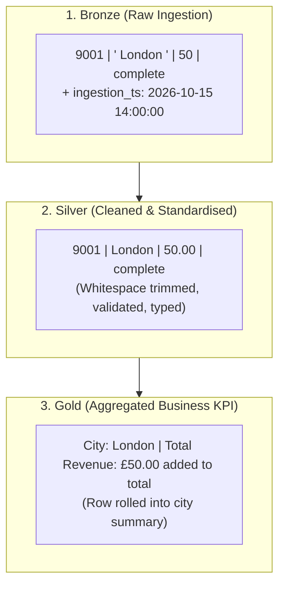
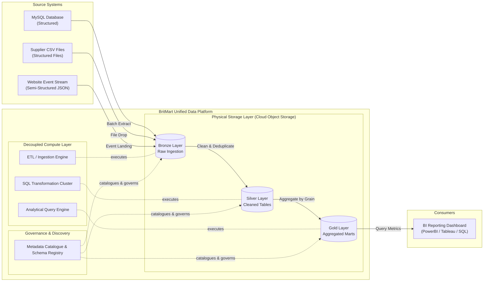

# Week 2 — Day 4: Data Lake, Data Warehouse, and Lakehouse Architecture

## Practice Workbook: BritMart Architecture & Data Platform Design

> ### Today's Core Concepts
>
> ---
>
> #### 1. The Three Storage Platforms
>
> - **Data Lake (The Big Storage Reservoir):**
>   - **In simple words:** A giant, low-cost digital storage room where you can drop *any* kind of data in its original format—Excel files, JSON logs, website clicks, PDF contracts, or photos.
>   - **Real-world analogy:** Think of a large attic or garage. You put items there right out of the box without organizing them first. You save them cheaply now so you never lose them, and you figure out how to organize them later when you actually need them.
>
> - **Data Warehouse (The Supermarket Shelves):**
>   - **In simple words:** A highly organised, polished database built strictly for business reporting and fast SQL queries. It only accepts clean, structured tables.
>   - **Real-world analogy:** Think of a neatly organized supermarket. Every apple is washed, weighed, priced, and placed in the right aisle. A business analyst can walk in and immediately grab the exact numbers they need for their sales dashboard.
>
> - **Lakehouse (The Best of Both Worlds):**
>   - **In simple words:** A modern hybrid. It uses the cheap, flexible storage of a Data Lake, but adds a smart management layer on top so it behaves like a clean, reliable Data Warehouse with tables, transactions, and SQL.
>   - **Real-world analogy:** A supermarket that has its own giant loading dock attached in the back. You get cheap, endless storage, but you still have clean, organized shelves in the front for shoppers.
>
> ---
>
> #### 2. When Do We Enforce the Rules? (Schema Timing)
>
> - **Schema-on-Read (Inspect when you use it):**
>   - **In simple words:** You store the raw data first without checking if it follows any strict rules. You only figure out the structure (the columns and types) later when you actually read or process the file.
>   - **Real-world analogy:** Bringing groceries home and putting them straight into the pantry without unpacking. When you decide to cook dinner tonight, you take them out, wash them, and peel them.
>
> - **Schema-on-Write (Check before accepting it):**
>   - **In simple words:** The database has strict rules (like *"Column 1 must be a positive number"*). If incoming data has the wrong format or missing columns, the system refuses to let it in until it is fixed.
>   - **Real-world analogy:** A security guard or passport control at the airport. If your paperwork isn't filled out correctly, you are not allowed through the gate.
>
> ---
>
> #### 3. The 3 Steps of Refining Data (Medallion Architecture)
>
> Think of this as refining raw metal into pure gold jewelry:
>
> - 🥉 **Bronze Layer (Raw & Untouched):**
>   - **What it is:** The raw data exactly as it arrived from the source, warts and all (including duplicates, typos, or negative amounts), plus a timestamp showing when it arrived.
>   - **Why keep it?** If someone discovers a calculation mistake 6 months from now, you can always go back to the original Bronze records and replay everything from scratch.
>
> - 🥈 **Silver Layer (Cleaned & Standardised):**
>   - **What it is:** The cleaned-up, deduplicated, and validated data. Spaces are trimmed (turning `" London "` into `"London"`), negative numbers are removed, and duplicate orders are deleted.
>   - **Why keep it?** This is the company's single source of truth. Every team can trust this table for their work without having to do their own cleaning.
>
> - 🥇 **Gold Layer (Business Summaries & KPIs):**
>   - **What it is:** High-level summary tables built specifically for decision-makers and dashboards (e.g. *"Total revenue per city"* or *"Monthly sales growth"*).
>   - **Why keep it?** A CEO or dashboard does not want to read 10 million individual receipts; they just want the final totals so they can make business decisions quickly.
>
> ---
>
> #### 4. Types of Data
>
> - **Structured Data:** Tidy rows and columns with fixed types, like a clean Excel spreadsheet or a SQL database table.
> - **Semi-structured Data:** Data with labels and tags, but flexible shapes that can change from record to record, like a JSON file from a website or mobile app.
> - **Unstructured Data:** Files with no rows or columns at all, such as product photos, PDF contracts, audio, or video clips.
>
> ---
>
> #### 5. Platform Architecture Principles
>
> - **Storage-First Architecture:** Always save incoming files into safe, durable storage *first* before running any heavy transformation. If a transformation program crashes, your raw data is still 100% safe.
> - **Separation of Compute and Storage:**
>   - **Storage** is your hard drive / shelves (you pay a small fee to store files 24/7).
>   - **Compute** is the worker / processor (CPU and RAM) that does the heavy calculations.
>   - **Why separate them?** If you only run heavy reports at 2:00 AM, you can turn on 50 powerful servers for 30 minutes, finish the job, and turn them completely off for the rest of the day—without touching or moving the stored data!
> - **Metadata (Data about Data):** The "nutrition label" on your dataset (e.g., who created it, what columns it has, how often it updates).
> - **Data Catalogue (The Library Directory):** A searchable registry that allows engineers and analysts to easily look up where tables live, who owns them, and what they mean, preventing your lake from becoming a messy "data swamp".

---

# Part 1 — Data Lake, Data Warehouse, and Lakehouse

## Q. 1 — Choose the Better Platform

For each requirement, choose **data lake**, **data warehouse**, or **lakehouse**, and explain the reason based on the lesson.

### Solution:

| Requirement | Choice | Reason |
| :--- | :--- | :--- |
| **Keep large amounts of raw structured and semi-structured data** | **Data lake** | Flexible, low-cost storage capable of handling diverse data shapes without prior schema definition. |
| **Give analysts controlled SQL-ready business tables** | **Data warehouse** | Highly optimised for structured analytical SQL, robust governance, and fast BI dashboard queries. |
| **Keep flexible storage while also supporting governed table-style analytics** | **Lakehouse** | Combines the cost-effective object storage of a lake with ACID transactions and warehouse-style table management. |
| **Keep raw website events for future use** | **Data lake** | Allows rapid landing of raw JSON events where the full schema or future analytical use is not yet known. |

> 💡 **Explanatory Notes:**
> - **Why not a warehouse for raw events?** Loading millions of raw event logs directly into a data warehouse is costly and unnecessary if you haven't decided how to use or model them yet.
> - **Why Lakehouse?** A Lakehouse uses open file formats (like Parquet) stored on cloud object storage, but adds a metadata and governance layer that makes files look and act like reliable SQL tables.

---

## Q. 2 — Place BritMart Data

BritMart has:
- `MySQL order extract`
- `supplier CSV files`
- `website JSON events`
- `monthly finance table`
- `daily sales summary`

Place each item where it would most naturally fit in a data lake, warehouse, or lakehouse design.

### Solution:

```text
- MySQL order extract      --> Data lake or lakehouse raw area (Bronze)
- Supplier CSV files       --> Data lake or lakehouse raw area (Bronze)
- Website JSON events      --> Data lake or lakehouse raw area (Bronze)
- Monthly finance table    --> Data warehouse or governed lakehouse table (Gold)
- Daily sales summary      --> Data warehouse or governed lakehouse table (Gold)
```

| Data Asset | Storage Tier / Layer | Architecture Platform | Rationale |
| :--- | :--- | :--- | :--- |
| **MySQL order extract** | Raw landing / Bronze | Data Lake / Lakehouse | Raw dump directly from the operational OLTP database; stored verbatim for historical auditing and replayability. |
| **Supplier CSV files** | Raw landing / Bronze | Data Lake / Lakehouse | External batch files received from third-party partners; stored in original format before cleaning. |
| **Website JSON events** | Raw landing / Bronze | Data Lake / Lakehouse | Semi-structured streaming or batch clickstream events; schema can evolve freely. |
| **Monthly finance table** | Curated / Gold | Data Warehouse / Lakehouse | Fully cleaned, aggregated, reconciled financial metrics requiring strict governance and access control. |
| **Daily sales summary** | Curated / Gold | Data Warehouse / Lakehouse | Standard business reporting model optimised for fast dashboard slicing by store, date, or region. |

> 💡 **Explanatory Notes:**
> The fundamental design principle taught in the lesson is the **separation of raw, flexible storage** from **trusted, structured business outputs**. Raw ingestion feeds into the lake/raw zone, while high-value analytical assets live in structured warehouse/gold tables.

---

## Q. 3 — Compare the Three Architectures

Complete the comparison table between Data Lake, Data Warehouse, and Lakehouse across key operational areas.

### Solution:

| Area | Data Lake | Data Warehouse | Lakehouse |
| :--- | :--- | :--- | :--- |
| **Raw data support** | **Strong** (Native fit for all file formats) | **Usually not the main purpose** (Costly / rigid) | **Strong** (Built directly on object storage) |
| **Strong structured reporting** | **Possible but needs more design** (Requires query engine config) | **Strong** (Primary core purpose) | **Strong** (ACID tables + fast query engines) |
| **Flexible data shapes** | **Strong** (Handles tabular, JSON, logs, images) | **More controlled** (Requires predefined schema) | **Strong** (Stores raw files + managed tables) |
| **Table-style analytics** | **Depends on tools and design** (e.g. Hive/Athena) | **Strong** (Built-in SQL query engine) | **Strong** (Open table formats like Delta/Iceberg) |

> 💡 **Explanatory Notes:**
> - **Data Warehouse:** King of curated, structured SQL reporting, but poor for storing raw images, audio, or messy semi-structured logs.
> - **Data Lake:** King of raw storage and cost efficiency, but traditional lakes suffer from lack of ACID transactions and slow SQL performance without careful tuning.
> - **Lakehouse:** The best of both worlds—it sits on raw object storage but uses metadata layers to offer table-like reliability and high-speed SQL.

---

## Q. 4 — MCQ: Data Warehouse

Which requirement is the strongest fit for a data warehouse?

- **A.** Keep every raw file exactly as received for unknown future use
- **B.** Store only application log text with no reporting need
- **C.** Replace every source system
- **D.** Run controlled business reporting over trusted structured data

### Solution:

**Correct Answer:** **D. Run controlled business reporting over trusted structured data**

> 💡 **Explanatory Notes:**
> - **Why D is correct:** A data warehouse is specifically engineered for business intelligence (BI), dashboards, and trusted analytical querying across structured, cleaned datasets.

---

# Part 2 — Schema-on-Read, Schema-on-Write, Bronze, and Silver

## Q. 5 — Schema-on-Read or Schema-on-Write?

Match each statement to either **Schema-on-read** or **Schema-on-write**:

- **A.** Data is stored first and interpreted when it is read.
- **B.** Data must match an expected structure before it is accepted into the target.
- **C.** A raw JSON area keeps different optional fields.
- **D.** A controlled reporting table requires known columns and types.

### Solution:

```text
A -> Schema-on-read
B -> Schema-on-write
C -> Schema-on-read
D -> Schema-on-write
```

| Statement | Paradigm | Explanation |
| :--- | :--- | :--- |
| **A. Data stored first, interpreted when read** | **Schema-on-read** | The raw bytes/files are saved without schema checks; downstream code applies schema during parsing. |
| **B. Must match expected structure before acceptance** | **Schema-on-write** | The database rejects rows that do not conform to predefined data types, null constraints, or columns. |
| **C. Raw JSON area keeping optional fields** | **Schema-on-read** | JSON documents can have variable structures or evolving keys without failing ingestion. |
| **D. Controlled reporting table requiring known columns/types** | **Schema-on-write** | Reporting engines require guaranteed columns and types to compute metrics reliably. |

> 💡 **Explanatory Notes:**
> - **Schema-on-read does NOT mean "no schema".** It simply means schema enforcement is postponed until query/processing time.
> - **Modern best practice:** Use *schema-on-read* at the Bronze/ingestion layer to capture all raw data safely, then transition to *schema-on-write* at the Silver and Gold layers to protect business reporting integrity.

---

## Q. 6 — Design Bronze and Silver Rules

BritMart receives incoming order records with the following fields:
- `order_id`
- `city`
- `amount_gbp`
- `status`

Define what should happen in Bronze and Silver:

### Solution:

#### Bronze Layer Rules:
- **What should be kept:**
  - Ingest and preserve all incoming records exactly as received from source systems (including duplicates, nulls, or invalid amounts).
  - Add pipeline audit metadata:
    - `ingestion_timestamp`: When the record was loaded.
    - `source_filename` / `source_system`: Where the batch came from.
    - `pipeline_run_id`: Execution ID for lineage and debugging.
- **Purpose:** Ensure 100% data traceability and historical replayability if downstream transformation logic changes or bugs occur.

#### Silver Layer Rules:
- **What should be checked or cleaned:**
  1. **Mandatory Keys (Completeness):** `order_id` must be present and not null.
  2. **Domain Validation (Accuracy):** `amount_gbp` must be positive (`> 0`). Non-positive amounts are flagged or routed to a quarantine/rejection table.
  3. **String Standardisation (Consistency):** `city` values must be trimmed of leading/trailing whitespace (e.g., `" Bristol "` becomes `"Bristol"`) and standard casing applied.
  4. **Deduplication (Uniqueness):** Duplicate `order_id` values must be resolved (e.g., keep the first occurrence or latest based on timestamp).
  5. **Status Normalisation:** Validate that `status` values conform to allowed values (e.g., `'complete'`, `'cancelled'`).

> 💡 **Explanatory Notes:**
> - Bronze answers: *"What did the source system actually send us?"*
> - Silver answers: *"What is the clean, standardised, trusted version of that data?"*

---

## Q. 7 — Process Three Batches from Bronze to Silver

### Problem Statement:
Process the three incoming batches in Python using Pandas.
1. Combine all rows into **Bronze**.
2. Transform into **Silver** by:
   - Keeping positive amounts (`amount_gbp > 0`)
   - Trimming whitespace from city names (`city.str.strip()`)
   - Removing duplicate `order_id` values (`drop_duplicates`)
3. Print Bronze and Silver row counts, and display the final Silver DataFrame.

### Python Solution:

```python
import pandas as pd

# ----------------------------------------------------
# 1. Incoming Batches
# ----------------------------------------------------
batch_1 = pd.DataFrame(
    [
        (101, "London", 45.50, "complete"),
        (102, "Manchester", -5.00, "complete"),
    ],
    columns=["order_id", "city", "amount_gbp", "status"],
)

batch_2 = pd.DataFrame(
    [
        (103, " Bristol ", 30.00, "complete"),
        (104, "Leeds", 20.00, "cancelled"),
    ],
    columns=["order_id", "city", "amount_gbp", "status"],
)

batch_3 = pd.DataFrame(
    [
        (101, "London", 45.50, "complete"),
        (105, "Manchester", 51.00, "complete"),
    ],
    columns=["order_id", "city", "amount_gbp", "status"],
)

# ----------------------------------------------------
# 2. Bronze Layer: Concatenate all raw batches
# ----------------------------------------------------
bronze = pd.concat([batch_1, batch_2, batch_3], ignore_index=True)

# ----------------------------------------------------
# 3. Silver Layer: Clean, filter, standardise & deduplicate
# ----------------------------------------------------
# Step 3a: Keep only positive amounts (filters out order 102 with -5.00)
silver = bronze[bronze["amount_gbp"] > 0].copy()

# Step 3b: Trim whitespace from city names (" Bristol " -> "Bristol")
silver["city"] = silver["city"].str.strip()

# Step 3c: Remove duplicate order_ids (removes duplicate order 101 from batch 3)
silver = silver.drop_duplicates(subset=["order_id"], keep="first")

# ----------------------------------------------------
# 4. Output Results
# ----------------------------------------------------
print("Bronze rows:", len(bronze))
print("Silver rows:", len(silver))
print("\n--- Final Silver DataFrame ---")
print(silver)
```

### Output:

```text
Bronze rows: 6
Silver rows: 4

--- Final Silver DataFrame ---
   order_id        city  amount_gbp     status
0       101      London        45.5   complete
2       103     Bristol        30.0   complete
3       104       Leeds        20.0  cancelled
5       105  Manchester        51.0   complete
```

> 💡 **Explanatory Notes:**
> - **Row Filtering Breakdown:**
>   - **Bronze total:** 6 rows (2 from batch 1 + 2 from batch 2 + 2 from batch 3).
>   - **Invalid amounts:** Order `102` has `amount_gbp = -5.00` (1 row dropped).
>   - **Duplicates:** Order `101` appears in both Batch 1 and Batch 3 (1 duplicate row dropped).
>   - **Silver total:** $6 - 1 - 1 = 4$ clean rows 

---

## Q. 8 — MCQ: Silver

Which record belongs most naturally in Silver?

- **A.** An unchanged raw event with an invalid amount
- **B.** A final monthly management KPI only
- **C.** A cleaned and deduplicated order row
- **D.** A source-system password

### Solution:

**Correct Answer:** **C. A cleaned and deduplicated order row**

> 💡 **Explanatory Notes:**
> - **Why C is correct:** Silver represents clean, validated, conformed, enterprise-wide datasets that retain individual entity detail (row-level records) ready for downstream consumption.
> - **Why A belongs in Bronze:** Raw, unchanged records with invalid amounts remain in Bronze for audit trails.
> - **Why B belongs in Gold:** Highly aggregated business metrics and management KPIs belong in Gold.
> - **Why D should never be in any analytical layer:** Passwords and credentials must be scrubbed/masked at ingestion for security and data privacy.

---

# Part 3 — Gold, Data Types, and Storage-First Architecture

## Q. 9 — Build a Gold Summary

Using the `silver` DataFrame created in Q. 7:
1. Filter to keep only completed orders (`status == 'complete'`).
2. Group by `city` and calculate total revenue (`revenue_gbp`).
3. Sort results in descending order of revenue.

### Python Solution:

```python
# ----------------------------------------------------
# 1. Filter for completed orders
# ----------------------------------------------------
completed = silver[silver["status"] == "complete"]

# ----------------------------------------------------
# 2. Build Gold summary: Total revenue by city
# ----------------------------------------------------
gold = (
    completed
    .groupby("city", as_index=False)
    .agg(revenue_gbp=("amount_gbp", "sum"))
    .sort_values("revenue_gbp", ascending=False)
)

print("--- Final Gold DataFrame ---")
print(gold)
```

### Output:

```text
--- Final Gold DataFrame ---
         city  revenue_gbp
1  Manchester         51.0
2      London         45.5
0     Bristol         30.0
```

> 💡 **Explanatory Notes:**
> - **Why Leeds is excluded:** Order `104` in Leeds has status `"cancelled"`, so it generates zero completed revenue.
> - **Gold Table Characteristics:** Notice how the Gold output is aggregated, compact (3 rows), and maps directly to a clear business question (*"What is our completed revenue by city?"*).
> - **Defined Grain:** The grain of this Gold table is: **One row per city**.

---

## Q. 10 — Structured, Semi-Structured, or Unstructured?

Classify each of BritMart's assets into **Structured**, **Semi-structured**, or **Unstructured**:

- `MySQL orders table`
- `JSON website event`
- `CSV supplier file`
- `product photo`
- `PDF supplier contract`

### Solution:

```text
MySQL orders table    -> Structured
JSON website event    -> Semi-structured
CSV supplier file     -> Structured
Product photo         -> Unstructured
PDF supplier contract -> Unstructured
```

| Asset | Classification | Why? |
| :--- | :--- | :--- |
| **MySQL orders table** | **Structured** | Strictly defined tabular rows, columns, and relational types (INT, VARCHAR, DECIMAL). |
| **JSON website event** | **Semi-structured** | Self-describing key-value format with potential nested arrays, varying schemas, or optional tags. |
| **CSV supplier file** | **Structured** | Delimited tabular layout organised into consistent columns and rows. |
| **Product photo** | **Unstructured** | Binary image file (JPEG/PNG); contains pixels with no internal tabular schema. |
| **PDF supplier contract** | **Unstructured** | Free-form legal text, layout formatting, and embedded graphics without database schema. |

> 💡 **Explanatory Notes:**
> In data engineering, storage systems are picked based on data structure:
> - Relational databases/warehouses excel at **structured** data.
> - Data lakes excel at storing **all three**, especially semi-structured logs and unstructured media files.

---

## Q. 11 — Design a Storage-First Flow

BritMart wants to ensure incoming data is safely landed before processing begins. Draw and explain a storage-first flow showing at least three sources.

### Solution:

```mermaid
flowchart LR
    A["MySQL Extract"] --> S[("Durable Storage<br/>(Bronze / Landing Lake)")]
    B["Supplier CSV"] --> S
    C["Website JSON"] --> S
    S --> P["Processing Engine<br/>(Cleansing & Transformation)")]
    P --> T[("Trusted Output<br/>(Silver & Gold Tables)")]
```

> 💡 **Explanatory Notes on Storage-First Design:**
> 1. **Decoupling Ingestion from Processing:** Source extract tools simply write incoming files directly to durable cloud object storage. Ingestion is fast and lightweight.
> 2. **Immutability & Replayability:** Because raw files sit untouched in durable storage, any transformation failure, schema change, or bug discovery can be resolved by simply re-running the processing engine over the existing raw files.
> 3. **Resilience:** If the downstream database or transformation cluster is temporarily offline, incoming data is safely preserved without losing a single transaction.

---

## Q. 12 — MCQ: Gold

Which output is the strongest Gold example?

- **A.** Daily revenue by city for reporting
- **B.** A duplicate order waiting to be cleaned
- **C.** A source CSV copied without changes
- **D.** Raw JSON received from a website

### Solution:

**Correct Answer:** **A. Daily revenue by city for reporting**

> 💡 **Explanatory Notes:**
> - **Why A is correct:** Gold tables are tailored specifically for decision-makers and BI dashboards. Aggregating business metrics (daily revenue by city) is the textbook definition of a Gold layer deliverable.
> - **B is a Bronze issue:** A duplicate record waiting to be cleaned should be detected and filtered during the Bronze-to-Silver transition.
> - **C is Bronze:** An unchanged source copy is raw Bronze data.
> - **D is Bronze:** Raw JSON from a website is raw landing data.

---

# Part 4 — Compute, Storage, Metadata, and Catalogues

## Q. 13 — Compute or Storage?

Classify each item as either **Compute** or **Storage**:

- **A.** Files kept for later use
- **B.** CPU and memory used to run a transformation
- **C.** Stored analytical table data
- **D.** Processing resources used for a query

### Solution:

```text
A -> Storage
B -> Compute
C -> Storage
D -> Compute
```

| Item | Classification | Explanation |
| :--- | :--- | :--- |
| **A. Files kept for later use** | **Storage** | Persisted bits sitting on disk or cloud object storage (e.g. AWS S3 bucket). |
| **B. CPU and memory used to run a transformation** | **Compute** | Active hardware/cluster resources executing data pipelines (e.g. Spark, pandas, SQL engine). |
| **C. Stored analytical table data** | **Storage** | Persisted columnar files or database blocks holding table rows over time. |
| **D. Processing resources used for a query** | **Compute** | Dynamic CPU cycles and RAM allocated to parse, scan, filter, and aggregate SQL queries. |

> 💡 **Explanatory Notes:**
> - **Storage:** Retains state and keeps data safe at rest.
> - **Compute:** Performs active work (reading, calculating, writing) and can be turned off when idle.

---

## Q. 14 — Why Separate Compute and Storage?

BritMart stores data all day but runs a large transformation only at night. Explain why being able to change compute without moving all stored data can be useful.

### Solution:

Separating compute from storage provides three core advantages:

1. **Independent Scaling:** 
   BritMart's stored data grows continuously 24/7, but heavy computing power is only needed during the nightly batch window. BritMart can scale compute up to a high-capacity cluster at night to finish transformations quickly, and scale compute down to zero (or pause it) during the day, avoiding 24/7 server costs.
2. **Zero Data Movement:** 
   Different compute engines (e.g., an ETL processing engine at night, and a SQL query warehouse for BI analysts during business hours) can query the exact same underlying storage without duplicating or physically copying massive datasets.
3. **Cost Optimisation & Concurrency:** 
   Heavy data transformations do not compete with or slow down analysts running interactive dashboards, as each workload can run on its own isolated compute cluster while sharing the underlying data.

---

## Q. 15 — Create a Small Metadata Catalogue

Create a metadata catalogue table for BritMart's three primary datasets:
- `bronze_orders`
- `silver_orders`
- `gold_daily_sales`

### Solution:

| Dataset Name | Purpose | Main Columns | Source | Owner / Team | Last Known Update |
| :--- | :--- | :--- | :--- | :--- | :--- |
| **`bronze_orders`** | Preserves raw incoming order extracts verbatim for auditing and pipeline replay. | `order_id`, `city`, `amount_gbp`, `status`, `ingestion_timestamp`, `source_file` | Source MySQL extracts & supplier CSVs | Data Engineering | 2026-10-15 (Batch ingestion) |
| **`silver_orders`** | Cleaned, deduplicated, and validated order dataset ready for company-wide analytics. | `order_id`, `city`, `amount_gbp`, `status` | `bronze_orders` | Data Engineering | 2026-10-15 (Nightly ETL) |
| **`gold_daily_sales`** | Business-ready sales summary table for BI dashboards and executive revenue reporting. | `city`, `revenue_gbp` (aggregated sum) | `silver_orders` | BI & Analytics | 2026-10-15 (Daily report refresh) |

> 💡 **Explanatory Notes on Data Catalogues:**
> Without a metadata catalogue, data lakes easily degenerate into **"data swamps"** where nobody knows which files are up to date, who owns them, what columns represent, or whether the data is safe to use for business decisions.

---

## Q. 16 — MCQ: Metadata

Why is metadata useful?

- **A.** It replaces all stored business data.
- **B.** It describes data so people and systems can understand what the data represents.
- **C.** It removes the need for column names.
- **D.** It performs every transformation automatically.

### Solution:

**Correct Answer:** **B. It describes data so people and systems can understand what the data represents.**

> 💡 **Explanatory Notes:**
> - **Metadata = "Data about data."** It provides essential business context (definitions, owners, data classifications) and technical context (schemas, storage paths, row counts, partition keys, data lineage) so both human analysts and automated tools know how to interpret and trust datasets.

---

# Optional Practice

## Q. 17 — Trace One Record Through Bronze, Silver, and Gold

Start with this raw order record:
```text
order_id = 9001
city = " London "
amount_gbp = 50
status = complete
```

Write how the record looks or contributes at each stage of the Medallion Architecture:

### Solution:



- **Bronze:**
  ```text
  9001 | " London " | 50 | complete
  ```
  *Explanation:* Stored in raw form exactly as received from the source, preserving original spacing and raw types, accompanied by ingestion metadata.
- **Silver:**
  ```text
  9001 | London | 50.00 | complete
  ```
  *Explanation:* Cleaned record with leading/trailing spaces trimmed from `" London "`, validated positive amount, validated status, and confirmed unique `order_id`.
- **Gold:**
  ```text
  city: London | revenue_gbp: +£50.00
  ```
  *Explanation:* The individual transaction row is aggregated into the city-level summary. The order contributes £50.00 to London's cumulative revenue KPI; the row itself is no longer kept as an individual transaction in this Gold aggregate table.

---

## Q. 18 — Find a Layering Mistake

A team creates Gold directly from raw Bronze data and repeats different cleaning rules in five reports. Explain two problems with this design.

### Solution:

#### Problem 1: Inconsistent Business Numbers (No Single Source of Truth)
When 5 different report creators write their own custom cleaning logic (e.g. one developer filters out negative amounts, another replaces negatives with zero, and a third filters out `status != 'complete'`), the reports will output contradictory numbers for the same business metric. Executives lose trust in the data.

#### Problem 2: Duplication of Effort and Maintenance Nightmare
If business rules change or a data bug is discovered (such as a new format for city names), engineers have to locate, modify, and test the cleaning code in all 5 separate reports. In contrast, having a shared **Silver layer** ensures data is cleaned **once** in a central, trusted table, which all 5 Gold reports consume consistently.

---

## Q. 19 — Reconcile the Layers

BritMart's batch pipeline reports:
- `Bronze rows = 1000`
- `Silver rows = 960`

The data engineering team logs:
- `25 rows had invalid amounts`
- `15 rows were duplicates`

Check whether the numbers reconcile.

### Solution:

$$\text{Total Rejected Rows} = 25 \text{ (invalid amounts)} + 15 \text{ (duplicate order IDs)} = 40 \text{ rows}$$

$$\text{Expected Silver Rows} = \text{Bronze Rows} - \text{Total Rejected Rows} = 1000 - 40 = 960 \text{ rows}$$

$$\text{Actual Silver Rows} = 960 \text{ rows}$$

**Conclusion:** **The numbers reconcile perfectly ($1000 - 40 = 960$).**

> 💡 **Explanatory Notes:**
> Data reconciliation is a critical daily responsibility in data engineering. By keeping audit counts at every stage (Bronze input count, rejected count by reason code, and Silver output count), engineers can prove that no valid data was lost and explain every dropped record.

---

## Q. 20 — Design a Small Platform

Create one end-to-end architecture using only today's concepts. 
It must include:
- 3 source types
- Bronze layer
- Silver layer
- Gold layer
- Storage
- Compute
- Metadata / Catalogue
- One reporting consumer

Explain the purpose of each part in one short sentence.

### Solution Architecture Diagram:



### Component Responsibilities (One Short Sentence Each):

1. **MySQL / Supplier CSV / Website JSON (Sources):** Operational systems and partner feeds generating transactional, file-based, and event data.
2. **Bronze Layer:** Stores incoming raw data verbatim in durable storage to ensure historical auditability and replayability.
3. **Silver Layer:** Cleans, standardises, deduplicates, and validates data into trusted, reusable relational tables.
4. **Gold Layer:** Models aggregated, business-ready tables aligned to specific business metrics and reporting grains.
5. **Storage:** Cloud object storage that durably retains all data files across Bronze, Silver, and Gold tiers at low cost.
6. **Compute:** Processing clusters that execute data cleaning, transformations, and SQL queries independently from storage.
7. **Metadata / Catalogue:** Central registry that indexes schemas, data ownership, lineage, and access permissions across all datasets.
8. **BI Reporting Dashboard (Consumer):** Business analytics interface that queries Gold tables to display sales KPIs and revenue trends for decision-makers.

---

