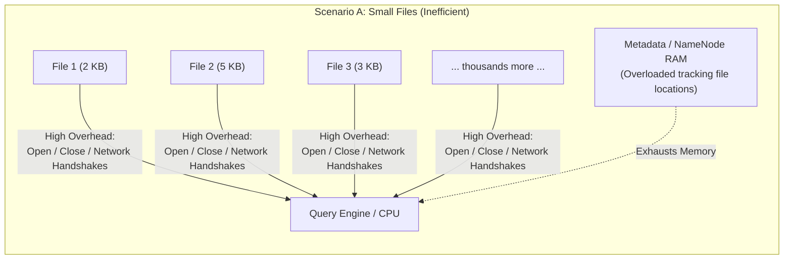
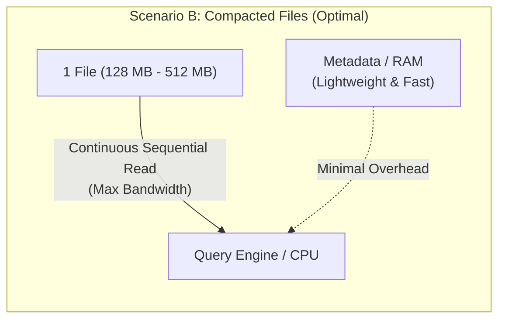
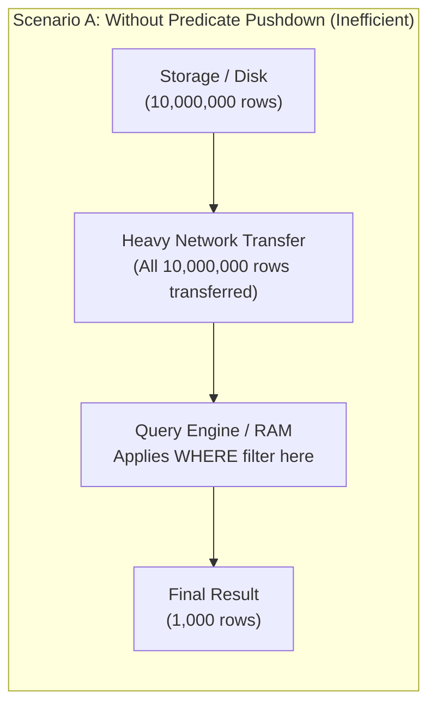
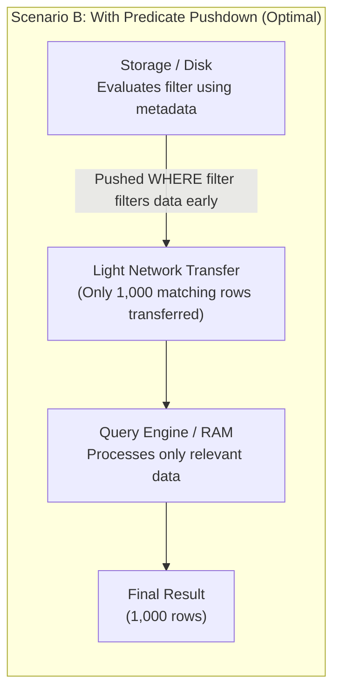

# Interview Questions: Query Optimisation, Indexing & Storage Performance

## 1. What is the "Small Files Problem"?

### Overview
The **Small Files Problem** occurs when a distributed data storage or processing system stores **millions of tiny files** (e.g., a few kilobytes each) instead of a balanced number of **optimally sized files**.

### Why is it a Problem for Distributed Systems?

1. **Metadata Overhead:**
   * Every file requires metadata (file name, path, block locations, permissions, timestamps).
   * In distributed query engines, this metadata is cached in RAM. Millions of tiny files exhaust memory just keeping track of where files live.
2. **I/O Bottleneck & Latency:**
   * Opening and closing a file incurs network latency, disk seek times, and protocol handshakes.
   * If a file holds only a few records, the engine spends more time opening/closing the file than reading real data.
3. **Execution Engine Inefficiency (Too Many Tasks):**
   * Distributed engines create reading tasks per file partition. 100,000 tiny files can trigger 100,000 micro-tasks, overwhelming the cluster scheduler.

---

### Visual Comparison

---

### How to Solve & Prevent It

1. **File Compaction:** Periodically combine small files into larger ones.
2. **Adjust Partitioning Strategy:** Use coarser partition keys (e.g., partition by `year/month/day` instead of full timestamp).
3. **Aim for Target File Sizes:** Store data in columnar formats (like Parquet or ORC) with file sizes between **128 MB and 512 MB**.

---

## 2. What is "Predicate Pushdown"?

### Overview
A **predicate** is simply a filter condition in a query (e.g., `WHERE status = 'active'` or `WHERE age > 30`).

**Predicate Pushdown** is an optimization technique where the query engine "pushes" the filter condition directly down to the **storage layer** (files), filtering out unwanted rows *before* transferring the data over the network or loading it into memory.

### Why is it Important for Performance?

1. **Massive I/O & Network Savings:**
   * Only the rows and blocks that match your filter are read from disk and sent over the network.
2. **Lower Memory Footprint:**
   * Query engines don't waste RAM holding millions of rows that will just be discarded immediately after.
3. **Accelerated Query Speeds:**
   * In columnar formats (like Parquet or ORC), entire blocks of data can be skipped completely using file metadata (min/max values) without reading the actual records.

---

### Visual Comparison

---

### How It Works in Practice

* **File-level pruning (Metadata):** Columnar files (like Parquet) store `min` and `max` statistics for each chunk of data. If your query has `WHERE age > 50`, and a chunk's metadata shows `max(age) = 42`, the engine skips reading that entire chunk of data completely.
* **Storage-level filtering:** Cloud storage engines (such as Amazon S3 Select or modern database storage engines) filter rows at the source before sending bytes across the wire.