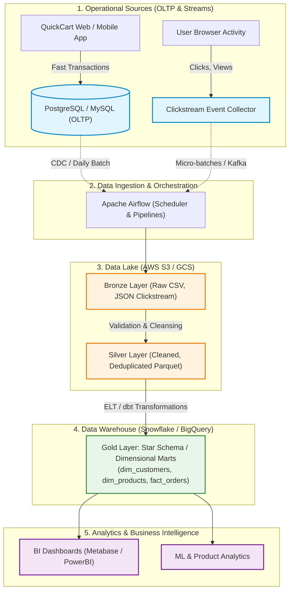

# Section A: Data Engineering Theory & Architecture — QuickCart Platform

---

## Q1. OLTP vs OLAP Architecture

### 1. Why running transactional and analytical workloads in the same SQL database creates performance issues

QuickCart currently executes both everyday app operations (orders, checkouts, account logins) and heavy BI analytics (monthly dashboards, revenue aggregations) in the same relational database. This causes severe bottlenecks due to:

1. **Resource Contention (CPU, Memory & Disk I/O)**:
   - Analytical queries perform full table scans across millions of rows and execute expensive `JOIN` and `GROUP BY` aggregations.
   - This consumes all available CPU and RAM, starving transactional queries that need sub-millisecond response times.
2. **Database Locking & Concurrency Blocking**:
   - Long-running analytical reports place shared read locks on tables or partition pages.
   - Ongoing customer checkouts attempting to insert/update rows (`orders`, `inventory`) are blocked waiting for locks to release, resulting in timeouts or cart abandonment.
3. **Cache Eviction / Buffer Pool Thrashing**:
   - Relational databases keep frequently accessed transaction pages in memory (RAM buffer pool).
   - A single massive analytical query reading gigabytes of historical data flushes the cache, forcing subsequent transaction queries to read from slow disk storage.
4. **Row-Oriented Storage Mismatch**:
   - Relational databases (like PostgreSQL/MySQL) store data row by row. To calculate total revenue for the year, the database must read every column (name, email, shipping address, etc.) off the disk just to sum two columns (`quantity` * `unit_price`).

---

### 2. Comparison: OLTP vs OLAP Workloads

| Feature | OLTP (Online Transaction Processing) | OLAP (Online Analytical Processing) |
| :--- | :--- | :--- |
| **Primary Goal** | High-speed daily operations & transaction recording | Business intelligence, aggregations, trend analysis |
| **Target Users** | End users, customers, web application backend | Data analysts, business stakeholders, ML models |
| **Data Structure** | Highly normalized (3NF) to eliminate duplicates | Denormalized, Star Schema, Snowflake Schema |
| **Query Nature** | Simple, fast lookups, single-row `INSERT`/`UPDATE` | Complex aggregations (`SUM`, `AVG`, window functions) |
| **Read vs Write** | Balanced mix of fast reads and writes | Read-heavy; writes occur in bulk batch/micro-batch loads |
| **Response Time** | Milliseconds (< 100 ms) | Seconds to minutes |
| **Storage Layout** | Row-oriented (B-Tree indexed pages) | Columnar storage (Parquet, ORC, Snowflake micro-partitions) |
| **Typical Systems** | PostgreSQL, MySQL, SQL Server, Oracle | Snowflake, Google BigQuery, AWS Redshift, ClickHouse |

---

### 3. Suggested Improved Architecture for QuickCart

Instead of a single database doing everything, we decouple **Ingestion**, **Storage**, and **Analytics** into a modern layered architecture:



```
[ QuickCart Web App / Mobile App ]
      │ (OLTP: Fast Orders, Customers)
      ▼
[ PostgreSQL / MySQL Database ]
      │
      │ (CDC via Debezium or Batch ETL via Apache Airflow)
      ▼
┌────────────────────────────────────────────────────────┐
│                      DATA LAKE                         │
│             (AWS S3 / GCS / Azure ADLS)                │
│                                                        │
│  - Raw Landing Zone (Bronze): CSV / JSON clickstream   │
│  - Cleaned Zone (Silver): Partitioned Parquet files    │
└──────────────────────────┬─────────────────────────────┘
                           │
                           ▼ (ELT Transformations via dbt / Airflow)
┌────────────────────────────────────────────────────────┐
│                   DATA WAREHOUSE                       │
│        (Snowflake / BigQuery / Databricks / Redshift)  │
│                                                        │
│  - Gold Layer: Star Schema / Dimensional Fact Tables   │
│  - Fast Columnar Query Engine                          │
└──────────────────────────┬─────────────────────────────┘
                           │
                           ▼
[ BI Dashboards (Metabase / PowerBI) & ML Analytics ]
```

---

### 4. Where Each Storage Layer Should Be Used

- **PostgreSQL / MySQL / SQL Server (OLTP Operational Database)**:
  - **Where to use**: As the live transactional engine powering the customer-facing website and mobile app.
  - **Best for**: Customer authentication, order placement, real-time inventory updates, payment status tracking where strict ACID transactions and low latency are critical.
  
- **Data Lake (e.g., AWS S3, Google Cloud Storage, MinIO)**:
  - **Where to use**: As the central, cost-effective storage repository for all raw and semi-structured data.
  - **Best for**: Storing high-volume clickstream logs, raw CSVs, JSON API payloads, and historical archive files in open columnar formats like Apache Parquet.

- **Data Warehouse (e.g., Snowflake, BigQuery, Amazon Redshift)**:
  - **Where to use**: As the centralized analytical engine for reporting, dashboards, and KPI analysis.
  - **Best for**: Aggregating millions of records across customers, orders, and products with sub-second dashboard performance without ever affecting the production transactional database.

  ## Q2. ACID vs BASE in Distributed Systems

### 1. Why BASE systems are preferred for clickstream systems

QuickCart tracks millions of user interactions every day (`page_view`, `click`, `add_to_cart`, `search`). BASE systems (e.g., Apache Kafka, Amazon DynamoDB, Apache Cassandra) are preferred over traditional ACID databases for clickstream data because:

1. **Massive Ingestion Throughput (Write Velocity)**:
   - Clickstream generates tens of thousands of writes per second. ACID systems require locking tables and writing to synchronous transaction logs, creating massive queue backlogs.
   - BASE systems accept high-speed append-only writes in memory and replicate them asynchronously across nodes with near-zero latency.
2. **High Availability Over Immediate Consistency (CAP Theorem)**:
   - If a clickstream collector goes down under ACID rules to preserve strict consistency, user clicks are dropped and lost.
   - BASE prioritizes **Availability** and **Partition Tolerance** (AP): it never drops an incoming event, even during network splits or node reboots.
3. **Horizontal Scalability**:
   - ACID databases are difficult and expensive to scale horizontally across multiple machines.
   - BASE distributed stores scale linearly by adding cheap commodity worker nodes as traffic grows during peak sales (like Black Friday).
4. **Tolerance for Micro-Delays**:
   - Analytics do not need to know that a user clicked a button within 1 millisecond. If that click arrives at the reporting dashboard 2 seconds later, business decisions remain unaffected.

---

### 2. Workloads That Require ACID Compliance

Workloads where any inconsistency leads to financial loss, legal penalties, or corrupted business state **must** be ACID-compliant:

1. **Payment Processing & Financial Ledger**:
   - Charging a customer's credit card and recording the payment status (`Paid`) must occur together atomically. If payment fails, the order must not proceed.
2. **Inventory Stock Allocation**:
   - If there is only 1 unit left of a `4K Monitor`, two customers purchasing at the same second must be handled with strict Isolation so the item is not oversold and stock does not become `-1`.
3. **Order Lifecycle & Fulfillment**:
   - Order creation, order status transitions (`Pending` ➔ `Paid` ➔ `Shipped`), and customer invoice generation.
4. **User Security & Authentication**:
   - Password changes, permissions, and credential updates require immediate consistency across all login sessions.

---

### 3. Real-World Examples Where Eventual Consistency Is Acceptable

In these scenarios, temporary discrepancies of a few seconds (or minutes) do not impact the business:

1. **Clickstream & Website Traffic Analytics**:
   - If a dashboard displays 12,450 page views and updates to 12,480 a few seconds later, no business process is damaged.
2. **Product Reviews and Star Ratings**:
   - When a user submits a 5-star review, it is acceptable if other users across different geographic regions see the updated average rating 30 seconds later.
3. **Social Media & Engagement Counters**:
   - View counters (like YouTube view counts or Instagram likes) frequently use eventual consistency to handle massive concurrency.
4. **Product Recommendation Feeds**:
   - Showing "Customers also viewed..." or "Frequently bought together" recommendations can be computed from data that is minutes or hours old.
5. **Search Engine Indexing**:
   - When a new product is added to the catalogue, it is completely acceptable if it takes a few seconds to appear in the autocomplete search bar.

---

## Q3. Storage Formats & Querying

### 1. Comparison: CSV, JSON, Avro, and Parquet

| Feature | CSV | JSON | Apache Avro | Apache Parquet |
| :--- | :--- | :--- | :--- | :--- |
| **Format Type** | Row-based, plain text | Hierarchical, plain text | Row-based, binary | Columnar, binary |
| **Human Readable** | Yes (Excel, text editor) | Yes (text editor) | No (binary) | No (binary) |
| **Schema Support** | None (implicit from headers) | Optional / Implicit (No strict schema) | Strict schema (JSON-based `.avsc`) | Strict schema (embedded metadata & statistics) |
| **Schema Evolution**| Poor (adding columns breaks parsers) | Moderate (tolerates new keys) | Excellent (full backward/forward compatibility) | Excellent (schema stored in file footer) |
| **Compression** | Poor | Poor (keys repeated in every single row) | Good (compact binary representation) | Excellent (Snappy, ZSTD, dictionary encoding) |
| **Splittable** | Partially (line-based) | Poor (especially multiline JSON) | Highly splittable (sync markers) | Highly splittable (row groups) |
| **Best Used For** | Quick exports, manual data sharing | Web APIs, application config, semi-structured logs | High-throughput streaming (Apache Kafka) | Big Data analytics, OLAP warehouses (Snowflake, BigQuery, Spark) |

---

### 2. Why Analytical Systems Prefer Columnar Storage

Analytical queries (OLAP) almost never request all columns of a table. Instead, they look like this:
```sql
SELECT category, SUM(selling_price) FROM products GROUP BY category;
```
Analytical databases prefer columnar storage (like Parquet) because of:

1. **Column Pruning (Projection)**:
   - In a row-based format (CSV), the database must read the entire row (ID, description, supplier, dimensions, dates) off the disk just to sum `selling_price`.
   - In columnar storage, the query engine only reads the `category` and `selling_price` columns off the disk, skipping all other columns entirely. This eliminates 80–90% of disk I/O.
2. **Predicate Pushdown & Min/Max Filtering**:
   - Parquet files store column statistics (minimum, maximum, null count) inside the file footer for each block (Row Group).
   - If a query asks for `WHERE order_date >= '2025-01-01'`, the engine reads the metadata first, sees that a block only contains `2024` data, and skips reading that block entirely without touching disk sectors.
3. **Drastic Cloud Cost Reduction**:
   - Modern cloud query engines (Google BigQuery, Amazon Athena, Snowflake) bill by the number of gigabytes scanned. Reading only the necessary columns directly reduces cloud bills by up to 90%.

---

### 3. Avro vs JSON Format

Both Avro and JSON support complex, nested data structures, but they differ fundamentally:

| Dimension | JSON | Apache Avro |
| :--- | :--- | :--- |
| **Data Encoding** | Text-based (UTF-8 strings) | Compact binary |
| **Key Storage** | Field names are repeated in every single record (e.g., `"customer_id": 1`, `"customer_id": 2`) | Field names are defined **once** in the schema header; data rows contain only values |
| **Parsing Speed** | Slow CPU parsing (converting text numbers to integers/floats) | Extremely fast direct binary serialization |
| **Schema Enforcement** | None by default (validation must be written in application code) | Enforces strict schemas; rejects records that do not conform |
| **Schema Evolution** | Risky; schema changes can silently break downstream consumers | Native schema registry support; handles added, removed, or renamed fields cleanly |
| **Primary Industry Role** | Web APIs, REST endpoints, lightweight configs | Event streaming message serialization in Apache Kafka |

---

### 4. Compression Benefits in Apache Parquet

Parquet achieves extraordinary compression rates (often **75% to 85% smaller** than raw CSV) due to two key factors:

1. **Data Homogeneity (Same Data Types Grouped Together)**:
   - In row storage, an integer is followed by a text string, a date, and a boolean. Mixed data types compress poorly.
   - In Parquet, thousands of integers (e.g., `quantity`) are stored back-to-back. Similar values compress with extreme efficiency.
2. **Advanced Encoding Techniques**:
   - **Dictionary Encoding**: Replaces repetitive string values (like payment status `"Paid"`, `"Pending"`, `"Failed"`) with small numbers (`0`, `1`, `2`), storing the text words only once in a dictionary.
   - **Run-Length Encoding (RLE)**: If the status `"Paid"` appears 500 times consecutively, it stores `500 x 0` instead of repeating the string 500 times.
   - **Delta Encoding**: For timestamps or incremental IDs (`1001, 1002, 1003`), it stores only the differences (`+1, +1, +1`), requiring far fewer bits.
3. **Secondary Block Compression**:
   - After encoding, Parquet applies fast compression algorithms like **Snappy** (optimized for speed) or **Zstandard (ZSTD)** (optimized for high compression ratio) to reduce file size even further.

---

## Q4. Partitioning, Indexing

### 1. Partitioning Strategy Design

#### A. Partitioning Strategy for `orders` Table
* **Recommended Strategy**: **Range Partitioning by Date (`YEAR` and `MONTH`)**
  - Path structure in Data Lake / Warehouse:
    ```
    orders/year=2025/month=01/
    orders/year=2025/month=02/
    ...
    orders/year=2026/month=03/
    ```
* **Why this works best**:
  - E-commerce analytics are predominantly time-based (e.g., Monthly Sales Growth, Q1 Revenue, Year-over-Year comparisons).
  - **Partition Pruning**: A query filtering for `WHERE order_date >= '2025-01-01' AND order_date < '2025-02-01'` only scans the January 2025 partition folder, completely skipping 95% of the dataset.

---

#### B. Partitioning Strategy for `clickstream` Data
* **Recommended Strategy**: **Hierarchical Partitioning by Date and Hour (`year / month / day / hour`)**
  - Path structure in Data Lake (S3 / GCS):
    ```
    clickstream/year=2025/month=04/day=12/hour=10/events.parquet
    clickstream/year=2025/month=04/day=12/hour=11/events.parquet
    ```
* **Why this works best**:
  - **Extreme Velocity & Volume**: Clickstream generates millions of events per hour. Hourly partitioning matches streaming micro-batches from Kafka or Airflow ingestion pipelines.
  - **Cost-Free Lifecycle Data Retention**: In e-commerce, raw click logs older than 90 days are usually archived or deleted. With date-partitioned storage, dropping old data is an instant folder deletion (`DROP PARTITION`) rather than an expensive, slow, table-locking `DELETE FROM clickstream WHERE timestamp < ...` query.

---

### 2. Suggested Indexing Strategy

| Operation | Target Column(s) | Recommended Index Type | Rationale & Query Accelerated |
| :--- | :--- | :--- | :--- |
| **Customer Lookups** | `customer_id` | **B-Tree (Primary Key)** | Instant $O(\log N)$ point lookups when customers log in or view account profiles. |
| **Customer Lookups** | `email` | **Unique B-Tree** | Prevents duplicate accounts and accelerates login queries (`WHERE email = 'user@example.com'`). |
| **Order Filtering** | `(order_date, payment_status)` | **Composite B-Tree** | Optimizes common dashboard queries filtering by date and payment status (`WHERE order_date >= '2025-01-01' AND payment_status = 'Paid'`). |
| **Order Joins** | `orders(customer_id)` | **B-Tree (Foreign Key)** | Dramatically accelerates `JOIN customers c ON o.customer_id = c.customer_id` by avoiding a full sequential scan on `orders`. |
| **Order Joins** | `orders(product_id)` | **B-Tree (Foreign Key)** | Accelerates product performance joins (`JOIN products p ON o.product_id = p.product_id`). |

---

### 3. When Indexes Negatively Affect Performance

While indexes make `SELECT` queries faster, they introduce significant penalties in certain scenarios:

1. **Write Amplification (Slows down `INSERT`, `UPDATE`, `DELETE`)**:
   - Every time a new order or click event is inserted, the database must write the data row **AND** update every single B-Tree index on that table.
   - For high-throughput write workloads (like clickstream), having 4 or 5 indexes can degrade ingestion speed by 200% to 300%.
2. **Storage and RAM Overhead**:
   - Indexes are separate data structures stored on disk. For large tables, indexes can consume as much disk space as the actual table data itself.
   - Crucially, indexes must be loaded into the database's RAM (Buffer Pool) to be fast. Too many indexes crowd out table data from memory.
3. **Low-Cardinality Columns (Ineffective Indexes)**:
   - Creating an index on a column with very few distinct values (e.g., `gender` with M/F, or boolean `is_active` with True/False) is counter-productive.
   - The query planner will recognize that half the table matches and will ignore the index in favor of a full table scan, wasting memory.
4. **Maintenance Overhead during Bulk Loads**:
   - During large nightly batch ETL loads, keeping indexes active forces constant tree re-balancing. Best practice is to drop indexes prior to bulk loading and rebuild them afterward.
