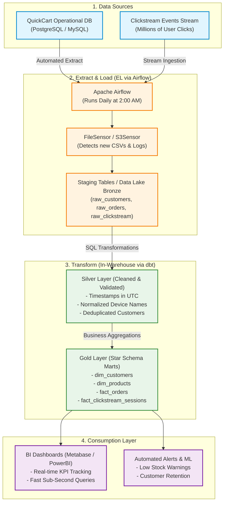

# Section D: ETL/ELT & Apache Airflow — QuickCart Platform

---

## Q1. ETL vs ELT Architecture

### 1. Comparison: ETL vs. ELT

| Dimension | Traditional ETL (Extract, Transform, Load) | Modern ELT (Extract, Load, Transform) |
| :--- | :--- | :--- |
| **Execution Order** | Extract ➔ Transform in transit ➔ Load into Target | Extract ➔ Load Raw data into Target ➔ Transform inside Target |
| **Where Transformations Occur** | On an intermediate processing server (e.g., Informatica, SSIS, custom Python server) | Inside the scalable Cloud Data Warehouse (Snowflake, BigQuery, Redshift) |
| **Load Speed** | Slower (data must be fully cleaned and converted before loading) | Extremely Fast (raw data is ingested directly in minutes) |
| **Raw Data Retention** | Usually discarded; only transformed data is stored | Preserved in Raw/Bronze tables; raw data is never lost |
| **Flexibility** | Rigid; if business logic changes, the entire pipeline must re-extract from sources | High; if business logic changes, simply re-run SQL models on existing raw tables |
| **Compute Scalability** | Limited by the CPU/RAM of the middle transformation server | Scalable; leverages warehouse compute separation |
| **Data Types Supported** | Structured relational data | Structured, semi-structured (JSON, Avro, Parquet), and raw logs |
| **Primary Tools** | Informatica, Talend, Apache NiFi, SSIS | Apache Airflow, Fivetran, Airbyte, dbt, Snowflake, BigQuery |

---

### 2. Why Cloud Data Warehouses Prefer ELT

Modern cloud platforms (Snowflake, Google BigQuery, Databricks, Amazon Redshift) are purpose-built for ELT rather than ETL because:

1. **Separation of Storage and Compute**:
   - Cloud warehouses decouple storage (cheap cloud disks) from compute (virtual clusters). You can scale up a 64-core compute warehouse for 5 minutes to run heavy transformations and immediately scale it down, saving thousands in cloud costs.
2. **Massive Parallel Processing (MPP)**:
   - Instead of a single Python/ETL server struggling to join millions of clickstream rows, cloud warehouses distribute the query across dozens of distributed nodes executing in parallel.
3. **Preservation of Raw History (Auditability & Replayability)**:
   - In ELT, raw clickstream logs and order snapshots are permanently stored in the raw/landing schema. If a bug is found in last month's revenue calculation, engineers can simply update the SQL model and re-transform the historical data without bothering the operational database.
4. **SQL-Centric Modeling with dbt**:
   - Transformations are written in standard, version-controlled SQL models (using dbt - data build tool), making data pipelines maintainable, testable, and accessible to data analysts.

---

### 3. Modern ELT Pipeline Design for QuickCart

Here is the end-to-end blueprint designed to resolve QuickCart's performance and reporting delays:



```
┌────────────────────────────────────────────────────────────────────────┐
│                        1. DATA SOURCES                                 │
│  - QuickCart PostgreSQL (Orders, Customers, Products)                  │
│  - Clickstream Event Stream (Clicks, Searches, Views)                  │
└───────────────────────────────────┬────────────────────────────────────┘
                                    │
                        (Airflow Orchestration)
                                    ▼
┌────────────────────────────────────────────────────────────────────────┐
│                    2. EXTRACT & LOAD (EL)                              │
│  - Raw CSVs / JSON loaded directly into Data Lake / Snowflake Staging  │
│  - Bronze Tables: raw_customers, raw_orders, raw_clickstream          │
└───────────────────────────────────┬────────────────────────────────────┘
                                    │
                     (dbt / SQL Warehouse Engine)
                                    ▼
┌────────────────────────────────────────────────────────────────────────┐
│                     3. TRANSFORM IN-WAREHOUSE (T)                      │
│  - Silver Layer: Cleaned, deduplicated, standardized datatypes         │
│  - Gold Layer: Star Schema Data Marts                                  │
│      * dim_customers (SCD Type 2)                                      │
│      * dim_products                                                    │
│      * fact_orders (Daily sales, revenue)                              │
│      * fact_clickstream_sessions (Aggregated 30-min user sessions)     │
└───────────────────────────────────┬────────────────────────────────────┘
                                    │
                                    ▼
┌────────────────────────────────────────────────────────────────────────┐
│                      4. CONSUMPTION LAYER                              │
│  - Executive BI Dashboards (Metabase / PowerBI) - sub-second queries   │
│  - Customer Retention & Logistics Alerting                             │
└────────────────────────────────────────────────────────────────────────┘
```
