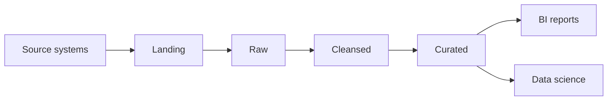
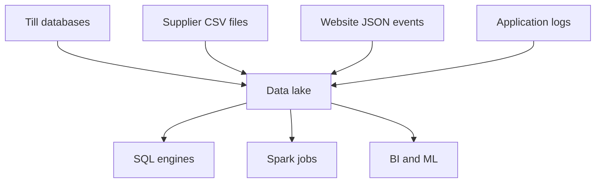
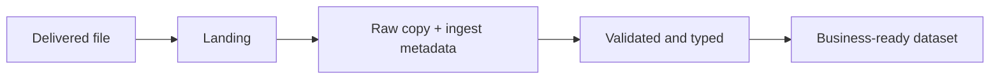
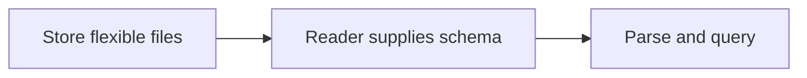
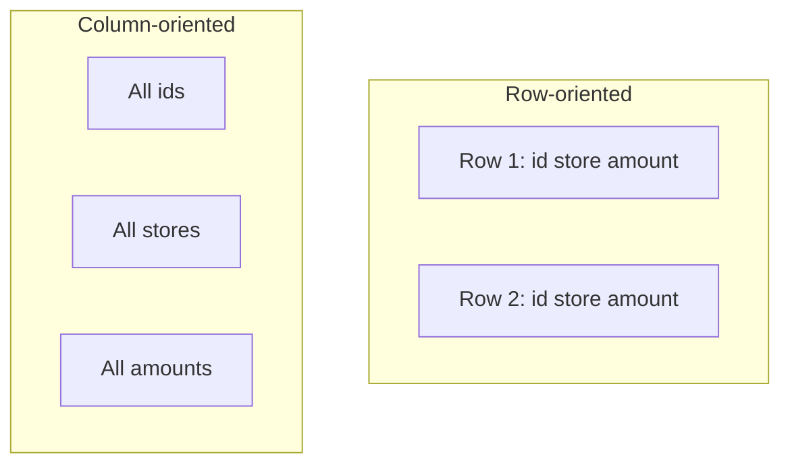
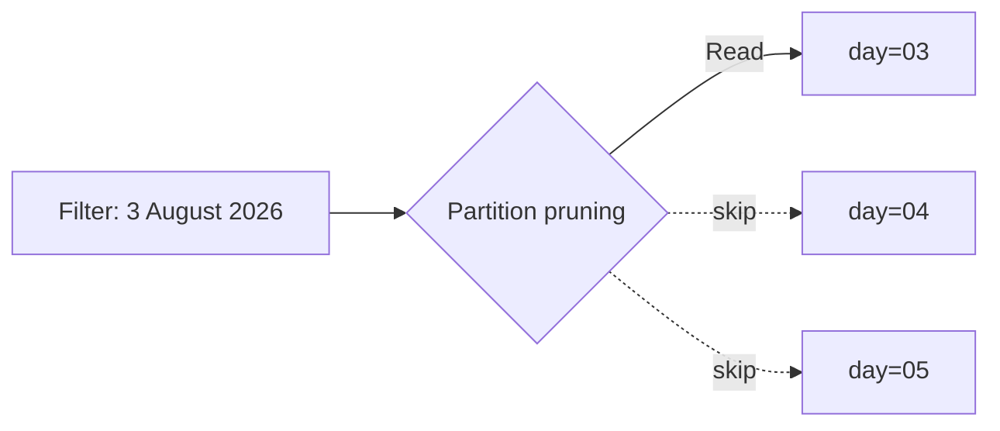
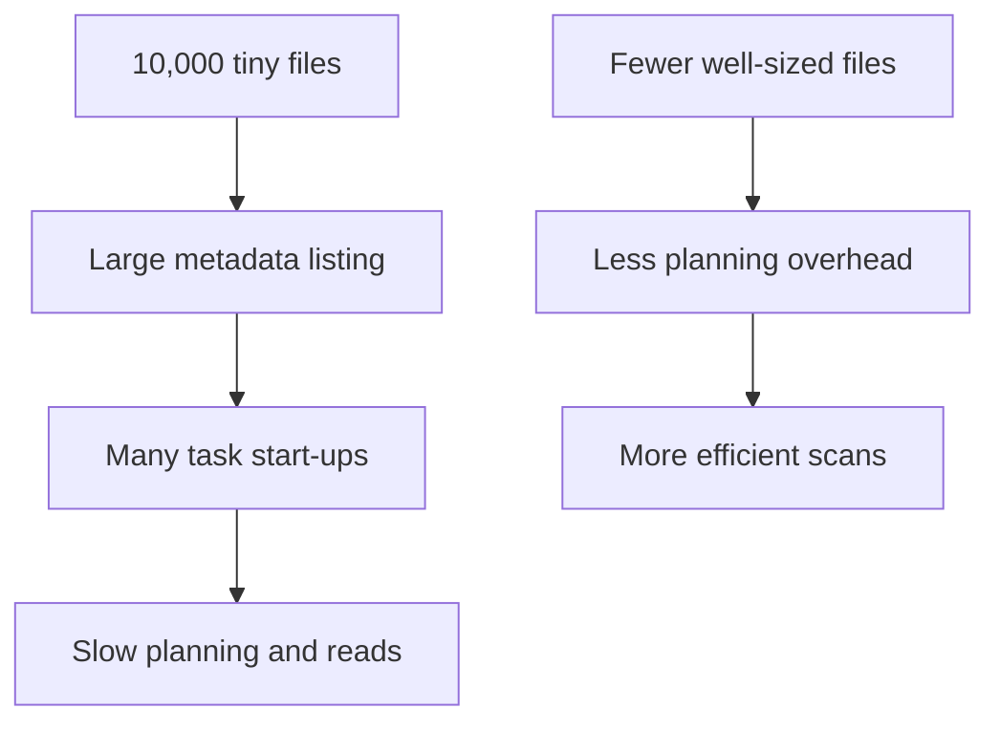
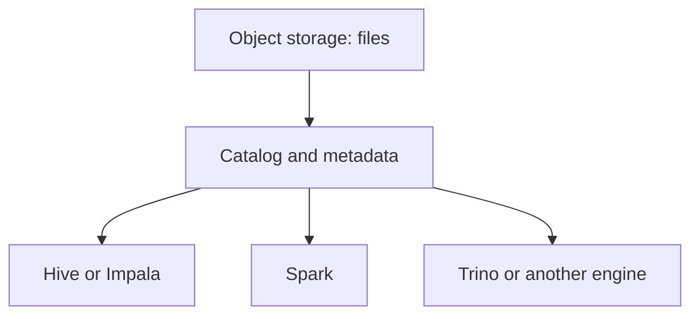
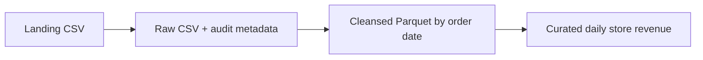

# Week 5 — Session 1: Data Lake Architecture and Analytical File Formats

> **Why this topic matters:** A data lake can hold years of valuable data, but storage alone does not make data useful. Teams need clear zones, suitable file formats, sensible partitions, and manageable file sizes so that data remains traceable, affordable, and fast to query.

---

## The 5-Minute Version (Overview)

**BritMart** is a fictional UK supermarket group. Its shops in London, Manchester, Birmingham, Bristol, and Leeds send till sales, stock updates, website events, and supplier files into a shared data lake.



| Area | Main Purpose |
| :--- | :--- |
| **Landing** | Receive source files exactly as delivered |
| **Raw** | Keep an immutable, organised source copy |
| **Cleansed** | Validate types, remove bad records, and standardise fields |
| **Curated** | Publish trusted datasets for reporting and machine learning |
| **Parquet / ORC** | Store analytical data by column for efficient reads |
| **Avro** | Store or exchange schema-aware row records |
| **Partitioning** | Group files by a useful key so queries can skip data |
| **Compaction** | Combine many tiny files into fewer useful files |

> **Memory rule:**
> - **Zones** describe the *trust level* of data.
> - **File formats** describe *how records are stored*.
> - **Partitions** describe *how files are grouped*.

### Learning Objectives
By the end of this lesson, you can:
- Explain the purpose of **landing**, **raw**, **cleansed**, and **curated** zones.
- Compare **schema-on-read** and **schema-on-write**.
- Compare **CSV**, **JSON**, **Parquet**, **Avro**, and **ORC**.
- Explain **row-oriented** and **column-oriented** storage.
- Choose a suitable **compression** approach.
- Design a practical **partitioned folder layout**.
- Explain the **small-files problem** and common fixes.
- Propose a maintainable **data lake design**.

---

## Running Example: BritMart Daily Sales

Every store sends a CSV file containing:

```csv
order_id,store_id,order_date,amount_gbp,payment_type
1001,LON-01,2026-08-03,42.75,card
1002,MAN-02,2026-08-03,18.20,cash
```

The source file is simple, but BritMart also needs:
- The **untouched file** for audit and reprocessing;
- A **typed dataset** for reliable joins;
- **Daily and monthly reporting tables**;
- **Efficient queries** that do not scan every year of sales.

---

## Part 1 — Data Lake Architecture and Zones

### 1. What is a Data Lake?
A **data lake** is a storage architecture used to keep large amounts of structured, semi-structured, and unstructured data. The data usually lives in distributed file or object storage such as **HDFS**, **Amazon S3**, **Azure Data Lake Storage (ADLS)**, or **Google Cloud Storage (GCS)**.

A data lake is not automatically organised. Without naming rules, metadata, ownership, and processing boundaries, it can become difficult to trust (often called a *"data swamp"*).



> **Common misconception:** A data lake is just a large folder.  
> **Better way to think about it:** Storage is the foundation. Zones, metadata, security, quality checks, and processing standards turn that storage into a usable data platform.

---

### 2. Why Use Zones?
Zones separate data by **processing stage** and **trust level**. This makes failures easier to investigate because engineers can compare the input and output of each stage.

| Zone | Trust Level | Typical Change |
| :--- | :--- | :--- |
| **Landing** | Unknown | None (exact arrival bytes) |
| **Raw** | Source copy | Organisation and ingestion metadata only |
| **Cleansed** | Checked | Types, names, null handling, validation |
| **Curated** | Trusted for a purpose | Joins, metrics, aggregates, business rules |



*Note: Exact names vary between organisations. Many teams use the **Medallion Architecture** labels: **Bronze** (Raw), **Silver** (Cleansed), and **Gold** (Curated). The important point is the separation of responsibilities, not the label.*

---

### 3. Landing Zone
The **landing zone** is the first controlled location where external data arrives.

At BritMart, a supplier file might arrive at:
```text
britmart-lake/
└── landing/
    └── supplier_prices/
        └── received_at=2026-08-03T06-15-00Z/
            └── prices.csv
```

**Good landing-zone rules:**
- Keep the delivered bytes unchanged;
- Record source and arrival time;
- Restrict manual editing;
- Scan or validate before downstream use;
- Retain files according to retention policy (temporary or fixed period depending on audit, recovery, and cost requirements).

> **Common mistake:** Renaming columns or fixing values directly in the landing file.  
> **Correction:** Preserve the arrival copy untouched. Put corrected data in a later zone.

---

### 4. Raw Zone
The **raw zone** stores a stable, traceable copy of source data in an organised structure. It may also add ingestion metadata such as:
- `source_system`
- `ingested_at`
- `batch_id`
- `source_file_name`

```text
britmart-lake/
└── raw/
    └── till_sales/
        └── ingest_date=2026-08-03/
            ├── london_01.csv
            └── manchester_02.csv
```

Raw data should normally be **immutable**. If processing logic changes (or a bug is discovered in transformation code), engineers can rebuild downstream datasets from the raw copy instead of asking the source team to resend historical data.

#### Landing vs. Raw
| Question | Landing | Raw |
| :--- | :--- | :--- |
| **Is it the first arrival point?** | Yes | Usually no |
| **Is it organised for repeatable processing?** | Not always | Yes |
| **Can ingestion metadata be added?** | Usually beside the file | Commonly yes |
| **Should values be corrected?** | No | Usually no |

---

### 5. Cleansed Zone
The **cleansed zone** contains data that has passed technical quality checks.

**Typical work includes:**
- Applying an explicit schema;
- Converting dates and numeric fields;
- Standardising column names;
- Removing or quarantining invalid records;
- Handling duplicates;
- Normalising codes such as store or region identifiers;
- Converting text formats (CSV/JSON) into analytical formats like **Parquet** or **ORC**.

#### Example using `pandas`:
```python
from pathlib import Path
import pandas as pd

source = Path("britmart-lake/raw/till_sales/ingest_date=2026-08-03/sales.csv")
target = Path("britmart-lake/cleansed/till_sales/order_date=2026-08-03/sales.parquet")
target.parent.mkdir(parents=True, exist_ok=True)

df = pd.read_csv(source)
df["order_date"] = pd.to_datetime(df["order_date"], errors="coerce")
df["amount_gbp"] = pd.to_numeric(df["amount_gbp"], errors="coerce")

# Technical quality checks: drop missing required fields, negative amounts, and duplicate IDs
df = df.dropna(subset=["order_id", "store_id", "order_date", "amount_gbp"])
df = df[df["amount_gbp"] >= 0]
df = df.drop_duplicates(subset=["order_id"])

df.to_parquet(target, index=False)
```

> **Environment note:** Writing Parquet from `pandas` requires a Parquet engine such as `pyarrow`. The architectural idea remains the same when Spark or another distributed engine performs the write.  
> **Audit note:** A row-count drop between Raw and Cleansed is not automatically good or bad—it must be explained by quality rules and recorded in audit metrics.

---

### 6. Curated Zone
The **curated zone** contains datasets designed for a known consumer or business purpose.

**Examples for BritMart:**
- Daily revenue by store;
- Stock availability by region;
- Customer order summary;
- Supplier delivery performance;
- Product-level margin reporting.

```python
import pandas as pd

sales = pd.read_parquet(
    "britmart-lake/cleansed/till_sales/order_date=2026-08-03/sales.parquet"
)

summary = (
    sales.groupby(["order_date", "store_id"], as_index=False)["amount_gbp"]
    .sum()
    .rename(columns={"amount_gbp": "daily_revenue_gbp"})
)

summary.to_parquet(
    "britmart-lake/curated/daily_store_revenue/order_date=2026-08-03/data.parquet",
    index=False,
)
```

*Note: Curated does not mean "one table for everyone". A finance dataset and a stock-planning dataset may need different business rules, even when they use the same cleansed source.*

---

## Part 2 — Schema and Analytical File Formats

### 7. Schema-on-Read vs. Schema-on-Write
A **schema** defines column names, data types, and often rules about valid values.

#### Schema-on-Read
The schema is interpreted when a consumer reads the data.

- Useful for raw and evolving data, but moves more responsibility to every reader.

#### Schema-on-Write
The schema is checked before or during the write.


#### Comparison
| Area | Schema-on-Read | Schema-on-Write |
| :--- | :--- | :--- |
| **Flexibility** | Higher | More controlled |
| **Validation timing** | During reading | During writing |
| **Risk** | Different readers interpret data differently | Bad records may be rejected earlier |
| **Common fit** | Landing and raw exploration | Cleansed and curated data |

Modern platforms often use **both**: raw data is kept flexibly (schema-on-read), while trusted cleansed and curated layers enforce controlled schemas (schema-on-write).

---

### 8. CSV (Comma-Separated Values)
CSV is a plain-text, row-oriented format.
```csv
order_id,store_id,amount_gbp
1001,LON-01,42.75
```
- **Strengths:** Easy to create and inspect; widely supported; suitable for simple exchange; easy to debug with basic tools.
- **Limitations:** Data types are not stored reliably (everything is text); delimiters, quotes, encodings, and line breaks can cause parsing issues; readers must scan complete rows; compression and analytics performance are limited compared with columnar formats.
- **Verdict:** Acceptable at a system boundary (ingestion/export), but poor for long-term storage of large analytical tables.

---

### 9. JSON (JavaScript Object Notation)
JSON represents records as key-value structures and supports nested data.
```json
{
  "event_id": "evt-1001",
  "store_id": "LON-01",
  "event_type": "checkout",
  "basket": {
    "item_count": 4,
    "amount_gbp": 42.75
  }
}
```
- **Strengths:** Supports nested and optional fields; standard for APIs and event messages; self-describing (field names travel with values).
- **Limitations:** Verbose (repeats field names in every record); parsing text consumes CPU; schema drift can be hidden until query time; large tabular analytics are much more efficient in Parquet or ORC.
- **Tip:** **Newline-delimited JSON (NDJSON / JSON Lines)** is preferred for distributed systems because each line represents one independent record.

---

### 10. Parquet
**Apache Parquet** is a schema-aware, binary, **columnar** file format designed for analytical workloads.



**Why Parquet helps analytical engines:**
- **Column projection:** Read only the required columns (e.g., `SELECT SUM(amount_gbp)` skips `order_id` and `store_id` entirely);
- **Better compression:** Compress similar values together within the same column;
- **Predicate pushdown / row-group skipping:** Use min/max statistics stored in file metadata to skip irrelevant row groups;
- **Typed & structured:** Preserves exact data types and nested structures in file metadata.

> **Important distinction:** Parquet is a strong default for cleansed and curated analytical datasets, but **it is a file format, not a database**. By itself, it does not provide safe row-level updates, ACID transactions, or table history. Open table formats such as **Apache Iceberg** (or Delta Lake / Hudi) add those capabilities on top of Parquet data files.

---

### 11. Avro
**Apache Avro** is a binary, **row-oriented** format with an explicit schema (stored with the data or referenced via a schema registry).

**Well suited to:**
- Serialising individual records;
- Event and message pipelines (e.g., Kafka);
- Write-heavy flows;
- Exchanging records between microservices;
- Schema evolution governed by compatible producer and consumer rules.

#### Avro vs. Parquet
| Characteristic | Avro | Parquet |
| :--- | :--- | :--- |
| **Layout** | Row-oriented | Column-oriented |
| **Strong use case** | Record exchange and streams | Analytical scans and aggregation |
| **Schema** | Included or referenced | Stored with file metadata |
| **Reading a few columns** | Less efficient (reads whole row) | Very efficient (reads only target columns) |

---

### 12. ORC (Optimized Row Columnar)
**Apache ORC** is another binary, columnar analytical format. It is strongly associated with the **Hadoop and Hive** ecosystem, although other engines support it too.

**ORC provides:**
- Columnar reads;
- Type-aware compression;
- File and stripe statistics;
- Predicate filtering support;
- Efficient storage for large analytical tables.

#### Parquet vs. ORC
| Question | Parquet | ORC |
| :--- | :--- | :--- |
| **Is it columnar?** | Yes | Yes |
| **Does it store schema?** | Yes | Yes |
| **Is it used by multiple engines?** | Yes (broadest ecosystem support) | Yes (especially strong in Hive) |
| **Which should BritMart choose?** | Test ecosystem support and workload | Test ecosystem support and workload |

---

### 13. File-Format Decision Guide

| Requirement | Good Starting Choice | Reason |
| :--- | :--- | :--- |
| Partner sends a small human-readable extract | **CSV** | Broad compatibility |
| API payload or nested application events | **JSON** | Natural nested structure |
| Streaming records with a governed schema | **Avro** | Row-based serialisation and schema evolution |
| Large cross-engine analytical table | **Parquet** | Strong columnar performance and interoperability |
| Hive-centred analytical workloads | **ORC** or **Parquet** | Both are columnar; test in the target platform |

> **Important:** A file format choice is not permanent at every layer. BritMart can receive **CSV** in Landing, preserve it in **Raw**, and publish **Parquet** in **Cleansed** and **Curated** zones.

---

### 14. Row Storage vs. Column Storage

- **Row-oriented layout:** Keeps all fields of one record together. Efficient when a system frequently reads or writes complete individual records (OLTP, streaming events).
- **Column-oriented layout:** Keeps values from the same column together across rows. Efficient when a query reads only a few columns across millions of rows (OLAP, analytics).

| Workload | Better Fit |
| :--- | :--- |
| Insert or retrieve one complete customer record | Row-oriented database or record format |
| Calculate `SUM(amount_gbp)` across millions of orders | Columnar analytical format |
| Exchange one event at a time | Row-oriented serialisation (Avro/JSON) |
| Scan selected columns for a BI dashboard | Columnar storage (Parquet/ORC) |

---

## Part 3 — Compression, Partitioning, and File Sizing

### 15. Compression
Compression reduces the number of bytes stored on disk and transferred over the network. The trade-off is **CPU work** during compression and decompression.

| Codec | Typical Characteristic | Common Use |
| :--- | :--- | :--- |
| **None** | Fastest write, largest files | Temporary or diagnostic data |
| **Gzip** | Strong compression ratio, higher CPU cost | Text exchange (CSV/JSON) and cold archival |
| **Snappy** | Fast decompression, moderate compression | Common analytical default with Parquet |
| **Zstandard (Zstd)** | Adjustable balance of high compression ratio and fast CPU | Modern analytical workloads |

For columnar data, compression works especially well because similar values (e.g., repeated store IDs or dates) are stored consecutively.

> **Common mistake:** Always choosing the strongest compression.  
> **Correction:** Choose based on storage cost, network cost, CPU capacity, query frequency, and engine support.

---

### 16. Partitioned Data Layout
**Partitioning** groups files into directories by a field that appears frequently in query `WHERE` filters.

```text
britmart-lake/cleansed/till_sales/
└── year=2026/
    └── month=08/
        ├── day=03/
        │   └── part-00000.parquet
        └── day=04/
            └── part-00000.parquet
```

A query filtering for `3 August 2026` can skip reading other folders entirely when the query engine supports **partition pruning**.



#### Choosing Partition Keys
Good partition columns usually:
1. Appear in common query filters;
2. Have **manageable cardinality** (not millions of unique values);
3. Distribute data reasonably evenly;
4. Produce useful file sizes inside each partition folder.

| Candidate Column | Assessment |
| :--- | :--- |
| `order_date` | **Good:** Often useful for daily or monthly reporting filters |
| `region` | **Good:** Useful when region filters are common and there are few regions |
| `customer_id` | **Poor:** High cardinality — creates thousands/millions of tiny folders |
| `payment_type` | **Mixed/Poor:** Very low cardinality and often skewed (e.g., 90% card vs. 10% cash), creating uneven partitions |

---

### 17. The Small-Files Problem
A distributed data engine must discover, open, read metadata, schedule a task, and close each file. **Thousands of tiny files can therefore cost more time to manage than to actually read the data.**



- **Common causes:**
  - Writing one file per message or row;
  - Excessive partitioning (over-partitioning by high-cardinality keys);
  - Streaming jobs writing very small micro-batches;
  - Too many parallel output tasks/partitions in Spark;
  - Frequent incremental jobs without compaction.
- **Common remedies:**
  - Buffer records in memory/stream before writing;
  - Reduce unnecessary output partitions (e.g., `coalesce` / `repartition` before write);
  - Run periodic **compaction** jobs (combining small files into larger ones);
  - Use table-format maintenance procedures (e.g., Iceberg `rewrite_data_files`);
  - Monitor file count and average file size per partition.

*Note: There is no single universal ideal file size (though 128 MB–512 MB is a common range in distributed engines). The right range depends on engine, storage, cluster size, compression, and query pattern.*

---

### 18. Storage and Compute Separation
Modern cloud data platforms separate **durable object storage** from **temporary compute clusters**.



- **Benefits:**
  - Independent scaling of storage capacity and compute nodes;
  - Different engines (Spark, Trino, Hive, Impala) sharing the exact same datasets;
  - Compute clusters can stop when unused to save money;
  - Durable data outlives any specific compute cluster.
- **Trade-off:** Metadata catalogs, access control, concurrency consistency, and file maintenance must be designed carefully.

---

### 19. Data Lake Design Checklist

| Design Area | Recommended Question |
| :--- | :--- |
| **Ownership** | Who is accountable for each dataset? |
| **Naming** | Are paths and table names predictable? |
| **Immutability** | Which zones may be rewritten vs. append-only? |
| **Schema** | Where is the schema contract stored and checked? |
| **Quality** | What happens to invalid records (quarantine vs. fail)? |
| **Partitioning** | Do partitions match real query filters? |
| **File size** | Are files large enough for efficient scans without small-file overhead? |
| **Retention** | How long are landing, raw, and historical files kept? |
| **Security** | Is sensitive data (PII) protected by zone and role? |
| **Metadata** | Can users discover meaning, owner, schema, and freshness? |
| **Recovery** | Can a failed dataset be rebuilt deterministically from a trusted source? |

---

## Worked Example — BritMart Daily Order Pipeline

### Input
`britmart-lake/landing/till_sales/received_at=2026-08-04T01-10-00Z/sales.csv`

### Proposed Movement


### Architecture Decisions
| Decision | Choice | Reason |
| :--- | :--- | :--- |
| **Raw format** | Keep delivered CSV | Preserve exact source representation for audit/replay |
| **Cleansed format** | Parquet with Snappy (or Zstd) | Typed, compressed, columnar reads |
| **Cleansed partition** | `order_date` | Matches common reporting filters |
| **Curated grain** | One row per store per day | Simple, fast BI dashboard consumption |
| **File maintenance** | Monitor and compact small partitions | Avoid metadata and task-planning overhead |

### Verification Checks
- Source and Raw row counts match unless the ingestion design records a documented exception;
- Cleansed rejected rows are counted and quarantined;
- `amount_gbp` is numeric and non-negative (`>= 0`);
- `order_id` is not duplicated within the agreed business key;
- Curated revenue totals reconcile with Cleansed totals;
- Each output records processing timestamp and source batch ID.

---

## Common Mistakes and Better Choices

| Mistake | Why It Causes Trouble | Better Choice |
| :--- | :--- | :--- |
| **Editing landing or raw files** | Removes the audit trail and prevents clean replay | Write a new cleansed output |
| **Treating every file format as interchangeable** | Ignores schema enforcement and query access patterns | Choose format per layer and workload |
| **Partitioning by a unique identifier (`customer_id`)** | Creates huge numbers of folders and tiny files | Use date or another manageable low-cardinality key |
| **Writing one file per record** | Creates massive metadata and task-scheduling overhead | Buffer writes and run compaction |
| **Assuming Parquet provides ACID transactions** | Confuses a file format with a table format | Add Apache Iceberg (or similar table format) when needed |
| **Applying schema only in each analyst query** | Produces inconsistent interpretations across teams | Publish a governed, typed Cleansed schema |
| **Copying fixed file-size advice blindly** | Ignores the actual platform and query patterns | Measure query planning time, scan size, and throughput |

---

## Quick Knowledge Check (with Answers)

1. **Which zone should preserve the source representation?**
   - **Answer:** The **Landing** and **Raw** zones preserve the untouched source representation (Raw organises the files and adds ingestion metadata without altering the business values).

2. **Why is Parquet usually more efficient than CSV for `SUM(amount_gbp)`?**
   - **Answer:** Parquet is **columnar**, so the query engine only reads the `amount_gbp` column bytes from disk instead of scanning every column of every row like CSV requires. It also benefits from binary encoding, column-specific compression, and row-group min/max statistics.

3. **When is JSON preferable to CSV?**
   - **Answer:** When the data contains **nested structures** (arrays, objects) or optional/varying attributes (common in API responses and web/application events) that do not fit neatly into a flat table.

4. **Why can `customer_id` be a poor folder partition key?**
   - **Answer:** `customer_id` has **high cardinality** (many unique values), which creates thousands or millions of directories containing tiny files, causing severe metadata overhead (the **small-files problem**).

5. **What is the difference between compression and compaction?**
   - **Answer:** **Compression** uses an algorithm (like Snappy, Zstd, or Gzip) to reduce the byte size of data inside a file. **Compaction** combines many small files into fewer, larger files to reduce file-management and query-planning overhead.

---

## Lesson Summary & Confidence Checklist

- [x] Explain **landing**, **raw**, **cleansed**, and **curated** zones.
- [x] Compare **schema-on-read** and **schema-on-write**.
- [x] Choose between **CSV**, **JSON**, **Parquet**, **Avro**, and **ORC** for a stated need.
- [x] Explain why **columnar storage** helps analytical queries.
- [x] Describe **compression** as a CPU-versus-I/O trade-off.
- [x] Design a **date-based partition path** (`year=YYYY/month=MM/day=DD`).
- [x] Explain the **small-files problem** and how **compaction** solves it.
- [x] Propose data lake design controls (ownership, immutability, quality quarantine, retention, metadata).

