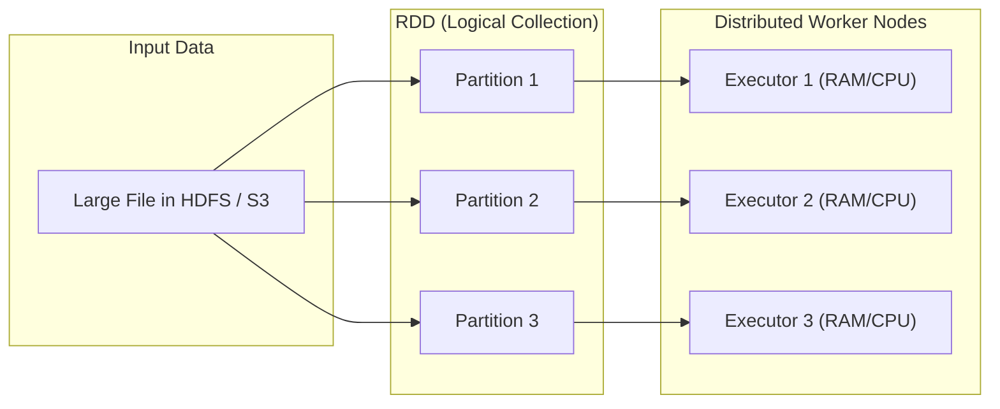
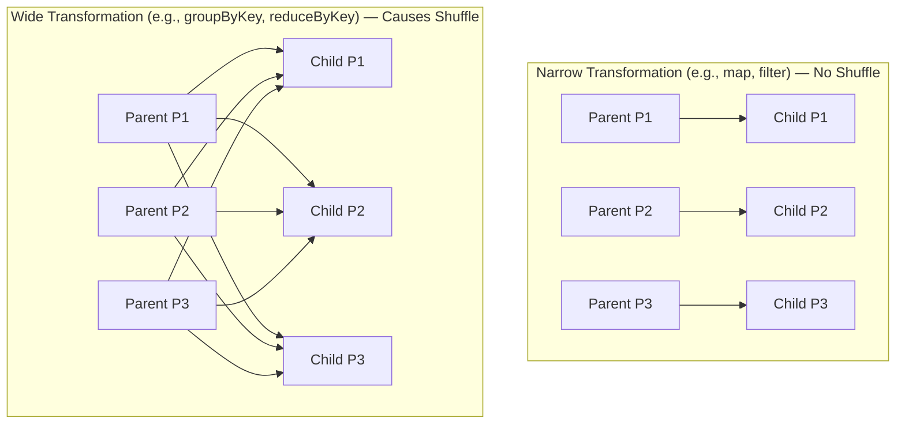
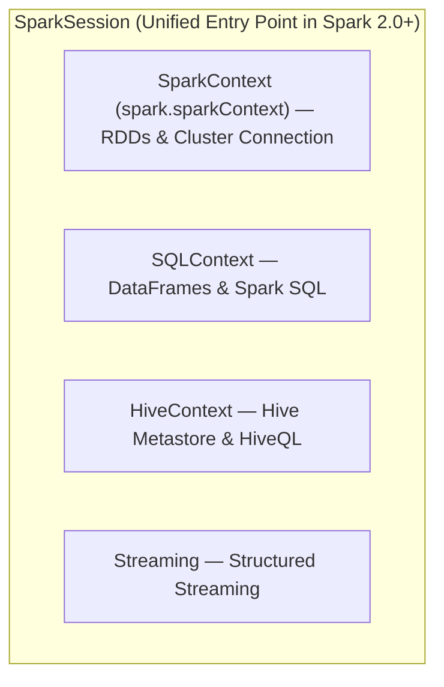
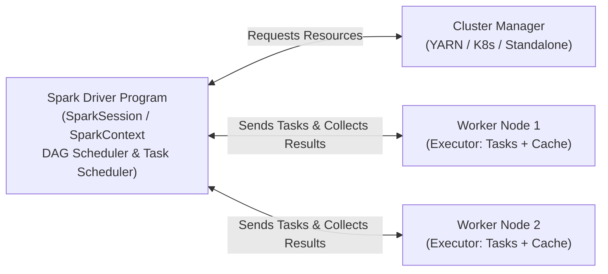

# Week 5 — Day 3: Apache Spark RDD – Theory Questions from Drive

---

## Questions Overview

1. **Q1.** What is an RDD? Explain the meaning of `"Resilient,"` `"Distributed,"` and `"Dataset"` in Resilient Distributed Dataset.
2. **Q2.** Explain the difference between transformations and actions in RDDs. Give two examples of each.
3. **Q3.** What is lazy evaluation in Spark? Why does Spark use it, and how does it benefit RDD processing?
4. **Q4.** What is RDD lineage (DAG)? How does it help Spark achieve fault tolerance without replicating data?
5. **Q5.** Differentiate between narrow and wide transformations. Why do wide transformations cause a shuffle?
6. **Q6.** Which is better, Python or Scala while working with Spark?
7. **Q7.** What is the difference between `SparkSession` and `SparkContext`?
8. **Q8.** What is the difference between RDD and DataFrames?
9. **Q9.** What is a driver program / Spark driver?
10. **Q10.** Where does Spark store the data?

---

## 1. What is an RDD? Explain the meaning of "Resilient," "Distributed," and "Dataset" in Resilient Distributed Dataset.

An **RDD (Resilient Distributed Dataset)** is the fundamental, low-level data structure of Apache Spark. It is an **immutable, fault-tolerant, partitioned collection of elements** that can be operated on in parallel across a cluster of machines.

### Meaning of Each Term:
- **Resilient (Fault-Tolerant):**
  If a worker node fails or a partition of data is lost in memory, Spark can automatically **recompute and rebuild** the lost data using the **RDD Lineage (DAG)**—the recorded history of transformations used to build that RDD from its original source—without needing to replicate the intermediate data across multiple nodes.
- **Distributed:**
  The data inside an RDD is logically divided into smaller chunks called **partitions**, and these partitions are spread across the memory (RAM) and CPU cores of multiple **worker nodes (executors)** in a cluster so they can be processed in parallel.
- **Dataset:**
  It is a collection of data records or objects. An RDD can hold any type of data—structured, semi-structured, or unstructured—such as strings, integers, tuples, dictionaries, JSON records, or custom Python/Java/Scala objects, loaded from external storage (like HDFS, S3, local files) or created by parallelizing an existing collection in the driver program.



---

## 2. Explain the difference between transformations and actions in RDDs. Give two examples of each.

Because RDDs are **immutable** (cannot be changed in place), every operation on an RDD falls into one of two categories: **Transformations** or **Actions**.

| Feature | Transformations | Actions |
| :--- | :--- | :--- |
| **Purpose** | Define how to create a **new RDD** from an existing RDD. | Trigger actual computation and **return a result** to the Driver or write data to external storage. |
| **Return Value** | Always returns a **new RDD**. | Returns a **non-RDD value** (e.g., an integer, a Python list) or writes output files. |
| **Execution Mode** | **Lazy** (does not execute immediately; only adds a step to the DAG lineage). | **Eager** (triggers execution of the entire DAG lineage built so far). |

### Examples of Transformations:
1. **`map(func)`:** Applies a function to every element of the RDD and returns a new RDD of the results.
   ```python
   # Multiplies each number by 2 (returns a new RDD, nothing computed yet)
   doubled_rdd = numbers_rdd.map(lambda x: x * 2)
   ```
2. **`filter(func)`:** Returns a new RDD containing only the elements that satisfy a condition (where `func` returns `True`).
   ```python
   # Keeps only even numbers (returns a new RDD, nothing computed yet)
   evens_rdd = doubled_rdd.filter(lambda x: x % 2 == 0)
   ```
   *(Other common transformations: `flatMap()`, `reduceByKey()`, `groupByKey()`, `distinct()`, `union()`)*

### Examples of Actions:
1. **`collect()`:** Computes the RDD partitions across the cluster and brings all elements back to the Driver program as a local array/list.
   ```python
   # Triggers the job and returns a Python list to the driver
   results = evens_rdd.collect()
   ```
2. **`count()`:** Returns the total number of elements in the RDD as an integer.
   ```python
   # Triggers the job and returns an integer count
   total_elements = evens_rdd.count()
   ```
   *(Other common actions: `take(n)`, `first()`, `reduce(func)`, `saveAsTextFile(path)`)*

---

## 3. What is lazy evaluation in Spark? Why does Spark use it, and how does it benefit RDD processing?

### What is Lazy Evaluation?
**Lazy evaluation** means that when you call a **transformation** on an RDD (such as `map()`, `filter()`, or `flatMap()`), Spark **does not execute the data processing immediately**. Instead, Spark simply records the transformation as a step in a metadata graph called the **DAG (Directed Acyclic Graph)** or **lineage**. Spark waits until an **action** (such as `count()`, `collect()`, or `saveAsTextFile()`) is called before executing any actual computation on the data.

### Why Spark Uses It & How It Benefits RDD Processing:
1. **Pipeline Optimization (Combining Operations / Stage Fusion):**
   Because Spark sees the entire chain of transformations before executing anything, it can combine narrow transformations (like a `map` followed by a `filter`) into a **single pass** over the data on each executor. Instead of reading the data, creating an intermediate array in memory for `map`, and reading it again for `filter`, Spark processes each record through `map -> filter` in one loop.
2. **Avoiding Unnecessary Computation (Short-Circuiting):**
   If you apply several transformations to a 100 GB file and then call the action `.first()` or `.take(5)`, Spark knows it only needs 1 or 5 records. Thanks to lazy evaluation, it only processes enough data from the first partition to satisfy `.take(5)` rather than transforming the entire 100 GB dataset.
3. **Reduced Memory and I/O Overhead:**
   Intermediate RDDs do not need to be materialized in RAM or written to disk at every step, saving huge amounts of memory, CPU cycles, and disk/network I/O.
4. **Fault Tolerance via Lineage:**
   Recording the recipe (transformations) instead of immediately mutating data allows Spark to replay any lost step if a node fails.

---

## 4. What is RDD lineage (DAG)? How does it help Spark achieve fault tolerance without replicating data?

### What is RDD Lineage (DAG)?
**RDD Lineage** (also known as the **RDD Dependency Graph** or **Logical Execution Plan** inside the **DAG — Directed Acyclic Graph**) is the complete recorded history of which parent RDDs an RDD was derived from and what transformations (`map`, `filter`, `reduceByKey`, etc.) were applied to create it.
- **Directed:** Operations flow in one direction from source data to final output.
- **Acyclic:** There are no loops or cycles; every transformation produces a new child RDD.

```mermaid
flowchart LR
    A["RDD 1: sc.textFile('hdfs://logs.txt')"] -->|filter('ERROR')| B["RDD 2: error_logs"]
    B -->|map(extract_ip)| C["RDD 3: ip_tuples"]
    C -->|reduceByKey(+)| D["RDD 4: ip_counts"]
```

*(You can inspect an RDD's lineage in Spark using `rdd.toDebugString()`).*

### How Lineage Achieves Fault Tolerance Without Replicating Data:
Traditional distributed storage systems (like HDFS) achieve fault tolerance by **physically replicating data blocks** (usually 3 copies across different machines), which consumes $3\times$ storage and heavy network bandwidth during writes.

In contrast, **in-memory RDDs do not replicate intermediate data by default**. Instead:
1. Because RDDs are **immutable** and transformations are **deterministic**, Spark knows the exact recipe used to build every partition of every RDD.
2. If a worker node crashes and **Partition 2 of `RDD 3`** is lost from RAM, Spark checks the lineage graph.
3. Spark sees that **Partition 2 of `RDD 3`** was created by applying `filter('ERROR')` and `map(extract_ip)` to **Partition 2 of `RDD 1`**.
4. Spark simply assigns another healthy worker node to **recompute only that lost partition** (`Partition 2`) from its parent partition, leaving Partition 1 and Partition 3 untouched.

---

## 5. Differentiate between narrow and wide transformations. Why do wide transformations cause a shuffle?

Transformations are classified into **Narrow** or **Wide** based on how partitions of the child RDD depend on partitions of the parent RDD.



### Comparison Table:

| Feature | Narrow Transformations | Wide Transformations |
| :--- | :--- | :--- |
| **Partition Dependency** | Each partition of the parent RDD is used by **at most one** partition of the child RDD ($1:1$ dependency). | Multiple child partitions may depend on data from **multiple parent partitions** (many-to-many dependency). |
| **Data Movement (Shuffle)** | **No Shuffle.** Executed entirely locally in memory on the same worker node. | **Requires a Shuffle.** Data must be redistributed across the network between nodes. |
| **Spark Stage Boundary** | Runs within the **same execution stage** (pipelined together). | Creates a **new stage boundary** in the DAG. |
| **Performance Cost** | Very **fast** (in-memory CPU operation). | **Expensive** (involves disk I/O, serialization, and network transfer). |
| **Examples** | `map()`, `flatMap()`, `filter()`, `union()`, `sample()` | `groupByKey()`, `reduceByKey()`, `join()`, `distinct()`, `repartition()`, `sortByKey()` |

### Why Do Wide Transformations Cause a Shuffle?
In a distributed cluster, records with the **same key** (for example, `city = "London"`) are initially scattered across different partitions on different worker nodes:
- **Worker 1** might have `("London", 10)` and `("Madrid", 5)`
- **Worker 2** might have `("London", 20)` and `("Paris", 15)`

When you call a wide transformation like `reduceByKey()` or `groupByKey()` to calculate the total for `"London"`, a single worker cannot compute the final answer using only its local partition. Spark must **redistribute (shuffle)** the data across the network so that all records with the key `"London"` are brought together into the **same partition on the same worker node**. This all-to-all data exchange across executors (writing shuffle files to local disk, sending over the network, and reading on target nodes) is called a **Shuffle**.

---

## 6. Which is better, Python or Scala while working with Spark?

Neither language is universally "better" in every scenario—the choice depends on **what API you use** (RDDs vs. DataFrames), your **team's skills**, and your **use case** (Data Science/ML vs. low-level Data Engineering).

| Criteria | Python (PySpark) | Scala |
| :--- | :--- | :--- |
| **Native Language of Spark** | No — Spark is written in Scala (runs on the JVM). Python communicates with the JVM via **Py4J**. | **Yes** — Spark is natively written in Scala and runs directly on the JVM. |
| **Performance on DataFrames / Spark SQL** | **Identical to Scala.** DataFrame and SQL queries are compiled by the **Catalyst Optimizer** into JVM bytecode, so Python and Scala run at the exact same speed. | **Fast & Native.** Compiles directly to JVM bytecode. |
| **Performance on Low-Level RDDs / UDFs** | **Slower than Scala.** Moving RDD objects or running custom Python UDFs requires serializing data back and forth between the JVM and a separate Python worker process (`pickle`). | **Much Faster on RDDs.** No cross-language serialization overhead; objects stay inside the JVM. |
| **Type Safety** | Dynamically typed (errors caught at runtime). Supports `DataFrame` API. | Statically typed (errors caught at compile time). Supports both `DataFrame` and type-safe `Dataset[T]` API. |
| **Ecosystem & Libraries** | **Best for Data Science, ML & AI** (seamless integration with Pandas, NumPy, Scikit-Learn, PyTorch, Matplotlib). | **Best for Core Data Engineering** and JVM enterprise ecosystems (Kafka, Akka, Play). |
| **Learning Curve** | Easy to learn, concise, and readable. | Steeper learning curve (functional + object-oriented programming). |

### Verdict:
- **Choose Scala if:** You are doing heavy **low-level RDD processing**, need compile-time type safety with the `Dataset[T]` API, write complex custom User-Defined Functions (UDFs), or want earliest access to brand-new internal Spark APIs.
- **Choose Python (PySpark) if:** You primarily work with **DataFrames and Spark SQL** (where performance is identical to Scala), or your workflow involves **Machine Learning, Data Science, or analytics** where Python's library ecosystem is unmatched.

---

## 7. What is the difference between `SparkSession` and `SparkContext`?

### Overview:
- **`SparkContext` (`sc`):** Introduced in **Spark 1.x**, it is the original entry point to Spark's low-level execution engine. It connects the Driver program to the cluster manager (YARN, Mesos, Kubernetes, or Standalone) and is used to create **RDDs**, accumulators, and broadcast variables. Before Spark 2.0, if you wanted to use SQL, Hive, or Streaming, you had to create separate contexts (`SQLContext`, `HiveContext`, `StreamingContext`).
- **`SparkSession` (`spark`):** Introduced in **Spark 2.0**, it is the **unified, single entry point** for all Spark functionality. It wraps and encapsulates `SparkContext`, `SQLContext`, `HiveContext`, and `StreamingContext` into one object, and is used to work with **DataFrames, Datasets, and Spark SQL** (while still providing access to the underlying `SparkContext` via `spark.sparkContext`).



### Comparison Table:

| Feature | `SparkContext` (`sc`) | `SparkSession` (`spark`) |
| :--- | :--- | :--- |
| **Introduced In** | Spark 1.0 | Spark 2.0 |
| **Role** | Low-level entry point representing the connection to the Spark cluster. | High-level unified entry point encapsulating `SparkContext`, `SQLContext`, and `HiveContext`. |
| **Primary Data Abstraction** | **RDDs** (`sc.textFile()`, `sc.parallelize()`) | **DataFrames, Datasets, and SQL Tables** (`spark.read.parquet()`, `spark.sql()`) |
| **Multiple Instances per JVM?** | **No.** Only **one** active `SparkContext` can exist per JVM. | **Yes.** You can create multiple isolated `SparkSession` objects (using `spark.newSession()`) that share the same underlying `SparkContext` but have separate SQL configurations and temporary views. |
| **How to Access in Code** | `sc = spark.sparkContext` | `spark = SparkSession.builder.appName("App").getOrCreate()` |

---

## 8. What is the difference between RDD and DataFrames?

While **RDDs** are low-level distributed collections of arbitrary objects, **DataFrames** (introduced in Spark 1.3) are higher-level distributed collections of data organized into **named columns with a defined schema**—conceptually equivalent to a relational database table or a Pandas DataFrame, but distributed across a cluster.

| Feature | RDD (Resilient Distributed Dataset) | DataFrame |
| :--- | :--- | :--- |
| **Schema** | **Schema-less.** Spark does not know the internal structure or columns of the objects inside an RDD. | **Has a Named Schema.** Organized into named columns with known data types (`INT`, `STRING`, `DOUBLE`, etc.). |
| **Abstraction Level** | **Low-level API:** You tell Spark *how* to compute (imperative/functional steps using lambdas). | **High-level API:** You tell Spark *what* you want to compute (declarative operations like `.select()`, `.groupBy()`, or SQL). |
| **Query Optimization** | **No built-in query optimizer.** If you write `groupBy` before `filter`, Spark executes it in that exact inefficient order. | **Automatically optimized by the Catalyst Optimizer** (e.g., predicate pushdown, column pruning, join reordering). |
| **Memory Management** | Stored as JVM or Python objects on the heap (high garbage collection and memory overhead). | Managed by **Project Tungsten** using off-heap binary memory encoding (much smaller memory footprint and no GC overhead). |
| **Language Performance** | Scala/Java is much faster than Python (due to Python serialization overhead). | **Same high speed across Python, Scala, Java, and R** because all languages compile down to the same Catalyst execution plan. |
| **When to Use** | Unstructured data (raw text/streams) or when you need fine-grained control over physical partitioning. | Structured and semi-structured data (CSV, JSON, Parquet, Avro, Hive tables, SQL databases)—used in 95%+ of modern Spark workloads. |

---

## 9. What is a driver program / Spark driver?

The **Spark Driver (Driver Program)** is the central **"brain"** or master process of a Spark application. It is the process that runs your `main()` function, creates the `SparkSession` / `SparkContext`, defines the transformations and actions on RDDs/DataFrames, and coordinates the execution of work across the cluster.



### Key Responsibilities of the Spark Driver:
1. **Holds `SparkSession` and `SparkContext`:** Maintains the state of the Spark application and connects to the Cluster Manager.
2. **Builds the Logical Plan & DAG:** Converts your user code (transformations and actions) into a **Directed Acyclic Graph (DAG)** of execution stages.
3. **Negotiates Resources with the Cluster Manager:** Communicates with YARN, Kubernetes, or the Standalone Cluster Manager to request CPU cores and RAM for Executor containers on Worker nodes.
4. **Schedules and Dispatches Tasks:** Splits each stage into individual **Tasks** (one task per RDD partition) and sends those serialized tasks to the **Executors** to run in parallel.
5. **Tracks Lineage & Handles Failures:** Monitors the health of Executors via heartbeats. If a task or executor fails, the Driver reschedules the failed task on another executor.
6. **Receives Final Results:** When an action like `.collect()`, `.count()`, or `.take(n)` is called, the Executors send the computed results back to the Driver program. *(Warning: calling `.collect()` on a massive dataset can cause an `OutOfMemoryError` on the Driver!)*

---

## 10. Where does Spark store the data?

### Short Answer:
**Apache Spark is a distributed processing engine, NOT a permanent storage system.** Spark does not have its own persistent file system like HDFS or a database engine like MySQL. Instead, it **reads persistent data from external storage systems**, **processes and caches working data in RAM (and temporary local disk) during execution**, and **writes final results back to external storage**.

### Detailed Breakdown of Where Data Lives in Spark:

1. **During Processing (In-Memory — Executor RAM):**
   - When Spark loads data into an RDD or DataFrame, it partitions the data and loads the active partitions into the **RAM (memory) of the Worker Nodes (Executors)** for fast parallel computation.
2. **When Explicitly Cached or Persisted (RAM and/or Local Executor Disk):**
   - If you reuse an RDD or DataFrame multiple times, you can call `.cache()` or `.persist(StorageLevel)`.
   - Depending on the chosen storage level (`MEMORY_ONLY`, `MEMORY_AND_DISK`, `DISK_ONLY`), Spark stores those partitions in the **Executor's RAM** and spills any partitions that do not fit in memory onto the **Worker Node's local scratch disk**.
   - **Important:** Cached data is **ephemeral (temporary)**—as soon as the Spark application stops, all cached data in RAM and local scratch disk is cleared.
3. **During Wide Transformations / Shuffles (Local Scratch Disk of Worker Nodes):**
   - During a shuffle (`reduceByKey`, `groupByKey`, `join`), executors write intermediate shuffle files to the **local disk** of the worker nodes (`spark.local.dir`) before transferring them over the network to other executors.
4. **For Permanent / Persistent Storage (External Storage Systems):**
   - Spark connects to external distributed storage systems and databases to read input data and save final outputs:
     - **Distributed File Systems:** Hadoop Distributed File System (**HDFS**)
     - **Cloud Object Storage:** **Amazon S3**, **Google Cloud Storage (GCS)**, **Azure Data Lake Storage (ADLS)**
     - **Data Warehouses & Lakehouses:** **Apache Hive**, **Delta Lake**, **Apache Iceberg**, **Snowflake**, **BigQuery**
     - **NoSQL & Relational Databases:** **Cassandra**, **HBase**, **MongoDB**, **MySQL**, **PostgreSQL** (via JDBC)

---

## Quick Revision Cheat Sheet (Summary for Class)

| Question Topic | Key Takeaway to Remember |
| :--- | :--- |
| **1. RDD** | **Resilient** (rebuilds lost data via lineage), **Distributed** (partitioned across cluster nodes), **Dataset** (immutable collection of records). |
| **2. Transformations vs. Actions** | **Transformations** (`map`, `filter`) are **lazy** and return a new RDD. **Actions** (`collect`, `count`) are **eager** and trigger the job. |
| **3. Lazy Evaluation** | Waits until an **action** is called to execute; allows Spark to fuse operations into one pass and skip unneeded work. |
| **4. RDD Lineage (DAG)** | Graph of parent-to-child transformations; if a partition is lost, Spark **recomputes only that lost partition** instead of needing $3\times$ data replication. |
| **5. Narrow vs. Wide** | **Narrow** (`map`, `filter`) = $1:1$ partition mapping, no shuffle. **Wide** (`reduceByKey`, `join`) = many-to-many mapping, causes a **network shuffle**. |
| **6. Python vs. Scala** | **Same speed on DataFrames/SQL** (thanks to Catalyst). **Scala is faster on raw RDDs/UDFs** (native JVM); **Python is better for ML/Data Science**. |
| **7. SparkSession vs. SparkContext** | `SparkContext` (Spark 1.x) is the low-level cluster connection for RDDs. `SparkSession` (Spark 2.0+) is the unified entry point wrapping `SparkContext`, `SQLContext`, and `HiveContext`. |
| **8. RDD vs. DataFrame** | **RDD** = schema-less objects, manual optimization. **DataFrame** = named columns + schema, **Catalyst Optimizer** + **Tungsten** memory management. |
| **9. Spark Driver** | The "brain" process running `main()` that builds the DAG, requests resources from the Cluster Manager, and schedules tasks on Executors. |
| **10. Where Spark Stores Data** | Spark has **no permanent storage** of its own; it processes/caches data in **Executor RAM** (spilling to local disk) and reads/writes permanent data in **HDFS, S3, Hive, or Databases**. |

