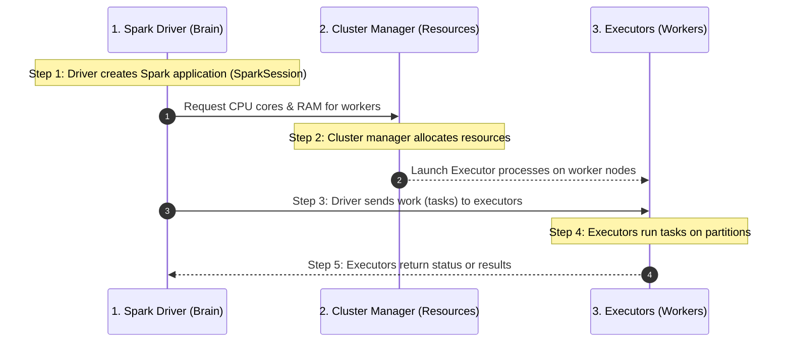
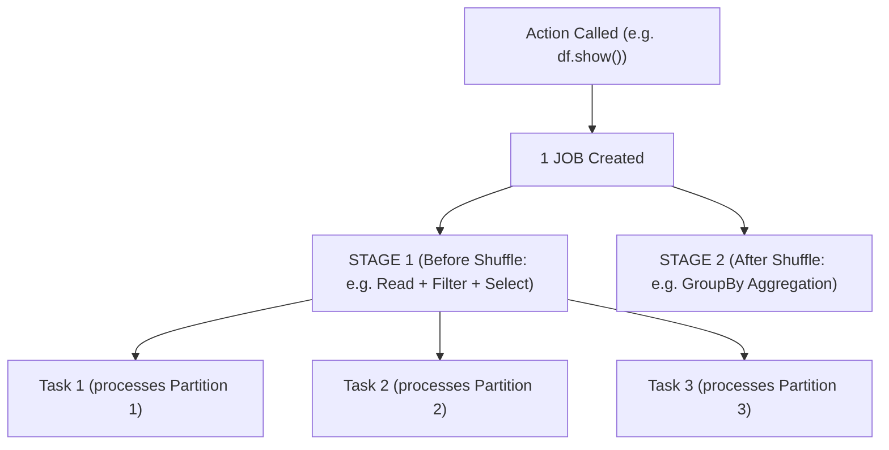

# Week 5 — LAB | Apache Spark Foundations & PySpark DataFrame Transformations

> Imagine **BritMart** (a big UK supermarket chain) has millions of sales records every day. One normal computer using Excel or Pandas would freeze or run out of memory trying to process all of them.
>
> **Apache Spark** solves this by splitting the huge data into smaller chunks (**Partitions**) and spreading the work across many computers (**Executors**), all coordinated by one "boss" program (**The Driver**).
>
> - **PySpark** is simply the Python library that lets us write simple Python code to control Apache Spark!

---

## Quick Vocabulary Cheat Sheet:

| Term                      | Real-World Analogy (Restaurant Kitchen)                 | What It Actually Does in Spark                                                                                                 |
| :------------------------ | :------------------------------------------------------ | :----------------------------------------------------------------------------------------------------------------------------- |
| **Driver**          | **Head Chef** (writes the recipe & gives orders)  | Runs your `main()` code, creates the `SparkSession`, builds the execution plan, and coordinates workers.                   |
| **Executor**        | **Line Cook** (does the actual cooking)           | A worker process on a machine that runs tasks on data partitions and stores cached data in memory (RAM).                       |
| **Cluster Manager** | **Restaurant Manager** (assigns kitchen stations) | Gives CPU cores and RAM to your Spark application (e.g., YARN, Kubernetes, or Spark Standalone).                               |
| **SparkSession**    | **The Kitchen Door / Control Panel**              | The single entry point (`spark`) you use in code to create DataFrames, read files, and run SQL in Spark.                     |
| **Partition**       | **One Tray of Ingredients**                       | A small logical slice of your big dataset that sits in one Executor's memory.                                                  |
| **Task**            | **One Cook Working on One Tray**                  | The smallest unit of work in Spark.**1 Partition = 1 Task**.                                                             |
| **RDD**             | **A Bucket of Raw Ingredients**                   | *Resilient Distributed Dataset*: Spark's low-level distributed list of items (no column names).                              |
| **DataFrame**       | **A Neat Excel / SQL Table**                      | Distributed data organized into**named columns with data types** (much faster and easier than RDDs).                     |
| **Transformation**  | **Writing a Step on the Recipe Card**             | Creates a new DataFrame/RDD (`filter`, `select`, `withColumn`, `groupBy`). **Lazy** — does NOT run immediately! |
| **Action**          | **Ringing the "Order Up!" Bell**                  | Tells Spark to actually run the recipe and produce a result (`show`, `count`, `collect`, `write.parquet`).             |
| **Lazy Evaluation** | **Reading the Whole Recipe Before Cooking**       | Spark waits until you call an**Action** before doing any work, so it can optimize the whole plan first.                  |
| **Shuffle**         | **Cooks Swapping Ingredients Across Tables**      | Moving data across the network between machines (happens during `groupBy`, `join`, `repartition`). Expensive!            |

---

# Part 1 — Spark Applications, Drivers, and Executors

---

## Q. 1 — Driver or Executor?

### Question

Classify each responsibility as **Driver** or **Executor**:

- **A.** Creates the Spark application.
- **B.** Builds the execution plan.
- **C.** Runs tasks on data partitions.
- **D.** Stores cached partition data.
- **E.** Coordinates work across executors.

### Solution

| Statement                                       | Answer             | Why? (Simple Explanation)                                                                                             |
| :---------------------------------------------- | :----------------- | :-------------------------------------------------------------------------------------------------------------------- |
| **A.** Creates the Spark application.     | **Driver**   | Your Python script starts on the Driver and creates the `SparkSession`.                                             |
| **B.** Builds the execution plan.         | **Driver**   | The Driver acts as the "brain" — it reads your transformations and builds the logical & physical plan (DAG).         |
| **C.** Runs tasks on data partitions.     | **Executor** | Executors are the "muscles" — they do the actual heavy lifting (filtering, multiplying, aggregating) on data chunks. |
| **D.** Stores cached partition data.      | **Executor** | When you cache data in Spark, each Executor holds its own partitions in its own RAM/disk.                             |
| **E.** Coordinates work across executors. | **Driver**   | The Driver sends tasks to Executors, watches their progress, and handles retries if an Executor fails.                |

> **Easy Rule to Remember:**
>
> - **Driver = The Brain** (Plans, schedules, coordinates).
> - **Executor = The Muscle** (Runs tasks on partitions, stores cached data).

---

## Q. 2 — Trace a Spark Application

### Question

Put these steps in chronological order:

- Executors run tasks
- Driver creates the Spark application
- Cluster manager allocates resources
- Driver sends work to executors
- Executors return status or results

### Solution (Step-by-Step Order)

1. **Driver creates the Spark application**
2. **Cluster manager allocates resources**
3. **Driver sends work to executors**
4. **Executors run tasks**
5. **Executors return status or results**



> **Beginner Note:**
> Think of opening a restaurant kitchen for the day:
>
> 1. The Head Chef arrives (**Driver creates the application**).
> 2. The Manager assigns kitchen stations and cooks (**Cluster manager allocates resources**).
> 3. The Head Chef hands out recipe tickets (**Driver sends work to executors**).
> 4. The Line Cooks chop and cook the food (**Executors run tasks**).
> 5. The Line Cooks bring the finished plates back or say "Done!" (**Executors return status or results**).

---

## Q. 3 — Create a Local Spark Application

### Question

Create a local Spark application named `britmart_foundations`.
Create a DataFrame from:

```python
[
    (101, "London", 45.50),
    (102, "Manchester", 18.00),
    (103, "Leeds", 30.00),
]
```

Display the rows and stop the session.

### Solution

```python
from pyspark.sql import SparkSession

# 1. Create a local SparkSession named "britmart_foundations"
spark = (
    SparkSession.builder
    .appName("britmart_foundations")
    .master("local[*]")
    .getOrCreate()
)

# 2. Define the input data (list of tuples) and column names
data = [
    (101, "London", 45.50),
    (102, "Manchester", 18.00),
    (103, "Leeds", 30.00),
]
columns = ["order_id", "city", "amount_gbp"]

# 3. Create the DataFrame
df = spark.createDataFrame(data, columns)

# 4. Display the rows (Action!)
df.show()

# 5. Stop the SparkSession to free up memory and CPU resources
spark.stop()
```

### Expected Console Output

```text
+--------+----------+----------+
|order_id|      city|amount_gbp|
+--------+----------+----------+
|     101|    London|      45.5|
|     102|Manchester|      18.0|
|     103|     Leeds|      30.0|
+--------+----------+----------+
```

> **Line-by-Line Explanation for Beginners:**
>
> - `SparkSession.builder`: Starts configuring our connection to Spark.
> - `.appName("britmart_foundations")`: Gives our program a human-readable name (visible in the Spark UI dashboard).
> - `.master("local[*]")`: Tells Spark to run on **our own laptop (local mode)** using all available CPU cores (`*`).
> - `.getOrCreate()`: Creates a new session (or reuses one if it already exists).
> - `spark.createDataFrame(data, columns)`: Turns a normal Python list of tuples into a distributed Spark **DataFrame** with named columns.
> - `df.show()`: An **action** that prints the table nicely to the screen.
> - `spark.stop()`: Always close your session at the end of a script so your computer's RAM is released!

---

## Q. 4 — MCQ: Spark Driver

### Question

What is the main job of the Spark driver?

- **A.** Coordinate the application and plan its work
- **B.** Store every HDFS block
- **C.** Replace the cluster manager
- **D.** Run every task on every worker

### Solution

- **Correct Answer:** **A. Coordinate the application and plan its work**

> **Why the others are wrong:**
>
> - *B is wrong* because HDFS DataNodes store HDFS blocks, not the Spark Driver.
> - *C is wrong* because the Driver works *with* the Cluster Manager (like YARN or Kubernetes), it does not replace it.
> - *D is wrong* because **Executors** run the tasks on the workers, not the Driver.

---

# Part 2 — Cluster Managers, Local Mode, SparkSession, and RDDs

---

## Q. 5 — Local or Cluster?

### Question

Choose the better mode (**Local mode** or **Cluster mode**) for each scenario:

- **A.** Small demonstration on one laptop.
- **B.** Production processing across many machines.
- **C.** Testing basic syntax during training.
- **D.** Shared processing of several terabytes.

### Solution

| Scenario                                                 | Better Mode            | Why?                                                                                            |
| :------------------------------------------------------- | :--------------------- | :---------------------------------------------------------------------------------------------- |
| **A.** Small demonstration on one laptop.          | **Local mode**   | Everything runs inside one machine (your laptop). No cluster setup needed!                      |
| **B.** Production processing across many machines. | **Cluster mode** | Uses multiple servers working together for speed, high memory, and fault tolerance.             |
| **C.** Testing basic syntax during training.       | **Local mode**   | Fast and simple for learning PySpark commands on small sample data.                             |
| **D.** Shared processing of several terabytes.     | **Cluster mode** | Several terabytes won't fit in one laptop's RAM — you need many worker nodes sharing the load. |

---

## Q. 6 — Read a Local Master Setting

### Question

Explain:

```python
.master("local[4]")
```

What does the `4` mean?

### Solution

- **Answer:** `.master("local[4]")` tells Spark to run in **local mode** (on a single machine, such as your laptop) using **4 worker threads (4 CPU cores)** to execute tasks in parallel.

> **Bonus Tip — Other `local` Variations You Will See in Class:**
>
> - `.master("local")` or `.master("local[1]")` → Uses only **1 thread / 1 CPU core** (no parallelism).
> - `.master("local[4]")` → Uses **4 threads / 4 CPU cores** in parallel.
> - `.master("local[*]")` → Uses **all logical CPU cores** available on your computer (e.g., if your Mac has 8 cores, it uses 8 threads).

---

## Q. 7 — Use an RDD

### Question

Create a complete Spark program using:

```python
amounts = [45.50, 18.00, 62.25, 12.00]
```

Tasks:

- create an RDD;
- keep values greater than `20`;
- multiply retained values by `1.10`;
- collect and print the result.

### Solution

```python
from pyspark.sql import SparkSession

# 1. Start the SparkSession
spark = (
    SparkSession.builder
    .appName("britmart_rdd_exercise")
    .master("local[*]")
    .getOrCreate()
)

# To work with RDDs, we access SparkContext via spark.sparkContext
sc = spark.sparkContext

# 2. Input Python list
amounts = [45.50, 18.00, 62.25, 12.00]

# 3. Create an RDD from the Python list
amounts_rdd = sc.parallelize(amounts)

# 4. Keep values greater than 20 (Transformation: filter)
filtered_rdd = amounts_rdd.filter(lambda x: x > 20)

# 5. Multiply retained values by 1.10 (Transformation: map)
# (We use round(..., 4) or standard multiplication x * 1.10)
taxed_rdd = filtered_rdd.map(lambda x: x * 1.10)

# 6. Collect the results back to the driver and print (Action: collect)
result = taxed_rdd.collect()
print(result)

# 7. Stop the SparkSession
spark.stop()
```

### Expected Console Output

```text
[50.050000000000004, 68.47500000000001]
```

*(Or `[50.05, 68.475]` — note that in Python floating-point math, `45.50 * 1.10 = 50.05` and `62.25 * 1.10 = 68.475`!)*

> **Beginner Notes — How This RDD Pipeline Works Step-by-Step:**
>
> 1. **`sc.parallelize(amounts)`**: Takes our regular Python list `[45.50, 18.00, 62.25, 12.00]` and distributes it into an **RDD** across our CPU cores.
> 2. **`.filter(lambda x: x > 20)`**: Checks each number `x`. Is `45.50 > 20`? Yes! Is `18.00 > 20`? No (dropped). Is `62.25 > 20`? Yes! Is `12.00 > 20`? No (dropped). Only `[45.50, 62.25]` remain.
> 3. **`.map(lambda x: x * 1.10)`**: Multiplies every remaining number by `1.10` (for example, adding a 10% tax or fee).
> 4. **`.collect()`**: Up until now, Spark was **lazy** and hadn't calculated anything! Calling `.collect()` is an **Action** that runs the pipeline and brings the final answers back as a regular Python list so we can `print()` it.

---

## Q. 8 — MCQ: Cluster Manager

### Question

What does a Spark cluster manager mainly allocate?

- **A.** Business rules
- **B.** DataFrame column names
- **C.** Python variable names
- **D.** CPU and memory resources

### Solution

- **Correct Answer:** **D. CPU and memory resources**

> **Why?**
> A Cluster Manager (such as **Apache YARN**, **Kubernetes**, or **Spark Standalone**) only cares about hardware resources: how many **CPU cores** and how many gigabytes of **RAM (memory)** each machine has available to run Spark Executors. It knows nothing about your Python variables or DataFrame columns!

---

# Part 3 — DataFrames, Transformations, and Actions

---

## Q. 9 — Identify Transformations and Actions

### Question

Classify each operation as a **Transformation** or an **Action**:

- `filter()`
- `select()`
- `show()`
- `count()`
- `withColumn()`
- `write.parquet()`

### Solution

| Operation                     | Classification           | Why? (Simple Explanation)                                                                 |
| :---------------------------- | :----------------------- | :---------------------------------------------------------------------------------------- |
| **`filter()`**        | **Transformation** | Returns a new DataFrame with matching rows.**Lazy** (just adds a step to the plan). |
| **`select()`**        | **Transformation** | Returns a new DataFrame with specific columns.**Lazy** (no data processed yet).     |
| **`show()`**          | **Action**         | Triggers execution and prints the top rows to the console screen.                         |
| **`count()`**         | **Action**         | Triggers execution and returns the total number of rows as a Python integer.              |
| **`withColumn()`**    | **Transformation** | Returns a new DataFrame with an added or modified column.**Lazy**.                  |
| **`write.parquet()`** | **Action**         | Triggers execution of the whole pipeline and saves the output files to disk/HDFS/S3.      |

> **How to Tell Them Apart in 2 Seconds:**
> Ask yourself: *"Does this give me a brand-new DataFrame recipe, or does it force Spark to show/count/save the answer right now?"*
>
> - Gives a **new DataFrame** (`filter`, `select`, `withColumn`, `groupBy`, `join`) $\rightarrow$ **Transformation (Lazy)**.
> - **Prints, returns a number/list, or writes a file** (`show`, `count`, `collect`, `write.parquet`) $\rightarrow$ **Action (Eager)**.

---

## Q. 10 — Filter and Select

### Question

Create a complete Spark program with:

```python
data = [
    (101, "London", 45.50, "complete"),
    (102, "Manchester", 18.00, "cancelled"),
    (103, "London", 62.25, "complete"),
]
```

Keep completed rows and display only:

- `order_id`
- `city`
- `amount_gbp`

### Solution

```python
from pyspark.sql import SparkSession
from pyspark.sql.functions import col

# 1. Create the SparkSession
spark = (
    SparkSession.builder
    .appName("britmart_filter_select")
    .master("local[*]")
    .getOrCreate()
)

# 2. Define data and column names
data = [
    (101, "London", 45.50, "complete"),
    (102, "Manchester", 18.00, "cancelled"),
    (103, "London", 62.25, "complete"),
]
columns = ["order_id", "city", "amount_gbp", "status"]

# 3. Create DataFrame
orders_df = spark.createDataFrame(data, columns)

# 4. Keep only completed rows (Transformation) and select the 3 required columns (Transformation)
result_df = (
    orders_df
    .filter(col("status") == "complete")   # You can also write: .filter("status = 'complete'")
    .select("order_id", "city", "amount_gbp")
)

# 5. Display the result (Action)
result_df.show()

# 6. Stop the session
spark.stop()
```

### Expected Console Output

```text
+--------+------+----------+
|order_id|  city|amount_gbp|
+--------+------+----------+
|     101|London|      45.5|
|     103|London|     62.25|
+--------+------+----------+
```

> **Beginner Note:**
> Notice how row `102` (`"Manchester"`, `"cancelled"`) was removed by `.filter()`, and the `"status"` column was hidden by `.select("order_id", "city", "amount_gbp")`.
> In PySpark, both `.filter(col("status") == "complete")` and `.filter("status = 'complete'")` work identically!

---

## Q. 11 — Group and Aggregate

### Question

Create a complete Spark program using:

```python
data = [
    (101, "London", 45.50),
    (102, "Leeds", 30.00),
    (103, "London", 62.25),
    (104, "Leeds", 20.00),
]
```

Calculate total sales by city.

### Solution

```python
from pyspark.sql import SparkSession
from pyspark.sql import functions as F

# 1. Create the SparkSession
spark = (
    SparkSession.builder
    .appName("britmart_group_aggregate")
    .master("local[*]")
    .getOrCreate()
)

# 2. Define data and column names
data = [
    (101, "London", 45.50),
    (102, "Leeds", 30.00),
    (103, "London", 62.25),
    (104, "Leeds", 20.00),
]
columns = ["order_id", "city", "amount_gbp"]

# 3. Create DataFrame
df = spark.createDataFrame(data, columns)

# 4. Group by city and calculate total sales using sum()
sales_by_city_df = (
    df.groupBy("city")
    .agg(F.sum("amount_gbp").alias("total_sales_gbp"))
)

# 5. Display the result
sales_by_city_df.show()

# 6. Stop the session
spark.stop()
```

*(Note: Writing `df.groupBy("city").sum("amount_gbp").show()` also works as a quick shorthand! Using `.agg(F.sum("amount_gbp").alias("total_sales_gbp"))` is best practice because it lets you give the new column a clean name.)*

### Expected Console Output

```text
+------+---------------+
|  city|total_sales_gbp|
+------+---------------+
|London|         107.75|
| Leeds|           50.0|
+------+---------------+
```

> **Beginner Note:**
>
> - **London**: $45.50 + 62.25 = 107.75$
> - **Leeds**: $30.00 + 20.00 = 50.00$
> - `.groupBy("city")` gathers rows with the same city together, and `.agg(F.sum("amount_gbp"))` adds up their amounts—just like `SELECT city, SUM(amount_gbp) FROM sales GROUP BY city` in SQL!

---

## Q. 12 — MCQ: Action

### Question

Which operation triggers Spark execution?

- **A.** `filter()`
- **B.** `show()`
- **C.** `select()`
- **D.** `withColumn()`

### Solution

- **Correct Answer:** **B. `show()`**

> **Why?**
> `filter()`, `select()`, and `withColumn()` are all **lazy transformations** — they only build the execution plan. **`show()`** is an **action** that forces Spark to run the job and display the output on your screen.

---

# Part 4 — Lazy Evaluation, Jobs, Stages, Tasks, and Shuffles

---

## Q. 13 — Explain Lazy Evaluation

### Question

Review:

```python
completed = orders.filter("status = 'complete'")
selected = completed.select("city", "amount_gbp")
```

No action has run.
What has Spark done so far?

### Solution

- **Answer:**
  So far, Spark has **not processed any data rows at all**.
  Instead, Spark has only:

  1. Checked that the column names (`status`, `city`, `amount_gbp`) exist in the `orders` schema, and
  2. Recorded the `filter` and `select` steps inside `selected`'s **logical execution plan (DAG / lineage)**.

  Spark will wait until an **action** (such as `selected.show()`, `selected.count()`, or `selected.write.parquet(...)`) is called before reading or filtering a single row of data.

> **Why Does Spark Do This? (Real-World Benefit):**
> Because Spark waits until the end, its **Catalyst Optimizer** can read your entire recipe first and combine steps! For example, it sees that you only need `"city"`, `"amount_gbp"`, and `"status"`, so if `orders` had 50 other columns, Spark won't even bother reading those 50 columns from disk!

---

## Q. 14 — Job, Stage, Task, or Partition?

### Question

Match each description to the correct term (**Job**, **Stage**, **Task**, or **Partition**):

- **A.** Work created when an action triggers execution.
- **B.** A group of tasks separated by shuffle boundaries.
- **C.** One unit of work on one partition.
- **D.** A logical slice of distributed data.

### Solution

| Description                                                    | Matching Term       | How to Visualize It                                                                                |
| :------------------------------------------------------------- | :------------------ | :------------------------------------------------------------------------------------------------- |
| **A.** Work created when an action triggers execution.   | **Job**       | Every time you call 1 Action (like `.show()`), Spark creates **1 Job**.                    |
| **B.** A group of tasks separated by shuffle boundaries. | **Stage**     | A Job is broken into**Stages** whenever data needs to be shuffled across machines.           |
| **C.** One unit of work on one partition.                | **Task**      | One single thread on an Executor processing one single partition (**1 Task per Partition**). |
| **D.** A logical slice of distributed data.              | **Partition** | A chunk of your dataset stored in memory on an Executor.                                           |



---

## Q. 15 — Identify Shuffle Operations

### Question

Choose whether a **shuffle is likely** (`Shuffle` vs `No shuffle`):

- `filter rows by status`
- `select two columns`
- `groupBy city`
- `join two large DataFrames by customer_id`
- `repartition by city`

### Solution

| Operation                                              | Shuffle Likely?                 | Why? (Narrow vs. Wide Transformation)                                                                                                                                  |
| :----------------------------------------------------- | :------------------------------ | :--------------------------------------------------------------------------------------------------------------------------------------------------------------------- |
| **`filter rows by status`**                    | **No shuffle**            | **Narrow transformation:** Each Executor can check `status == 'complete'` on its own local partition without talking to other machines.                        |
| **`select two columns`**                       | **No shuffle**            | **Narrow transformation:** Each Executor simply drops the unwanted columns in its own local partition.                                                           |
| **`groupBy city`**                             | **Yes — Shuffle likely** | **Wide transformation:** Rows for `"London"` might live on 4 different machines. Spark must move them over the network into the same partition to sum them up! |
| **`join two large DataFrames by customer_id`** | **Yes — Shuffle likely** | **Wide transformation:** Matching `customer_id` rows from both large tables must be sent across the network to meet on the same Executor.                      |
| **`repartition by city`**                      | **Yes — Shuffle likely** | **Wide transformation:** Explicitly instructs Spark to redistribute rows across partitions over the network based on `city`.                                   |

---

## Q. 16 — MCQ: Shuffle

### Question

Which operation commonly causes a shuffle?

- **A.** `select("city")`
- **B.** Rename a Python variable
- **C.** `groupBy("city")`
- **D.** Create a string variable

### Solution

- **Correct Answer:** **C. `groupBy("city")`**

> **Why?**
> To group records by `"city"`, Spark must bring all rows with the same city value from different partitions/machines together across the network — which is the exact definition of a **shuffle**.

---

# Optional Practice (Q. 17 – Q. 20)

---

## Q. 17 — Inspect a Spark Plan

### Question

Create a complete Spark program that:

- creates a DataFrame;
- filters completed orders;
- groups by city;
- calls `explain()`;
- then calls `show()`.

Use:

```python
data = [
    (101, "London", 45.50, "complete"),
    (102, "Manchester", 18.00, "cancelled"),
    (103, "London", 62.25, "complete"),
]
```

### Solution

```python
from pyspark.sql import SparkSession
from pyspark.sql import functions as F

# 1. Start the SparkSession
spark = (
    SparkSession.builder
    .appName("britmart_inspect_plan")
    .master("local[*]")
    .getOrCreate()
)

# 2. Define data and columns
data = [
    (101, "London", 45.50, "complete"),
    (102, "Manchester", 18.00, "cancelled"),
    (103, "London", 62.25, "complete"),
]
columns = ["order_id", "city", "amount_gbp", "status"]

# 3. Create the DataFrame
df = spark.createDataFrame(data, columns)

# 4. Filter completed orders and group by city
summary_df = (
    df.filter(F.col("status") == "complete")
    .groupBy("city")
    .agg(F.sum("amount_gbp").alias("total_amount_gbp"))
)

# 5. Inspect the physical execution plan that Spark will use
print("--- SPARK EXECUTION PLAN ---")
summary_df.explain()

# 6. Trigger execution and display the rows
print("--- FINAL RESULT ---")
summary_df.show()

# 7. Stop the session
spark.stop()
```

### Expected Console Output

```text
--- SPARK EXECUTION PLAN ---
== Physical Plan ==
AdaptiveSparkPlan isFinalPlan=false
+- HashAggregate(keys=[city#1], functions=[sum(amount_gbp#2)])
   +- Exchange hashpartitioning(city#1, 200), ENSURE_REQUIREMENTS, [plan_id=...]
      +- HashAggregate(keys=[city#1], functions=[partial_sum(amount_gbp#2)])
         +- Project [city#1, amount_gbp#2]
            +- Filter (isnotnull(status#3) AND (status#3 = complete))
               +- Scan ExistingRDD[order_id#0L,city#1,amount_gbp#2,status#3]

--- FINAL RESULT ---
+------+----------------+
|  city|total_amount_gbp|
+------+----------------+
|London|          107.75|
+------+----------------+
```

> **How to Read `df.explain()` Like a Pro (Read from Bottom to Top!):**
>
> 1. **`Scan ExistingRDD`**: Reads the input data.
> 2. **`Filter (... status = complete)`**: Filters out cancelled rows right away.
> 3. **`Project [city, amount_gbp]`**: Drops `order_id` and `status` early so less data is moved around!
> 4. **`HashAggregate (partial_sum)`**: Each Executor adds up the London sales it has locally first (this saves network traffic!).
> 5. **`Exchange hashpartitioning(city)`**: **Exchange = SHUFFLE!** Spark sends the partial sums for each city across the network to the same partition.
> 6. **`HashAggregate (sum)`**: Combines the partial sums into the final total (`107.75`).

---

## Q. 18 — Calculate Tasks from Partitions

### Question

A stage processes **12 partitions**.
Assume one task is created per partition.
How many tasks are created in that stage?

### Solution

- **Answer:** **12 tasks**

> **Golden Rule of Spark Parallelism:**
> Within a single stage, **1 Partition = 1 Task**.
>
> - If a stage has **12 partitions**, Spark creates **12 tasks**.
> - If your machine has `local[4]` (4 CPU cores), those 4 cores will run 4 tasks at a time until all 12 tasks are finished!

---

## Q. 19 — Find the Driver Risk

### Question

A DataFrame contains **50 million rows**.
A developer runs:

```python
rows = df.collect()
```

Explain the risk.

### Solution

- **Answer:**
  Running `df.collect()` forces Spark to send **all 50 million rows** from all distributed Executors over the network into the **single Spark Driver machine's memory (RAM)** as a regular Python list.
  - **The Risk:** A single Driver machine does not have enough RAM to hold 50 million rows at once. This will bottleneck the network, freeze the program, and crash the Driver with a **`java.lang.OutOfMemoryError` (OOM)**.

> **What Should the Developer Do Instead?**
>
> 1. **To inspect a few rows safely:** Use `df.show(20)` or `df.take(10)` (only brings 10–20 rows to the Driver).
> 2. **To summarize data:** Filter or aggregate in Spark first (`df.groupBy(...).count().collect()`) so only a tiny summary table comes back to the Driver.
> 3. **To save all 50 million rows:** Write directly from the Executors to distributed storage using `df.write.parquet("s3://.../output/")` — that way the 50 million rows never pass through the Driver!

---

## Q. 20 — Compare Two Spark Pipelines

### Question

- **Pipeline A:** `filter -> select -> show`
- **Pipeline B:** `groupBy -> aggregation -> show`

Which pipeline is more likely to contain a shuffle and why?

### Solution

- **Answer:**
  **Pipeline B (`groupBy -> aggregation -> show`)** is much more likely to contain a **shuffle**.
- **Why?**
  - In **Pipeline A**, both `filter` and `select` are **narrow transformations**. Every partition can be filtered and have its columns selected independently inside its own Executor's memory without needing any data from other partitions. No data needs to travel across the network.
  - In **Pipeline B**, `groupBy` followed by an `aggregation` is a **wide transformation**. Because rows belonging to the same group key (for example, `"London"`) may be scattered across many different partitions on different machines, Spark must perform a **shuffle** (network exchange) to bring all rows with the same key into the same partition before it can calculate the final aggregate total.

---

## Final Check — Summary Checklist for Your Exam / Lab Review

- [X] **Driver vs. Executor:** Driver = Brain (creates session, builds DAG plan, coordinates). Executor = Muscle (runs tasks on partitions, stores cached data).
- [X] **Local vs. Cluster Mode:** Local (`local[4]`, `local[*]`) runs on one laptop for learning/testing. Cluster runs across many machines for big production workloads.
- [X] **SparkSession:** Created with `SparkSession.builder.appName("...").master("...").getOrCreate()`. Stopped with `spark.stop()`.
- [X] **RDDs:** Low-level distributed collections created with `sc.parallelize(...)`, transformed with `.filter()` and `.map()`, collected with `.collect()`.
- [X] **DataFrames:** Structured distributed tables with named columns (`spark.createDataFrame(data, columns)`).
- [X] **Transformations vs. Actions:** Transformations (`filter`, `select`, `withColumn`, `groupBy`) are **lazy** recipes. Actions (`show`, `count`, `collect`, `write.parquet`) trigger actual work.
- [X] **Jobs, Stages, Tasks, Partitions:** 1 Action $\rightarrow$ 1 Job $\rightarrow$ split into Stages at Shuffle boundaries $\rightarrow$ 1 Task per Partition.
- [X] **Shuffle Operations:** Wide transformations (`groupBy`, `join`, `repartition`) move data across the network between stages; narrow transformations (`filter`, `select`) do not.
