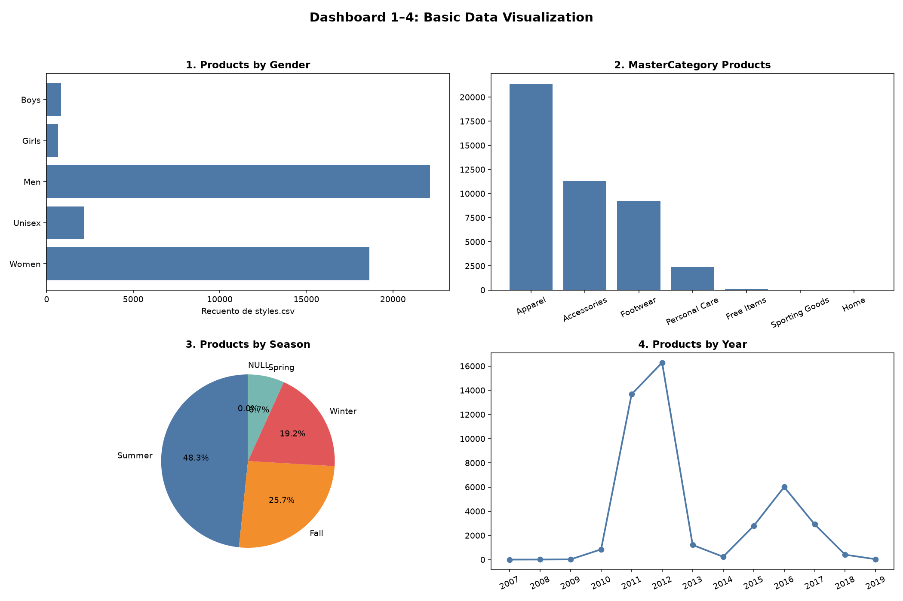
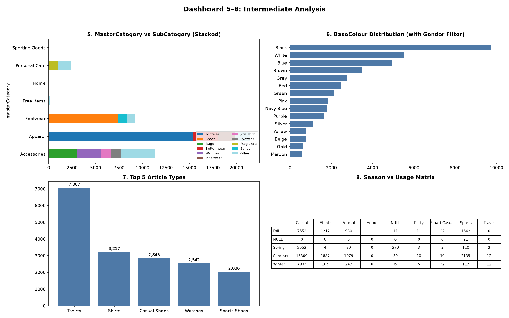
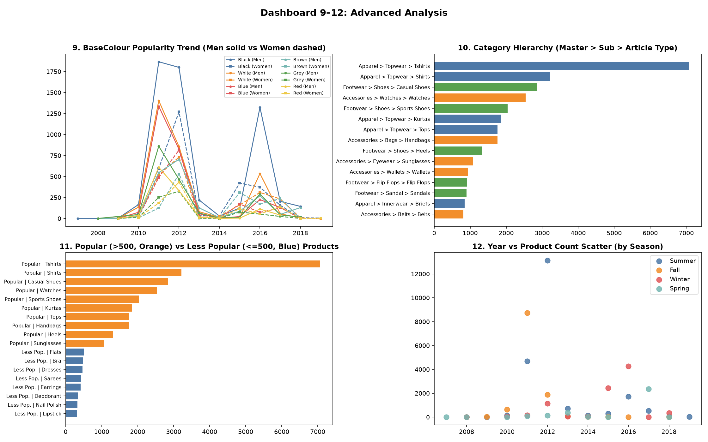
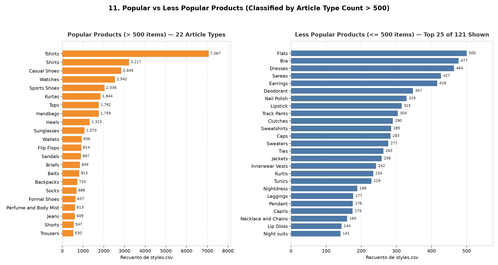

# Week 07 - Day 01: Fashion Styles Data Visualization & Dashboards (Tableau)

This folder contains the complete solution for the **`styles.csv`** visualization exercise built in **Tableau Public**, covering all 12 charts across **Basic**, **Intermediate**, and **Advanced Analysis**.

---

## 📊 Dashboard Previews

### 1. Dashboard 1–4 (Basic Data Visualization)


### 2. Dashboard 5–8 (Intermediate Analysis)


### 3. Dashboard 9–12 (Advanced Analysis)


### Detailed View — Exercise 11: Popular (> 500) vs Less Popular (≤ 500) Products by `Article Type`


---

## 🌐 Live Interactive Dashboards (Tableau Public)

| Dashboard | Charts Included | Live Link |
| :--- | :--- | :--- |
| **Dashboard 1–4 (Basic Analysis)** | 1. Products by Gender<br>2. MasterCategory Products<br>3. Products by Season<br>4. Products by Year | [🔗 Open Dashboard 1–4 Online](https://public.tableau.com/views/Dashboards9-12/Dashboard1-4) |
| **Dashboard 5–8 (Intermediate Analysis)** | 5. Stacked Bar Chart (`masterCategory` vs `subCategory`)<br>6. BaseColour by Gender (with Gender Slicer/Filter)<br>7. Top 5 Article Types<br>8. Season vs Usage Matrix | [🔗 Open Dashboard 5–8 Online](https://public.tableau.com/views/Dashboards9-12/Dashboard5-8) |
| **Dashboard 9–12 (Advanced Analysis)** | 9. BaseColour Trend (`Men` vs `Women` over `Year`)<br>10. Category Hierarchy (`masterCategory` > `subCategory` > `articleType`)<br>11. Popular vs Less Popular (`> 500` Calculated Field with `Article Type`)<br>12. Year vs Count Scatter (by `Season`) | [🔗 Open Dashboard 9–12 Online](https://public.tableau.com/views/Dashboards9-12/Dashboard9-12) |

---

## 📋 Summary of Completed Visualizations

### 1. Basic Data Visualization
1. **Products by Gender:** Horizontal bar chart showing total product count per `gender`. ([View Sheet](https://public.tableau.com/views/Dashboards9-12/ProductsbyGender))
2. **MasterCategory Products:** Vertical column chart displaying the count of products by `masterCategory`. ([View Sheet](https://public.tableau.com/views/Dashboards9-12/MasterCategoryProducts))
3. **Products by Season:** Pie chart showing the proportion of products across different `season` values. ([View Sheet](https://public.tableau.com/views/Dashboards9-12/ProductsbySeason))
4. **Products by Year:** Line chart representing the number of products added each `year`. ([View Sheet](https://public.tableau.com/views/Dashboards9-12/ProductsbyYear))

### 2. Intermediate Analysis
5. **MasterCategory vs SubCategory:** Stacked bar chart showing `masterCategory` broken down by `subCategory` with counts. ([View Sheet](https://public.tableau.com/views/Dashboards9-12/5_Stackedbarchart))
6. **BaseColour by Gender:** Distribution of `baseColour` with an interactive `gender` filter/slicer. ([View Sheet](https://public.tableau.com/views/Dashboards9-12/6_BaseColourbyGender))
7. **Top 5 Article Types:** Column chart filtered to the top 5 most common `articleType` categories (`Tshirts`, `Shirts`, `Casual Shoes`, `Watches`, `Sports Shoes`). ([View Sheet](https://public.tableau.com/views/Dashboards9-12/7_Top5ArticleTypes))
8. **Season vs Usage Matrix:** Matrix/crosstab visual displaying `season` vs `usage` product counts with row and column totals. ([View Sheet](https://public.tableau.com/views/Dashboards9-12/8_SeasonvsUsageMatrix))

### 3. Advanced Analysis
9. **BaseColour Popularity Trend:** Line trend analysis showing how `baseColour` popularity changes over `year` for **Men** and **Women** separately. ([View Sheet](https://public.tableau.com/views/Dashboards9-12/9_BaseColourTrend))
10. **Category Hierarchy:** Drill-down hierarchy (`Master Category` $\rightarrow$ `Sub Category` $\rightarrow$ `Article Type`) showing total products. ([View Sheet](https://public.tableau.com/views/Dashboards9-12/10_CategoryHierarchy))
11. **Popular vs Less Popular Products (Calculated Field):**
    - **Formula (`Popularity`):**
      ```text
      IF { FIXED [Article Type] : COUNT([Id]) } > 500 THEN "Popular" ELSE "Less Popular" END
      ```
    - **Popular Products (`> 500` items — 22 Article Types, 34,228 total items):**
      `Tshirts` (7,067), `Shirts` (3,217), `Casual Shoes` (2,845), `Watches` (2,542), `Sports Shoes` (2,036), `Kurtas` (1,844), `Tops` (1,762), `Handbags` (1,759), `Heels` (1,323), `Sunglasses` (1,073), `Wallets` (936), `Flip Flops` (914), `Sandals` (897), `Briefs` (849), `Belts` (813), `Backpacks` (724), `Socks` (686), `Formal Shoes` (637), `Perfume and Body Mist` (613), `Jeans` (609), `Shorts` (547), `Trousers` (533).
    - **Less Popular Products (`≤ 500` items — 121 Article Types, 10,216 total items):**
      `Flats` (500), `Bra` (477), `Dresses` (464), `Sarees` (427), `Earrings` (417), `Deodorant` (347), `Nail Polish` (329), `Lipstick` (315), `Track Pants` (304), `Clutches` (289), `Sweatshirts` (285), `Caps` (283), `Sweaters` (277), `Ties` (263), `Jackets` (258), `Innerwear Vests` (242), `Kurtis` (234), `Tunics` (229), `Nightdress` (189), `Leggings` (177), `Pendant` (176), `Capris` (173), `Necklace and Chains` (160), `Lip Gloss` (144), `Night suits` (141), and 96 more categories.
    - ([View Sheet](https://public.tableau.com/views/Dashboards9-12/11_PopularvsLessPopular))
12. **Year vs Product Count Scatter Chart:** Scatter plot of `year` vs product count with `season` as the color legend. ([View Sheet](https://public.tableau.com/views/Dashboards9-12/12_YearvsCountScatter))

---

## 📁 Files in This Folder

- **`Styles_Dashboards_1-12.twbx`** — Complete packaged Tableau workbook containing all 12 sheets (including updated Sheet 11 with `Article Type` + `Popularity` bars & colors), all 3 dashboards, and the data extract.
- **`images/`** — Direct visual snapshots of all 3 dashboards and Exercise 11.
- **`styles.csv`** — Source dataset (44,446 product records).
- **`POWER BI(styles.csv).docx`** — Original exercise instructions.
