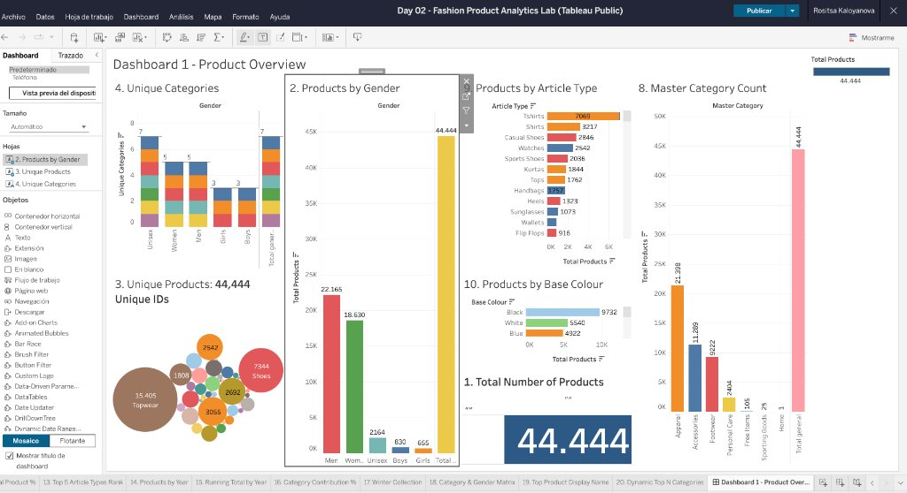
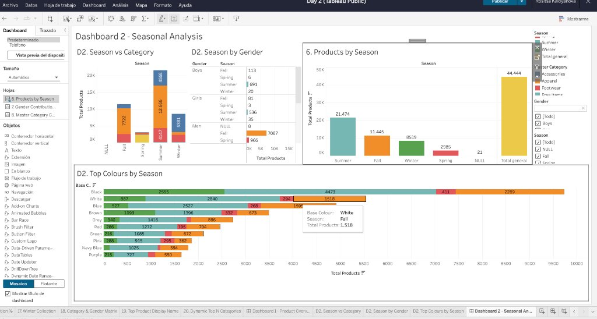

# Week 07 - Day 02: Fashion Product Analytics Lab (Power BI DAX & Tableau)

Complete step-by-step solutions for the **Fashion Product Analytics Lab (`styles.csv`)**, covering **Data Preparation (Part 1)**, **20 Guided Calculations in both Power BI DAX & Tableau (Parts 2–4)**, **3 Interactive Dashboards (Part 5)**, and **10 Independent Assessment Solutions (Part 6)**.

---

## 🌐 Live Interactive Dashboards (Tableau Public)

| Dashboard | Charts & Controls Included | Live Link |
| :--- | :--- | :--- |
| **Dashboard 1 – Product Overview** | KPIs (`1. Total Products`, `3. Unique Products`, `4. Unique Categories`), `2. Products by Gender`, `8. Master Category Count`, `9. Products by Article Type`, `10. Products by Base Colour` + Interactive Filters (`Gender`, `Master Category`, `Year`) | [🔗 Open Dashboard 1 Online](https://public.tableau.com/views/Day2WEEK07/Dashboard1-ProductOverview) |
| **Dashboard 2 – Seasonal Analysis** | `6. Products by Season`, `D2. Season vs Category`, `D2. Season by Gender`, `D2. Top Colours by Season` + Interactive Filters (`Gender`, `Season`, `Year`) | [🔗 Open Dashboard 2 Online](https://public.tableau.com/views/Day2WEEK07/Dashboard2-SeasonalAnalysis) |
| **Dashboard 3 – Product Intelligence** | `13. Top 5 Article Types Rank`, `D3. Usage Distribution`, `14. Products by Year`, `15. Running Total by Year`, `16. Category Contribution %`, `20. Dynamic Top N Categories` (`Top N` Selector) + Interactive Filters (`Gender`, `Season`, `Master Category`, `Year`) | [🔗 Open Dashboard 3 Online](https://public.tableau.com/views/Day2WEEK07/Dashboard3-ProductIntelligence) |

### 📊 Dashboard Previews

#### 1. Dashboard 1 – Product Overview


#### 2. Dashboard 2 – Seasonal Analysis


---

## 📊 Part 1 – Dataset Profile & Data Checks

| Metric / Field | Expected Check | Verified Value |
| :--- | :--- | :--- |
| **`id`** | Rows & distinct IDs | **44,446** rows / **44,446** unique IDs *(44,444 in Tableau CSV parser due to 2 unescaped `"` quotes)* |
| **`gender`** | Distinct values; missing values | **5** distinct values (`Men`, `Women`, `Unisex`, `Boys`, `Girls`); **0** missing |
| **`masterCategory`** | Distinct values | **7** distinct values |
| **`articleType`** | Distinct values | **143** distinct values |
| **`baseColour`** | Distinct values; missing values | **46** distinct colours; **15** missing (`NA`) |
| **`season`** | Missing values | **21** missing values (`Null`) |
| **`usage`** | Missing values | **317** missing values (`316` `"NA"` + `1` `Null`) |
| **`year`** | Missing values | **1** missing value (`Null`) |
| **`productDisplayName`** | Missing values | **7** missing values (`Null` / `"NA"`) |

---

## 🟢 Part 2 – Beginner Exercises (1–6)

### 1. Total number of products
- **Power BI (DAX):**
  ```dax
  Total Products = COUNTROWS(Styles)
  ```
- **Tableau:**
  ```text
  COUNT([Id])
  ```
- **Result:** **`44,446`** records (`44,444` in Tableau).

### 2. Products by gender
- **Power BI (DAX):**
  ```dax
  Products by Gender = COUNT(Styles[id])
  ```
- **Tableau:**
  ```text
  COUNT([Id])
  ```
- **Result:**
  - **Men:** `22,165`
  - **Women:** `18,632`
  - **Unisex:** `2,164`
  - **Boys:** `830`
  - **Girls:** `655`

### 3. Unique product IDs
- **Power BI (DAX):**
  ```dax
  Unique Products = DISTINCTCOUNT(Styles[id])
  ```
- **Tableau:**
  ```text
  COUNTD([Id])
  ```
- **Result:** **`44,446`** unique IDs.

### 4. Number of product categories
- **Power BI (DAX):**
  ```dax
  Unique Categories = DISTINCTCOUNT(Styles[masterCategory])
  ```
- **Tableau:**
  ```text
  COUNTD([Master Category])
  ```
- **Result:** **`7`** master categories (`Apparel`, `Accessories`, `Footwear`, `Personal Care`, `Free Items`, `Sporting Goods`, `Home`).

### 5. Missing usage values
- **Power BI (DAX):**
  ```dax
  Missing Usage =
  COUNTROWS(
      FILTER(Styles, ISBLANK(Styles[usage]))
  )
  ```
- **Tableau:**
  ```text
  SUM(IIF(ISNULL([Usage]) OR [Usage] = "NA", 1, 0))
  ```
- **Result:** **`317`** missing usage values (`Personal Care: 263`, `Accessories: 28`, `Apparel: 24`, `Footwear: 2`).

### 6. Products by season
- **Power BI (DAX):**
  ```dax
  Season Product Count = COUNTROWS(Styles)
  ```
- **Tableau:**
  ```text
  COUNT([Id])
  ```
- **Result:**
  - **Summer:** `21,476`
  - **Fall:** `11,445`
  - **Winter:** `8,519`
  - **Spring:** `2,985`
  - **Missing (`Null`):** `21`

---

## 🟡 Part 3 – Intermediate Exercises (7–12)

### 7. Gender contribution percentage
- **Power BI (DAX):**
  ```dax
  Gender Contribution % =
  DIVIDE(
      [Products by Gender],
      CALCULATE(
          [Total Products],
          REMOVEFILTERS(Styles[gender])
      ),
      0
  )
  ```
- **Tableau:**
  ```text
  COUNT([Id]) / MIN({ FIXED : COUNT([Id]) })
  ```
- **Result:**
  - **Men:** **`49.87%`**
  - **Women:** `41.92%`
  - **Unisex:** `4.87%`
  - **Boys:** `1.87%`
  - **Girls:** `1.47%`

### 8. Most common master category
- **Power BI (DAX):**
  ```dax
  Category Product Count = COUNTROWS(Styles)
  ```
- **Tableau:**
  ```text
  COUNT([Id])
  ```
- **Result:** **`Apparel – 21,400`** products (`Accessories: 11,289`, `Footwear: 9,222`, `Personal Care: 2,404`, `Free Items: 105`, `Sporting Goods: 25`, `Home: 1`).

### 9. Products by article type
- **Power BI (DAX):**
  ```dax
  Article Count = COUNTROWS(Styles)
  ```
- **Tableau:**
  ```text
  COUNT([Id])
  ```
- **Result (Top 5):**
  1. **Tshirts:** `7,070`
  2. **Shirts:** `3,217`
  3. **Casual Shoes:** `2,846`
  4. **Watches:** `2,542`
  5. **Sports Shoes:** `2,036`

### 10. Most common base colour
- **Power BI (DAX):**
  ```dax
  Colour Product Count = COUNTROWS(Styles)
  ```
- **Tableau:**
  ```text
  COUNT([Id])
  ```
- **Result:** **`Black – 9,732`** products (`White: 5,540`, `Blue: 4,922`, `Brown: 3,494`, `Grey: 2,741`, `Missing/NA: 15`).

### 11. Create a gender segment
- **Power BI (DAX):**
  ```dax
  Gender Segment =
  SWITCH(
      Styles[gender],
      "Men", "Adult",
      "Women", "Adult",
      "Boys", "Kids",
      "Girls", "Kids",
      "Unisex", "Unisex",
      "Other"
  )
  ```
- **Tableau:**
  ```text
  IF [Gender] = "Men" OR [Gender] = "Women" THEN "Adult"
  ELSEIF [Gender] = "Boys" OR [Gender] = "Girls" THEN "Kids"
  ELSEIF [Gender] = "Unisex" THEN "Unisex"
  ELSE "Other"
  END
  ```
- **Result:**
  - **Adult:** `40,797`
  - **Unisex:** `2,164`
  - **Kids:** `1,485`

### 12. Casual product percentage
- **Power BI (DAX):**
  ```dax
  Casual Products =
  CALCULATE(
      [Total Products],
      Styles[usage] = "Casual"
  )

  Casual Product % =
  DIVIDE([Casual Products], [Total Products], 0)
  ```
- **Tableau:**
  ```text
  // Casual Products
  SUM(IIF([Usage] = "Casual", 1, 0))

  // Casual Product %
  SUM(IIF([Usage] = "Casual", 1, 0)) / COUNT([Id])
  ```
- **Result:** **`34,414`** casual products (**`77.43%`** of all rows).

---

## 🔴 Part 4 – Advanced Exercises (13–20)

### 13. Rank the top five article types
- **Power BI (DAX):**
  ```dax
  Article Rank =
  RANKX(
      ALL(Styles[articleType]),
      [Article Count],
      ,
      DESC,
      DENSE
  )
  ```
- **Tableau:**
  ```text
  RANK_DENSE(COUNT([Id]), 'desc')
  ```
- **Result (Ranks 1–5):**
  1. **Tshirts** (`7,070`)
  2. **Shirts** (`3,217`)
  3. **Casual Shoes** (`2,846`)
  4. **Watches** (`2,542`)
  5. **Sports Shoes** (`2,036`)

### 14. Products by year
- **Power BI (DAX):**
  ```dax
  Yearly Products = COUNTROWS(Styles)
  ```
- **Tableau:**
  ```text
  COUNT([Id])
  ```
- **Result:** Highest year is **`2012 – 16,290`** records (`2011: 13,689`, `2016: 6,007`, `2017: 2,917`, `2015: 2,780`, `Missing/Null: 1`).

### 15. Running total by year
- **Power BI (DAX):**
  ```dax
  Running Product Total =
  CALCULATE(
      [Total Products],
      FILTER(
          ALL(Styles[year]),
          Styles[year] <= MAX(Styles[year])
      )
  )
  ```
- **Tableau:**
  ```text
  RUNNING_SUM(COUNT([Id]))
  ```
- **Result (Ascending `2007` → `2019`):**
  `2007: 2` → `2008: 9` → `2009: 29` → `2010: 875` → `2011: 14,564` → `2012: 30,854` → `2013: 32,067` → `2014: 32,303` → `2015: 35,083` → `2016: 41,090` → `2017: 44,007` → `2018: 44,412` → **`2019: 44,445`** (all non-blank year rows).

### 16. Category contribution percentage
- **Power BI (DAX):**
  ```dax
  Category Contribution % =
  DIVIDE(
      [Category Product Count],
      CALCULATE(
          [Total Products],
          REMOVEFILTERS(Styles[masterCategory])
      ),
      0
  )
  ```
- **Tableau:**
  ```text
  COUNT([Id]) / MIN({ FIXED : COUNT([Id]) })
  ```
- **Result:**
  - **Apparel:** **`48.15%`**
  - **Accessories:** `25.40%`
  - **Footwear:** `20.75%`
  - **Personal Care:** `5.41%`
  - **Free Items:** `0.24%`
  - **Sporting Goods:** `0.06%`
  - **Home:** `0.00%`

### 17. Winter collection classification
- **Power BI (DAX):**
  ```dax
  Season Classification =
  IF(
      Styles[season] = "Winter",
      "Winter Collection",
      "Other Collection"
  )
  ```
- **Tableau:**
  ```text
  IF [Season] = "Winter" THEN "Winter Collection"
  ELSE "Other Collection"
  END
  ```
- **Result:**
  - **Winter Collection:** **`8,519`** (**`19.17%`**)
  - **Other Collection:** **`35,927`** (**`80.83%`**)

### 18. Products by category and gender
- **Power BI (DAX):**
  ```dax
  Category Gender Count =
  CALCULATE(
      DISTINCTCOUNT(Styles[id]),
      ALLEXCEPT(
          Styles,
          Styles[masterCategory],
          Styles[gender]
      )
  )
  ```
- **Tableau:**
  ```text
  { FIXED [Master Category], [Gender] : COUNTD([Id]) }
  ```
- **Result (Matrix):**

| Master Category | Boys | Girls | Men | Unisex | Women | Total |
| :--- | :---: | :---: | :---: | :---: | :---: | :---: |
| **Accessories** | 17 | 28 | 4,426 | 1,497 | 5,321 | **11,289** |
| **Apparel** | 759 | 567 | 11,355 | 96 | 8,623 | **21,400** |
| **Footwear** | 54 | 60 | 5,751 | 521 | 2,836 | **9,222** |
| **Free Items** | 0 | 0 | 53 | 9 | 43 | **105** |
| **Home** | 0 | 0 | 0 | 1 | 0 | **1** |
| **Personal Care** | 0 | 0 | 580 | 15 | 1,809 | **2,404** |
| **Sporting Goods** | 0 | 0 | 0 | 25 | 0 | **25** |

### 19. Most repeated product display name
- **Power BI (DAX):**
  ```dax
  Product Name Count = COUNTROWS(Styles)
  ```
- **Tableau:**
  ```text
  COUNT([Id])
  ```
- **Result:** **`Lucera Women Silver Earrings – 82 records`** (followed by `Lucera Women Silver Pendant: 56`, `Lucera Women Silver Ring: 50`, `Catwalk Women Black Heels: 48`, `Q&Q Men Black Dial Watch: 42`).

### 20. Dynamic Top N category analysis
- **Power BI (DAX):**
  ```dax
  Top N Category Value =
  VAR SelectedN = SELECTEDVALUE('Top N'[Top N Value], 5)
  VAR CategoryRank =
      RANKX(
          ALL(Styles[masterCategory]),
          [Category Product Count],
          ,
          DESC,
          DENSE
      )
  RETURN
  IF(CategoryRank <= SelectedN, [Category Product Count], BLANK())
  ```
- **Tableau:**
  Create integer parameter `[Top N]` (`1` to `10`, default `5`) and filter `Master Category` by `Top [Top N]` (or filter `RANK_DENSE(COUNT([Id]), 'desc') <= [Top N]`).

---

## 📈 Part 5 – Dashboards Built

1. **Dashboard 1 – Product Overview**
   - KPI cards / views (`1. Total Products`, `3. Unique Products`, `4. Unique Categories`)
   - Products by Gender (`2. Products by Gender`)
   - Products by Master Category (`8. Master Category Count`)
   - Top 10 Article Types (`9. Products by Article Type`)
   - Products by Base Colour (`10. Products by Base Colour`)
   - Interactive filters: `Gender`, `Master Category`, `Year`
2. **Dashboard 2 – Seasonal Analysis**
   - Products by Season (`6. Products by Season`)
   - Season vs Master Category (`D2. Season vs Category`)
   - Gender-wise Seasonal Distribution (`D2. Season by Gender`)
   - Top Colours by Season (`D2. Top Colours by Season`)
   - Interactive filters: `Gender`, `Season`, `Year`
3. **Dashboard 3 – Product Intelligence**
   - Top 5 Article Types with Rank (`13. Top 5 Article Types Rank`)
   - Product Usage Distribution (`D3. Usage Distribution`)
   - Year-wise Product Count & Running Total (`14. Products by Year` & `15. Running Total by Year`)
   - Category Contribution % (`16. Category Contribution %`)
   - Dynamic Top N Category Selector (`20. Dynamic Top N Categories`)
   - Interactive filters: `Gender`, `Season`, `Master Category`, `Year`

---

## 🏆 Part 6 – Independent Assessment (Complete Solutions)

### 1. Which gender has the highest number of footwear products?
- **Answer:** **`Men`** with **`5,751`** footwear products (`62.36%` of all footwear).
- **Full Breakdown:** `Men: 5,751` | `Women: 2,836` | `Unisex: 521` | `Girls: 60` | `Boys: 54` (Total Footwear: `9,222`).

### 2. Which base colour is most common among Women products?
- **Answer:** **`Black`** with **`2,949`** products.
- **Top 5 Women Colours:** `1. Black (2,949)` | `2. White (2,029)` | `3. Blue (1,718)` | `4. Pink (1,488)` | `5. Brown (1,400)`.

### 3. Which season has the highest number of Men products?
- **Answer:** **`Summer`** with **`10,877`** Men products.
- **Full Breakdown for Men:** `Summer: 10,877` | `Fall: 7,087` | `Winter: 3,227` | `Spring: 966` | `Missing: 8`.

### 4. What percentage of footwear records are Casual Shoes?
- **Answer:** **`30.86%`** (`2,846` Casual Shoes out of `9,222` Footwear records).
- **DAX Formula:**
  ```dax
  Casual Shoes % of Footwear =
  DIVIDE(
      CALCULATE([Total Products], Styles[masterCategory] = "Footwear", Styles[articleType] = "Casual Shoes"),
      CALCULATE([Total Products], Styles[masterCategory] = "Footwear"),
      0
  )
  ```
- **Tableau Formula:**
  ```text
  SUM(IIF([Master Category] = "Footwear" AND [Article Type] = "Casual Shoes", 1, 0))
  /
  SUM(IIF([Master Category] = "Footwear", 1, 0))
  ```

### 5. Which master category contains the greatest number of distinct article types?
- **Answer:** **`Apparel`** with **`58`** distinct article types.
- **Full Breakdown:** `Apparel: 58` | `Accessories: 44` | `Personal Care: 31` | `Free Items: 9` | `Footwear: 8` | `Sporting Goods: 3` | `Home: 1`.

### 6. Find the top three colours for each gender.
- **Answer:**
  - **Men:** `1. Black (5,885)`, `2. White (3,103)`, `3. Blue (2,680)`
  - **Women:** `1. Black (2,949)`, `2. White (2,029)`, `3. Blue (1,718)`
  - **Unisex:** `1. Black (774)`, `2. Blue (263)`, `3. Red (192)`
  - **Boys:** `1. Blue (159)`, `2. White (157)`, `3. Red (107)`
  - **Girls:** `1. Pink (167)`, `2. White (109)`, `3. Blue (102)`

### 7. Compare Formal and Casual usage by gender.
- **Answer:**
  | Gender | Casual Products | Formal Products | Casual : Formal Insight |
  | :--- | :---: | :---: | :--- |
  | **Men** | `16,773` | `2,249` | **95.3%** of all Formal products (`2,249 / 2,359`) belong to Men. |
  | **Women** | `14,367` | `109` | Heavily Casual (`14,367`) vs Formal (`109`). |
  | **Unisex** | `1,830` | `1` | Almost exclusively Casual/Sports. |
  | **Boys** | `799` | `0` | `0` Formal items. |
  | **Girls** | `645` | `0` | `0` Formal items. |

### 8. Which year has the highest number of Apparel records?
- **Answer:** **`2011`** with **`9,561`** Apparel records! *(Note: While `2012` is the highest year overall across the whole dataset, for **`Apparel`** specifically, **`2011` (`9,561`)** beats `2012` (`8,646`)!)*
- **Top 5 Years for Apparel:** `2011 (9,561)` | `2012 (8,646)` | `2016 (1,317)` | `2015 (556)` | `2010 (476)`.

### 9. What percentage of all records belong to Accessories?
- **Answer:** **`25.40%`** (`11,289` Accessories records out of `44,446` total records).

### 10. Build a dashboard that allows filtering by gender, season, master category and year.
- **Answer:** Completed in **`Dashboard 3 - Product Intelligence`** (which includes interactive filters for `Gender`, `Season`, `Master Category`, and `Year`).

---

## 📁 Files in This Folder

- **`Day 2_WEEK 07.twbx`** — Complete packaged Tableau workbook containing all 20 exercise sheets, 4 additional dashboard helper sheets (`D2`/`D3`), all 3 interactive dashboards, and the data extract.
- **`README.md`** — Full documentation of Power BI (DAX) + Tableau formulas, verified calculations, live links, and Part 6 assessment solutions.
- **`images/`** — Dashboard visual snapshots.
- **`styles.csv`** — Source fashion catalogue dataset (44,446 records).
- **`DAX queries - Power BI.docx.pdf`** — Lab workbook instructions.


