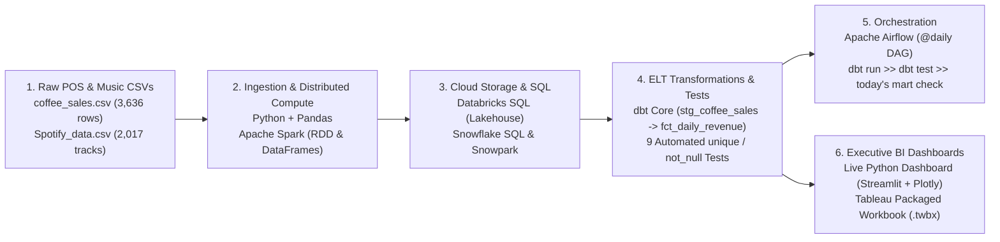

# ☕ BrewBeats — End-to-End Modern Data Engineering Pipeline (Mini Project 2)

**Author:** Rositsa Kaloyanova  
**Stack:** Apache Spark (RDDs & DataFrames) · Databricks SQL · Snowflake SQL & Snowpark · dbt (DuckDB / Snowflake) · Apache Airflow · Python (Streamlit & Plotly) · Tableau

[](https://week07day03-04-05-miniproject2sectione-casestudystep2-ccet58.streamlit.app)
[](https://www.python.org/)
[](https://spark.apache.org/)
[](https://www.getdbt.com/)
[](https://airflow.apache.org/)
[](https://www.snowflake.com/)

---

## 🎯 Business Case

**BrewBeats** is a growing coffee kiosk chain that curates in-store Spotify music playlists to increase customer dwell time and drive daily sales. To replace manual reporting, slow queries, and missing data quality checks, this project implements a complete **Modern Data Stack** covering:
- **Distributed Big-Data Processing** (`Apache Spark RDDs & DataFrames`)
- **Cloud Lakehouse & Warehouse Analytics** (`Databricks SQL`, `Snowflake SQL & Snowpark`)
- **Automated ELT Modeling & Testing** (`dbt` Staging + Mart models + `unique`/`not_null` tests)
- **Daily Workflow Orchestration** (`Apache Airflow` DAG with mart data freshness check)
- **Executive Business Intelligence** (**Live Real-Time Python Dashboard** built with Streamlit + Plotly + DuckDB, plus a packaged **Tableau Workbook** `.twbx`)

---

## 🏗️ End-to-End Architecture



---

## 🚀 Quick Access: Live Interactive Dashboard

[](https://week07day03-04-05-miniproject2sectione-casestudystep2-ccet58.streamlit.app)

> **⚡ Live Public URL (Anyone can open it!):**  
> 👉 **[https://week07day03-04-05-miniproject2sectione-casestudystep2-ccet58.streamlit.app](https://week07day03-04-05-miniproject2sectione-casestudystep2-ccet58.streamlit.app)**
>
> Built by **Rositsa Kaloyanova** with **Python + Streamlit + Plotly + DuckDB**, featuring a **Real-Time POS Order Simulator**, all 10 Executive Sales KPIs & charts, a Weekday × Hour staffing heatmap, and an interactive Spotify Playlist Curator!

- **Source Code:** [brewbeats_dashboard.py](Section%20E%20-%20Case%20Study/Step%202%20-%20Tableau%20Dashboard%20vs%20Live%20Python%20Dashboard/Live%20Python%20Dashboard/brewbeats_dashboard.py)
- **Tableau Packaged Workbook:** [Mini Project 2 - Section E.twbx](Section%20E%20-%20Case%20Study/Step%202%20-%20Tableau%20Dashboard%20vs%20Live%20Python%20Dashboard/Mini%20Project%202%20-%20Section%20E.twbx)
- **Run Locally in 1 Command:**
  ```bash
  pip install -r "Section E - Case Study/Step 2 - Tableau Dashboard vs Live Python Dashboard/Live Python Dashboard/requirements.txt"
  streamlit run "Section E - Case Study/Step 2 - Tableau Dashboard vs Live Python Dashboard/Live Python Dashboard/brewbeats_dashboard.py"
  ```

---

## 📂 Complete Project Navigation (Sections A – E)

| Section | Focus Area | Deliverables & Direct Links | Key Verified Results |
| :---: | :--- | :--- | :--- |
| **Section A** | **Spark RDD & DataFrames** | • [Section_A_Q1_Q2.ipynb](Section%20A%20-%20%20Spark%20RDD%20%26%20DataFrames%20%28Databricks%29%20and%20Local%20Spark%20for%20RDD/Section_A_Q1_Q2.ipynb) *(RDDs: Q1–Q2)*<br>• [Section_A_Q3_to_Q8.ipynb](Section%20A%20-%20%20Spark%20RDD%20%26%20DataFrames%20%28Databricks%29%20and%20Local%20Spark%20for%20RDD/Section_A_Q3_to_Q8.ipynb) *(DataFrames: Q3–Q8)* | • **Q1:** `1,343` distinct artists (`Drake: 16`, `Rick Ross: 13`)<br>• **Q2:** Avg danceability = **`0.6184`** (`61.84%`)<br>• **Q3:** Total revenue = **`$115,431.58`** (`3,636` tx)<br>• **Q7:** **`88`** songs with `'love'`<br>• **Q8:** Top 15 curated 5th Birthday party songs |
| **Section B** | **SQL on DatabricksSQL** | • **Q1:** [Section_B_Q1.sql](Section%20B%20-%20SQL%20on%20DatabricksSQL/Section_B_Q1.sql) \| [Notebook](Section%20B%20-%20SQL%20on%20DatabricksSQL/Section_B_Q1.ipynb)<br>• **Q2:** [Section_B_Q2.sql](Section%20B%20-%20SQL%20on%20DatabricksSQL/Section_B_Q2.sql) \| [Notebook](Section%20B%20-%20SQL%20on%20DatabricksSQL/Section_B_Q2.ipynb)<br>• **Q3:** [Section_B_Q3.sql](Section%20B%20-%20SQL%20on%20DatabricksSQL/Section_B_Q3.sql) \| [Notebook](Section%20B%20-%20SQL%20on%20DatabricksSQL/Section_B_Q3.ipynb)<br>• **Q4:** [Section_B_Q4.sql](Section%20B%20-%20SQL%20on%20DatabricksSQL/Section_B_Q4.sql) \| [Notebook](Section%20B%20-%20SQL%20on%20DatabricksSQL/Section_B_Q4.ipynb) | • **Q1 Top Coffee:** `Latte` (`$27,866.30`)<br>• **Q2 Payment:** `Card: $112,245.58` (`97.55%`) vs `Cash: $3,186.00`<br>• **Q3 Peak Month (CTE):** `2024-10` (`$13,891.16`)<br>• **Q4 Busiest Day:** `2024-10-11` (Friday, `26` tx) |
| **Section C** | **Snowflake SQL & Snowpark** | • **Q1:** [Section_C_Q1.sql](Section%20C%20-%20Snowflake%20SQL%20%26%20Snowpark/Section_C_Q1.sql) *(Stage + COPY INTO coffee_sales)*<br>• **Q2:** [Section_C_Q2.sql](Section%20C%20-%20Snowflake%20SQL%20%26%20Snowpark/Section_C_Q2.sql) *(Top 3 coffees)*<br>• **Q3:** [Section_C_Q3.sql](Section%20C%20-%20Snowflake%20SQL%20%26%20Snowpark/Section_C_Q3.sql) *(Stage + COPY INTO spotify_songs)*<br>• **Q4:** [Section_C_Q4.sql](Section%20C%20-%20Snowflake%20SQL%20%26%20Snowpark/Section_C_Q4.sql) *(Top 3 Drake songs)*<br>• **Snowpark:** [Section_C_Snowpark.py](Section%20C%20-%20Snowflake%20SQL%20%26%20Snowpark/Section_C_Snowpark.py) | • **Q2 Top 3 Coffees:** `Latte`, `Americano with Milk`, `Cappuccino`<br>• **Q4 Top 3 Drake Songs:** `Hotline Bling` (`0.896`), `Jumpman` (`0.853`), `Wu-Tang Forever` (`0.849`) |
| **Section D** | **dbt + Airflow Pipeline** | • **Q1:** [Section_D_Q1_stg_coffee_sales.sql](Section%20D%20-%20dbt%20%2B%20Airflow%20Pipeline/Section%20D_Q1/Section_D_Q1_stg_coffee_sales.sql) \| [Output](Section%20D%20-%20dbt%20%2B%20Airflow%20Pipeline/Section%20D_Q1/Section_D_Q1_Output.md)<br>• **Q2:** [Section_D_Q2_fct_daily_revenue.sql](Section%20D%20-%20dbt%20%2B%20Airflow%20Pipeline/Section%20D_Q2/Section_D_Q2_fct_daily_revenue.sql) \| [Output](Section%20D%20-%20dbt%20%2B%20Airflow%20Pipeline/Section%20D_Q2/Section_D_Q2_Output.md)<br>• **Q3:** [Section_D_Q3_schema.yml](Section%20D%20-%20dbt%20%2B%20Airflow%20Pipeline/Section%20D_Q3/Section_D_Q3_schema.yml) \| [Output](Section%20D%20-%20dbt%20%2B%20Airflow%20Pipeline/Section%20D_Q3/Section_D_Q3_Output.md)<br>• **Q4:** [Section_D_Q4_airflow_dbt_dag.py](Section%20D%20-%20dbt%20%2B%20Airflow%20Pipeline/Section%20D_Q4/Section_D_Q4_airflow_dbt_dag.py) \| [Output](Section%20D%20-%20dbt%20%2B%20Airflow%20Pipeline/Section%20D_Q4/Section_D_Q4_Output.md)<br>• **Q5:** [Section_D_Q5_airflow_dag_with_data_check.py](Section%20D%20-%20dbt%20%2B%20Airflow%20Pipeline/Section%20D_Q5/Section_D_Q5_airflow_dag_with_data_check.py) \| [Output](Section%20D%20-%20dbt%20%2B%20Airflow%20Pipeline/Section%20D_Q5/Section_D_Q5_Output.md) | • **`dbt run`:** `PASS=2` (`stg_coffee_sales` view & `fct_daily_revenue` table)<br>• **`dbt test`:** `PASS=9` (`unique` & `not_null` tests)<br>• **Airflow DAG:** `@daily` flow `dbt_run >> dbt_test >> check_mart_has_data_for_today` |
| **Section E** | **Case Study & Dashboards** | • **Step 1:** [Section_E_Case_Study_Writeup.md](Section%20E%20-%20Case%20Study/Step%201%20-%20Case%20Study%20%26%20Ingestion/Section_E_Case_Study_Writeup.md) \| [Section_E_Pipeline_Ingestion.py](Section%20E%20-%20Case%20Study/Step%201%20-%20Case%20Study%20%26%20Ingestion/Section_E_Pipeline_Ingestion.py)<br>• **Step 2:** [brewbeats_dashboard.py](Section%20E%20-%20Case%20Study/Step%202%20-%20Tableau%20Dashboard%20vs%20Live%20Python%20Dashboard/Live%20Python%20Dashboard/brewbeats_dashboard.py) \| [Mini Project 2 - Section E.twbx](Section%20E%20-%20Case%20Study/Step%202%20-%20Tableau%20Dashboard%20vs%20Live%20Python%20Dashboard/Mini%20Project%202%20-%20Section%20E.twbx) | • All **10 Dashboard Requirements** verified to the exact decimal<br>• Peak weekday: **Tuesday** (`$18,637.38`)<br>• Dual peak hours: **10:00 AM** (`$10,994.52`) & **4:00 PM** (`$9,221.60`) |

---

## 📊 Executive KPI Snapshot (`coffee_sales.csv`)

- **Total Sales Revenue:** `$115,431.58`
- **Total Transactions:** `3,636`
- **Average Transaction Value:** `$31.75`
- **Best-Selling Coffee:** **Latte** by revenue (`$27,866.30` / `24.14%` share) | **Americano with Milk** by cup volume (`824` cups)
- **Payment Split:** `97.55%` Card (`$112,245.58`) vs. `2.45%` Cash (`$3,186.00`)
- **Peak Month:** **October 2024** (`$13,891.16`, `426` transactions) followed by **February 2025** (`$13,215.48`, `423` transactions)

