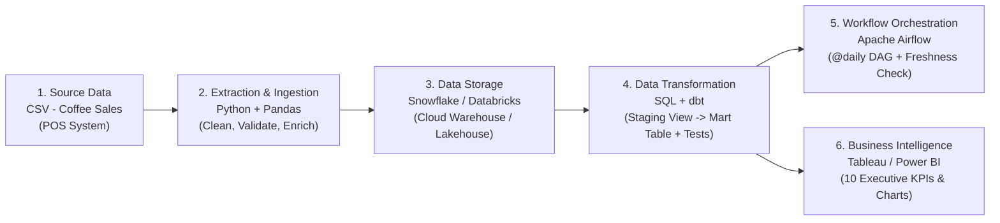

# BrewBeats — Mini Project 2: Section E (Case Study Write-Up & Dashboard Analytics)

**Folder:** `Section E - Case Study/`  
**Stack:** `CSV (Coffee Sales)` → `Python + Pandas` → `Snowflake / Databricks` → `SQL + dbt` → `Apache Airflow` → `Tableau / Power BI`

---

## 1. Business Scenario & Problem Statement

**BrewBeats** is a growing coffee kiosk chain that curates in-store music playlists to enhance customer dwell time and boost daily coffee sales. Currently, the company receives daily point-of-sale (POS) transaction data (`coffee_sales.csv`), but its reporting workflow suffers from four critical bottlenecks:
1. **Manual, slow reporting on daily sales** — analysts prepare reports by hand, delaying business decisions.
2. **No automated pipeline** — extraction, cleaning, and aggregation scripts are triggered manually.
3. **Growing data volume causing slow queries** — querying raw unindexed CSV files directly slows down analytics.
4. **No data quality checks before reports are shared** — missing values, duplicate loads, or empty daily tables can reach stakeholders undetected.

---

## 2. Proposed Modern Data Stack Architecture (End-to-End Pipeline)

### Layer-by-Layer Architecture Explanation: 

1. **Source Data (`CSV – Coffee Sales`)**:
   - The point-of-sale (POS) terminals export daily transactions (`date`, `datetime`, `cash_type`, `card`, `money`, `coffee_name`) into `coffee_sales.csv` (`3,636` transactions totaling `$115,431.58`).
2. **Extraction and Ingestion (`Python + Pandas` — `Section_E_Pipeline_Ingestion.py`)**:
   - A Python script using **Pandas** reads the incoming CSV file, validates data types (`date`, `datetime`, `money`), trims whitespace on text fields, fills missing `card` identifiers on cash orders with `'CASH_NO_CARD'`, and uploads the validated file into cloud staging (`@coffee_stage` in Snowflake or a Unity Catalog Volume in Databricks).
3. **Data Storage (`Snowflake / Databricks`)**:
   - **Snowflake** acts as our cloud **Data Warehouse** (using `COPY INTO coffee_sales FROM @coffee_stage`), or **Databricks** acts as our **Data Lakehouse** (storing raw data in Delta Lake tables). Moving from local CSVs to columnar cloud storage eliminates slow queries as data volume scales.
4. **Data Transformation (`SQL + dbt`)**:
   - **dbt (data build tool)** transforms the raw table inside the warehouse using modular SQL models:
     - **Staging Layer (`stg_coffee_sales.sql`)**: Standardizes column names, casts timestamps and numeric amounts, and generates a unique `transaction_id`.
     - **Mart Layer (`fct_daily_revenue.sql`)**: References `{{ ref('stg_coffee_sales') }}` to aggregate daily transaction counts, daily revenue, average ticket value, and card vs. cash revenue.
     - **Automated Data Quality Tests (`schema.yml`)**: Runs `unique` and `not_null` checks via `dbt test` to guarantee zero duplicate keys and zero `NULL` dates or revenue figures.
5. **Workflow Orchestration (`Apache Airflow`)**:
   - An **Apache Airflow DAG** (`schedule="@daily"`) automates the entire pipeline every morning without human intervention:
     `dbt_run_models >> dbt_test_models >> check_mart_has_data_for_today`.
   - If any dbt test fails or if today's data is missing from `fct_daily_revenue`, Airflow halts the pipeline and alerts the engineering team before dashboards refresh.
6. **Business Intelligence (`Tableau / Power BI`)**:
   - **Tableau** (and **Power BI**) connects directly to the clean mart tables to display BrewBeats' 10 executive KPIs and interactive trend charts.

---

## 3. Complete Verification of the 10 Dashboard Requirements

### KPI Requirements 1–4: Executive Summary Cards

| # | Dashboard Requirement | Verified Value | Tableau Formula | Power BI (DAX) Formula |
| :---: | :--- | :--- | :--- | :--- |
| **1** | **Total sales revenue** | **`$115,431.58`** | `SUM([Money])` | `Total Revenue = SUM(coffee_sales[money])` |
| **2** | **Total number of transactions** | **`3,636`** | `COUNT([Coffee Name])` | `Total Transactions = COUNTROWS(coffee_sales)` |
| **3** | **Average transaction value** | **`$31.75`** | `AVG([Money])` | `Avg Transaction Value = AVERAGE(coffee_sales[money])` |
| **4** | **Best-selling coffee** | **By Revenue:** **`Latte`** (`$27,866.30`) **By Volume:** **`Americano with Milk`** (`824` cups) | Top 1 of `SUM([Money])` / `COUNT([Coffee Name])` by `[Coffee Name]` | `TOPN(1, VALUES(coffee_sales[coffee_name]), [Total Revenue], DESC)` |

---

### Requirement 5: Revenue by Coffee Type (and Transaction Volume)

| Rank (by Revenue) | Coffee Name | Transactions (Cups Sold) | Total Revenue (`$`) | Share of Total Revenue (`%`) | Average Price (`$`) |
| :---: | :--- | :---: | :---: | :---: | :---: |
| **1** | **Latte** | 782 | **`$27,866.30`** | `24.14%` | `$35.63` |
| **2** | **Americano with Milk** | **824** *(Most Cups)* | **`$25,269.12`** | `21.89%` | `$30.67` |
| **3** | **Cappuccino** | 501 | **`$18,034.14`** | `15.62%` | `$36.00` |
| **4** | **Americano** | 578 | **`$15,062.26`** | `13.05%` | `$26.06` |
| **5** | **Hot Chocolate** | 282 | **`$10,172.46`** | `8.81%` | `$36.07` |
| **6** | **Cocoa** | 243 | **`$8,678.16`** | `7.52%` | `$35.71` |
| **7** | **Cortado** | 292 | **`$7,534.86`** | `6.53%` | `$25.80` |
| **8** | **Espresso** | 134 | **`$2,814.28`** | `2.44%` | `$21.00` |
| **Total** | **All 8 Coffee Types** | **3,636** | **`$115,431.58`** | **`100.00%`** | **`$31.75`** |

> **Key Business Insight:** **Latte** and **Americano with Milk** together generate **`46.03%`** (`$53,135.42`) of BrewBeats' total revenue. While **Americano with Milk** sells the highest number of cups (`824`), **Latte** generates the highest dollar revenue (`$27,866.30`) due to its higher average price (`$35.63` vs. `$30.67`).

---

### Requirements 6 & 10: Revenue by Month & Monthly Sales Trends (`2024-03` to `2025-03`)

| Year-Month | Month Name | Total Transactions | Monthly Revenue (`$`) | MoM Trend Note |
| :---: | :--- | :---: | :---: | :--- |
| **`2024-03`** | March 2024 | 206 | `$7,050.20` | Baseline launch month |
| **`2024-04`** | April 2024 | 196 | `$6,720.56` | `-4.68%` dip |
| **`2024-05`** | May 2024 | 267 | `$9,063.42` | `+34.86%` spring surge |
| **`2024-06`** | June 2024 | 227 | `$7,758.76` | Early summer stabilization |
| **`2024-07`** | July 2024 | 237 | `$6,915.94` | Mid-summer dip |
| **`2024-08`** | August 2024 | 272 | `$7,613.84` | Late-summer recovery |
| **`2024-09`** | September 2024 | 344 | `$9,988.64` | `+31.19%` autumn ramp-up |
| **`2024-10`** | **October 2024** | **426** | **`$13,891.16`** | 🏆 **All-Time Peak Month** |
| **`2024-11`** | November 2024 | 259 | `$8,590.54` | Late-autumn normalization |
| **`2024-12`** | December 2024 | 259 | `$8,237.74` | Holiday steady demand |
| **`2025-01`** | January 2025 | 201 | `$6,398.86` | Post-holiday winter low |
| **`2025-02`** | **February 2025** | **423** | **`$13,215.48`** | 🥈 **2nd Highest Month (`+106.5%` MoM)** |
| **`2025-03`** | March 2025 *( through Mar 23)* | 319 | `$9,986.44` | `+41.65%` YoY vs. March 2024! |

---

### Requirement 7: Sales by Weekday

| Weekday | Total Transactions | Total Revenue (`$`) | Share of Revenue (`%`) |
| :--- | :---: | :---: | :---: |
| **Monday** | 561 | `$17,925.10` | `15.53%` |
| **Tuesday** 🏆 | **585** | **`$18,637.38`** | **`16.15%`** |
| **Wednesday** | 510 | `$16,093.46` | `13.94%` |
| **Thursday** | 520 | `$16,477.40` | `14.27%` |
| **Friday** | 544 | `$17,257.66` | `14.95%` |
| **Saturday** | 482 | `$15,182.52` | `13.15%` |
| **Sunday** | 434 | `$13,858.06` | `12.01%` |

> **Key Business Insight:** Weekday commuter traffic drives BrewBeats' highest sales, peaking on **Tuesday (`585` transactions, `$18,637.38`)** and **Monday (`561` transactions, `$17,925.10`)**, while **Sunday** is the quietest day (`434` transactions, `$13,858.06`).

---

### Requirement 8: Sales by Hour of Day (`06:00` to `22:00`)

| Hour of Day | Transactions | Revenue (`$`) | Time-of-Day Pattern |
| :---: | :---: | :---: | :--- |
| **`06:00`** | 5 | `$149.40` | Early opening |
| **`07:00`** | 91 | `$2,940.02` | Early commuter ramp-up |
| **`08:00`** | 235 | `$7,017.88` | Morning rush begins |
| **`09:00`** | 247 | `$7,429.28` | Morning rush continues |
| **`10:00` 🏆** | **349** | **`$10,994.52`** | **#1 Peak Hour of the Day (10:00 AM)** |
| **`11:00` 🥈** | **294** | **`$8,849.10`** | **#2 Morning Peak (11:00 AM)** |
| **`12:00`** | 249 | `$7,668.62` | Lunch hour |
| **`13:00`** | 227 | `$7,108.76` | Early afternoon |
| **`14:00`** | 228 | `$7,265.80` | Mid-afternoon |
| **`15:00`** | 245 | `$7,789.02` | Afternoon pick-me-up |
| **`16:00` 🥉** | **283** | **`$9,221.60`** | **#1 Afternoon Peak (4:00 PM)** |
| **`17:00`** | 244 | `$7,925.00` | Evening commute |
| **`18:00`** | 220 | `$7,235.60` | Dinner hour |
| **`19:00`** | 235 | `$7,966.96` | Evening social hour |
| **`20:00`** | 171 | `$5,656.92` | Late evening |
| **`21:00`** | 197 | `$6,465.94` | Night wind-down |
| **`22:00`** | 116 | `$3,747.16` | Closing hour |

> **Key Business Insight:** BrewBeats experiences a **dual-peak daily curve**: a primary morning peak at **10:00 AM (`349` transactions, `$10,994.52`)** and a secondary afternoon peak at **4:00 PM / 16:00 (`283` transactions, `$9,221.60`)**. Staffing and upbeat playlist curation should be concentrated around **10:00–11:00 AM** and **4:00–5:00 PM**.

---

### Requirement 9: Cash versus Card Transactions

| Payment Type (`cash_type`) | Total Transactions | Share of Transactions (`%`) | Total Revenue (`$`) | Share of Revenue (`%`) | Average Transaction Value (`$`) |
| :--- | :---: | :---: | :---: | :---: | :---: |
| **`card`** | **3,547** | **`97.55%`** | **`$112,245.58`** | **`97.24%`** | `$31.65` |
| **`cash`** | **89** | **`2.45%`** | **`$3,186.00`** | **`2.76%`** | `$35.80` |
| **Total** | **3,636** | **`100.00%`** | **`$115,431.58`** | **`100.00%`** | **`$31.75`** |

> **Key Business Insight:** BrewBeats is an almost completely cashless business, with **`97.55%` of transactions (`97.24%` of revenue)** paid via **card**.
