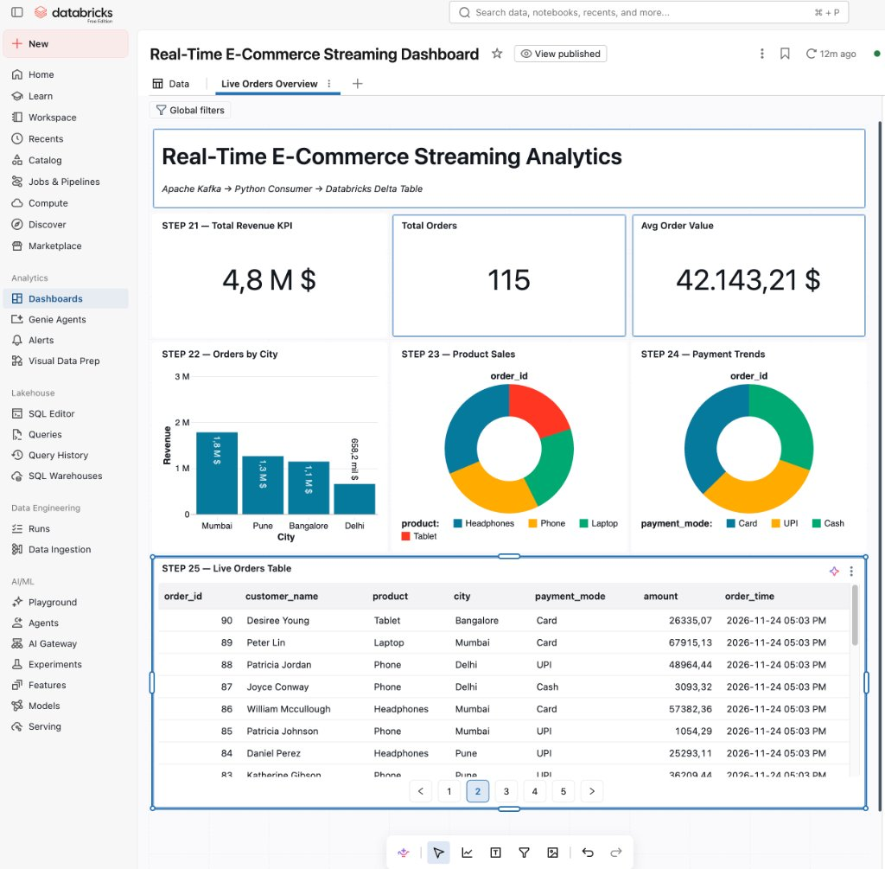

# Week 08 — Day 02: Kafka + Snowflake + Power BI Integration Project

**Student:** Rositsa Kaloyanova  
**Environment:** macOS Terminal (`zsh`) + Docker (`apache/kafka:latest`) + Python (`3.14.6`) + Databricks Unity Catalog  
**Project Instructions:** [Kafka Snowflake Power BI Integration.docx.pdf](Kafka%20Snowflake%20Power%20BI%20Integration.docx.pdf)

[](https://dbc-9044289c-3f13.cloud.databricks.com/dashboardsv3/01f1e8246f9a1b5ab12bd5ee4a53923d/published?o=7474645737278966)

---

## 🎯 Project Architecture

```text
Python Producer (Part 4_producer.py with Faker)
        ↓
Apache Kafka Topic (ecommerce_orders)
        ↓
Python Consumer (Part 7_consumer_databricks.py)
        ↓
Databricks Delta Table (workspace.kafka_demo.orders)
        ↓
Databricks AI/BI Dashboard (Live Visuals)
```

---

## ⚙️ Part 1 — Start / Verify Apache Kafka (Docker KRaft Mode) ✅

*(Adapted from the Windows ZooKeeper commands in the handout to Kafka 4+ running in Docker with KRaft, as noted on page 3 of the PDF.)*

```bash
docker ps --filter "name=kafka"
```
- **Verified:** Container `kafka` (`apache/kafka:latest`) is running on `localhost:9092` (`127.0.0.1:9092`).

---

## 📌 Part 2 — Create & Verify Kafka Topic (`ecommerce_orders`) ✅

```bash
# Create the topic with 1 partition and replication factor 1
docker exec -it kafka /opt/kafka/bin/kafka-topics.sh --create \
  --topic ecommerce_orders \
  --bootstrap-server localhost:9092 \
  --partitions 1 \
  --replication-factor 1

# Verify it appears in the topic list and inspect its layout
docker exec -it kafka /opt/kafka/bin/kafka-topics.sh --list --bootstrap-server localhost:9092
docker exec -it kafka /opt/kafka/bin/kafka-topics.sh --describe --topic ecommerce_orders --bootstrap-server localhost:9092
```
- **Verified:** `Created topic ecommerce_orders.` (`PartitionCount: 1`, `ReplicationFactor: 1`, `Leader: 1`).

---

## 📦 Part 3 — Install Python Libraries ✅

```bash
python3 -m pip install kafka-python snowflake-connector-python pandas faker python-dotenv
```
- **Verified Imports (Python `3.14.6`):**
  - `kafka-python` (`3.0.13`)
  - `snowflake-connector-python` (`5.2.0`)
  - `pandas` (`3.0.3`)
  - `faker` (`40.63.0`)
  - `python-dotenv` (`1.2.1`) — added so Snowflake credentials stay safely in a local `.env` file and are never pushed to GitHub.

---

## 🚀 Part 4 — Create Producer (`Part 4_producer.py`) ✅

- **File:** [Part 4_producer.py](Part%204_producer.py)
- **What it does:** Connects to `127.0.0.1:9092` via `KafkaProducer`, serializes Python dictionaries into UTF-8 JSON bytes (`value_serializer`), and generates a simulated e-commerce order every 2 seconds (`order_id`, `customer_name`, `city`, `product`, `amount`, `payment_mode`, `order_time`) into the `ecommerce_orders` topic.

---

## 🔍 Part 5 — Verify Kafka Data (`ecommerce_orders`) ✅

Ran [Part 4_producer.py](Part%204_producer.py) to stream simulated live orders (~108 orders generated), then verified the JSON messages directly inside Kafka using `kafka-console-consumer.sh`:

```bash
docker exec -it kafka /opt/kafka/bin/kafka-console-consumer.sh \
  --topic ecommerce_orders \
  --from-beginning \
  --max-messages 5 \
  --bootstrap-server localhost:9092
```
- **Verified Output (first 5 JSON order events):**
```json
{"order_id": 1, "customer_name": "Laura Warner", "city": "Delhi", "product": "Headphones", "amount": 3920.82, "payment_mode": "Cash", "order_time": "2026-11-24 17:00:31.426754"}
{"order_id": 2, "customer_name": "Barry Brooks", "city": "Mumbai", "product": "Tablet", "amount": 59858.59, "payment_mode": "Cash", "order_time": "2026-11-24 17:00:33.537069"}
{"order_id": 3, "customer_name": "Melissa Obrien", "city": "Bangalore", "product": "Phone", "amount": 7369.74, "payment_mode": "Card", "order_time": "2026-11-24 17:00:35.544194"}
{"order_id": 4, "customer_name": "Jonathan Neal", "city": "Pune", "product": "Tablet", "amount": 72285.79, "payment_mode": "UPI", "order_time": "2026-11-24 17:00:37.551625"}
{"order_id": 5, "customer_name": "Jesus Sanchez", "city": "Bangalore", "product": "Laptop", "amount": 58349.36, "payment_mode": "Card", "order_time": "2026-11-24 17:00:39.555369"}
```

---

## 🧱 Part 6 — Create Databricks Schema & Delta Table (`workspace.kafka_demo.orders`) ✅

*(Using Databricks as allowed on page 2 of the project instructions: `Snowflake Trial Account / Databricks`, connected via `databricks-sql-connector` `4.10.0` with credentials stored safely in a gitignored `.env` file.)*

- **SQL Script:** [Part 6_databricks_setup.sql](Part%206_databricks_setup.sql)
- **Verified Table Schema (`workspace.kafka_demo.orders`):**
  - `order_id` (`INT`)
  - `customer_name` (`STRING`)
  - `city` (`STRING`)
  - `product` (`STRING`)
  - `amount` (`DOUBLE`)
  - `payment_mode` (`STRING`)
  - `order_time` (`TIMESTAMP`)

---

## 🔌 Part 7 — Create & Run Kafka Consumer (`Part 7_consumer_databricks.py`) ✅

- **File:** [Part 7_consumer_databricks.py](Part%207_consumer_databricks.py)
- **What it does:** Reads JSON messages from Kafka topic `ecommerce_orders`, loads Databricks credentials safely from `.env`, and writes orders into `workspace.kafka_demo.orders` using safe parameterized batch `INSERT` statements (`?` placeholders so names with apostrophes never break SQL, and 50-row batches for fast ingestion).
- **Command & Verified Output:**
  ```bash
  python3 "Part 7_consumer_databricks.py" --idle 5
  ```
  ```text
  Connecting to Databricks (dbc-9044289c-3f13.cloud.databricks.com)...
  Listening to Kafka topic "ecommerce_orders"... (Press Ctrl-C to stop)
  Inserted batch of 50 orders into Databricks (total: 50)
  Inserted batch of 50 orders into Databricks (total: 100)
  Inserted batch of 15 orders into Databricks (total: 115)
  Idle timeout (5s) reached — stopping cleanly.
  Done! Total orders inserted into workspace.kafka_demo.orders: 115
  ```

---

## ✅ Part 8 — Verify Data in Databricks (`workspace.kafka_demo.orders`) ✅

```sql
SELECT COUNT(*) AS total_orders, ROUND(SUM(amount), 2) AS total_revenue
FROM workspace.kafka_demo.orders;

SELECT * FROM workspace.kafka_demo.orders ORDER BY order_id LIMIT 5;
```
- **Verified Results:**
  - **Total Orders:** `115`
  - **Total Revenue:** `4,846,469.52`
  - **First 5 rows match the exact Kafka JSON events:** `order_id` 1 (`Laura Warner`, `Delhi`, `Headphones`, `3920.82`, `Cash`) through `order_id` 5 (`Jesus Sanchez`, `Bangalore`, `Laptop`, `58349.36`, `Card`).

---

## 📊 Parts 9 & 10 — Live Databricks AI/BI Dashboard ✅

[](https://dbc-9044289c-3f13.cloud.databricks.com/dashboardsv3/01f1e8246f9a1b5ab12bd5ee4a53923d/published?o=7474645737278966)



- **Published Dashboard Link:** [Real-Time E-Commerce Streaming Dashboard (Databricks AI/BI)](https://dbc-9044289c-3f13.cloud.databricks.com/dashboardsv3/01f1e8246f9a1b5ab12bd5ee4a53923d/published?o=7474645737278966)
- **Verified Dashboard SQL Queries:** [Part 9_10_dashboard_queries.sql](Part%209_10_dashboard_queries.sql)

### Visuals Included on the Published Dashboard
- **STEP 21 — Total Revenue KPI:** `$4.85 M` (`SUM(amount)`) + bonus executive KPIs: **Total Orders** (`115`) and **Avg Order Value** (`$42,143.21`)
- **STEP 22 — Orders by City:** Sorted bar chart (`Mumbai`, `Pune`, `Bangalore`, `Delhi`) with data labels
- **STEP 23 — Product Sales:** Pie chart breaking down order counts by product (`Headphones`, `Phone`, `Laptop`, `Tablet`)
- **STEP 24 — Payment Trends:** Pie chart showing payment method distribution (`Card`, `UPI`, `Cash`)
- **STEP 25 — Live Orders Table:** Full-width table (`order_id`, `customer_name`, `product`, `city`, `payment_mode`, `amount`, `order_time`) sorted by newest order first
- **Interactive Global Filters:** Filter the entire dashboard live by `city` and `payment_mode`.

---

## 📁 Files in This Folder

- **[README.md](README.md)** — Complete end-to-end documentation, verified outputs, and 1-click Live Dashboard button.
- **[Part 4_producer.py](Part%204_producer.py)** — Python Kafka Producer generating live fake e-commerce orders with `Faker`.
- **[Part 6_databricks_setup.sql](Part%206_databricks_setup.sql)** — SQL script creating `workspace.kafka_demo.orders` Delta table in Unity Catalog.
- **[Part 7_consumer_databricks.py](Part%207_consumer_databricks.py)** — Python Kafka Consumer streaming JSON orders from Kafka into Databricks via parameterized batch inserts.
- **[Part 9_10_dashboard_queries.sql](Part%209_10_dashboard_queries.sql)** — Verified SQL queries powering all 5 dashboard visuals (`STEP 21`–`STEP 25`).
- **[Kafka Snowflake Power BI Integration.docx.pdf](Kafka%20Snowflake%20Power%20BI%20Integration.docx.pdf)** — Official project instructions.
- *(`.env` containing local Databricks credentials is excluded via `.gitignore` and never committed to GitHub.)*
