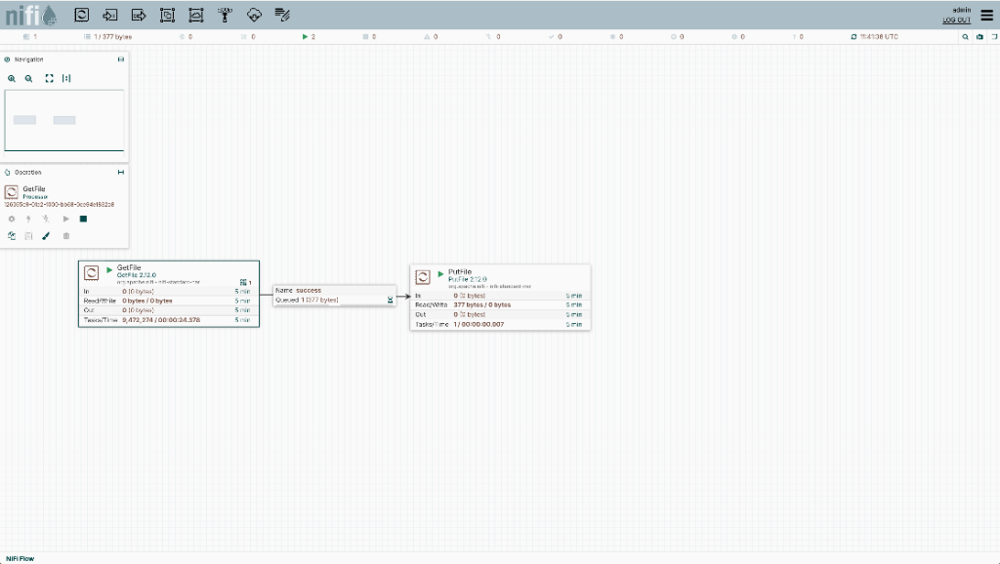

# Week 08 - Day 03: Installation of Apache NiFi (Docker Cheat Sheet)

These are my notes and quick commands for running **Apache NiFi 2.12.0** locally with Docker on my Mac.

## Access & Login Details

- **NiFi Web UI:** https://localhost:8443/nifi
- **Credentials:** Stored locally in `.env` (which is ignored by `.gitignore` so private details are never committed to Git).
  - If setting this up on a new machine, copy `.env.example` to `.env` and fill in your own `NIFI_USERNAME` and `NIFI_PASSWORD` (password must be at least 12 characters).
- **Note on browser warning:** Because NiFi runs locally with a self-signed HTTPS certificate, Chrome shows *"Your connection is not private"*. I click **Advanced** → **Proceed to localhost (unsafe)** to open it.

## Folder Structure

- `docker-compose.yml` — My Docker Compose configuration for the `nifi` container (reads credentials from `.env`).
- `.env` — My private local credentials (**ignored by Git — never committed**).
- `.env.example` — Template showing which environment variables are needed (safe to commit).
- `data/` — Shared folder between my Mac (`./data`) and inside the NiFi container (`/opt/nifi/nifi-current/data`). I can drop input files here or write output files here during NiFi labs.
- `images/` — Screenshots of my working Apache NiFi flows.

## First Working Flow (`GetFile` → `PutFile`)

To verify my NiFi installation, I built and ran a basic flow that reads `sample_sales.csv` from `/opt/nifi/nifi-current/data/input` using **`GetFile`** and writes it to `/opt/nifi/nifi-current/data/output` using **`PutFile`**:



## Useful Docker Commands

Always run these commands from inside this folder (`Week 08/Day 03 - Installation of NiFi`):

```bash
# Start NiFi for the first time (or rebuild/recreate the container if I edit docker-compose.yml)
# -d runs the container in the background (detached mode) so my terminal stays free
docker compose up -d

# Stop NiFi when I am finished for the day (keeps my container and flows saved, frees up RAM)
docker compose stop

# Start NiFi again the next time I need it
docker compose start

# Check if the nifi container is currently running and see its status/ports
docker ps

# View the last 50 lines of NiFi's logs (helpful if NiFi is still starting up or throws an error)
docker logs --tail 50 nifi

# Stop AND remove the container + network (my flows stay safe in the nifi_state volume
# and my files stay safe in ./data)
docker compose down
```
