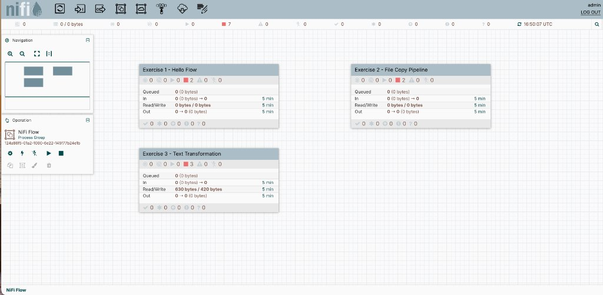
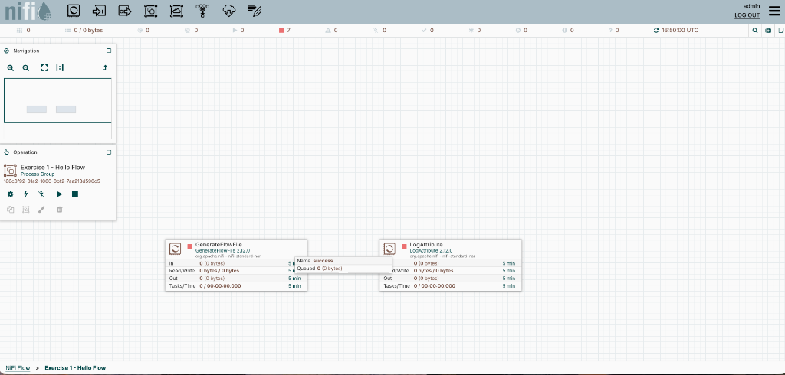
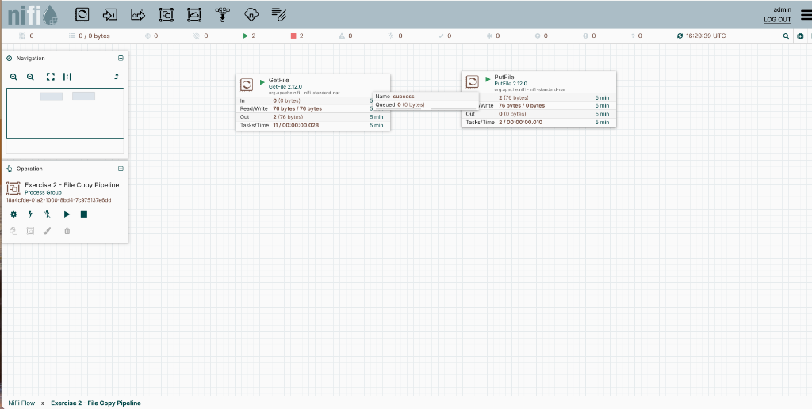
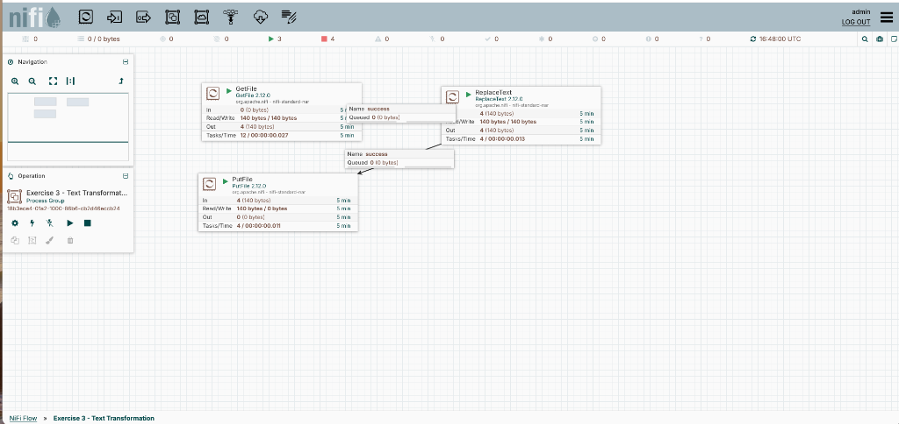

# Week 08 — Day 04: Apache NiFi Beginner Exercises Guide (Exercises 1–3)

In this lab, I practiced building my first three dataflows in **Apache NiFi 2.12.0** (running locally in Docker at `https://localhost:8443/nifi`).

To keep my canvas clean and easy to revisit, I placed each exercise inside its own **Process Group** on the main `NiFi Flow` canvas:



---

## Docker Shared Folder Setup (Used in Exercises 2 & 3)

Because my NiFi instance runs inside a Docker container (configured in `Week 08/Day 03 - Installation of NiFi/docker-compose.yml`), NiFi cannot read `~/nifi-input` directly from my Mac's home folder. Instead, Docker mounts my local `data/` folder into the container:

| Location | Path |
| :--- | :--- |
| **On my Mac** | `Week 08/Day 03 - Installation of NiFi/data/nifi-input` and `data/nifi-output` |
| **Inside NiFi container** | `/opt/nifi/nifi-current/data/nifi-input` and `/opt/nifi/nifi-current/data/nifi-output` |

---

## Exercise 1: Hello Flow

**Goal:** Understand FlowFiles, connections, relationships, Data Provenance, and the Start/Stop lifecycle.  
**Processors used:** `GenerateFlowFile` → `LogAttribute`

### Steps I Followed

1. Created a Process Group named **`Exercise 1 - Hello Flow`** on the main `NiFi Flow` canvas and double-clicked to enter it.
2. Added a **`GenerateFlowFile`** processor (which generates empty or sample FlowFiles on a timer for testing) and configured it:
   - **Properties tab:**
     - `File Size`: `0B` *(creates empty FlowFiles just to carry attributes/metadata)*
     - Left all other properties as default.
   - **Scheduling tab:**
     - `Run Schedule`: `10 sec` *(generates one FlowFile every 10 seconds so it doesn't flood my logs)*.
3. Added a **`LogAttribute`** processor (which writes each FlowFile's attributes into NiFi's application log) and configured it:
   - **Relationships tab:** Checked **`terminate`** for **`success`** *(in NiFi, every relationship must either be connected downstream or explicitly auto-terminated before a processor can start)*.
4. Connected **`GenerateFlowFile` → `LogAttribute`** on the **`success`** relationship.
5. Selected both processors → **Start**, waited ~15–20 seconds for FlowFiles to pass through, then inspected **View Data Provenance** on `LogAttribute` to trace the FlowFile events.
6. Verified the logged FlowFile attributes in `/opt/nifi/nifi-current/logs/nifi-app.log` inside my Docker container:
   ```bash
   # I use docker exec to inspect the last 30 lines of NiFi's application log inside the container
   docker exec nifi tail -n 30 /opt/nifi/nifi-current/logs/nifi-app.log
   ```
   **Observed log output:**
   ```text
   FlowFile Properties
     Key: 'entryDate'        Value: 'Thu Nov 26 15:48:19 UTC 2026'
     Key: 'lineageStartDate' Value: 'Thu Nov 26 15:48:19 UTC 2026'
     Key: 'fileSize'         Value: '0'
   FlowFile Attribute Map Content
     Key: 'filename'         Value: '582b2dc5-a7bc-4dbe-8cd2-cc1321d97de1'
     Key: 'path'             Value: './'
     Key: 'uuid'             Value: '582b2dc5-a7bc-4dbe-8cd2-cc1321d97de1'
   ```
7. Stopped both processors when finished.

### Screenshot — Exercise 1



---

## Exercise 2: File Copy Pipeline

**Goal:** Learn basic file ingestion (`GetFile`) and egress (`PutFile`) processors and directory configuration.  
**Processors used:** `GetFile` → `PutFile`

### Steps I Followed

1. Created two folders (`nifi-input` and `nifi-output`) inside my shared Docker `data/` directory and placed a sample file `sample.txt` inside `nifi-input`:
   ```bash
   # Create the input and output folders inside the Docker-mounted data folder
   mkdir -p "/Users/rosi/Documents/IronHack Course /Week 08/Day 03 - Installation of NiFi/data/nifi-input"
   mkdir -p "/Users/rosi/Documents/IronHack Course /Week 08/Day 03 - Installation of NiFi/data/nifi-output"

   # Create sample.txt inside nifi-input so GetFile has a file to ingest
   echo 'This is a sample file for Exercise 2.' > "/Users/rosi/Documents/IronHack Course /Week 08/Day 03 - Installation of NiFi/data/nifi-input/sample.txt"
   ```
2. Created a new Process Group named **`Exercise 2 - File Copy Pipeline`** and entered it.
3. Added a **`GetFile`** processor and configured it:
   - **Properties tab:**
     - `Input Directory`: `/opt/nifi/nifi-current/data/nifi-input`
     - `Keep Source File`: `true` *(keeps `sample.txt` in `nifi-input` instead of deleting it while I test)*
   - **Scheduling tab:**
     - `Run Schedule`: `5 sec` *(since `Keep Source File` is `true`, this prevents NiFi from re-copying the file hundreds of times per second)*.
4. Added a **`PutFile`** processor and configured it:
   - **Properties tab:**
     - `Directory`: `/opt/nifi/nifi-current/data/nifi-output`
     - `Conflict Resolution Strategy`: `replace` *(overwrites the output file cleanly if a file with the same name already exists)*
   - **Relationships tab:**
     - Checked **`terminate`** for both **`success`** and **`failure`** *(since `PutFile` is the final step in this pipeline)*.
5. Connected **`GetFile` → `PutFile`** on the **`success`** relationship.
6. Started both processors, refreshed the canvas to verify FlowFiles moving from `GetFile` (`Out: 2`) to `PutFile` (`In: 2`), and confirmed `nifi-output/sample.txt` appeared with the exact original content (`This is a sample file for Exercise 2.`).
7. Stopped both processors before moving to Exercise 3.

### Screenshot — Exercise 2



---

## Exercise 3: Text Transformation

**Goal:** Practice configuring processor properties and regex-based text replacement on FlowFile content.  
**Processors used:** `GetFile` → `ReplaceText` → `PutFile`

### Steps I Followed

1. Reused my `nifi-input` and `nifi-output` folders and added a new input file `greeting.txt` containing the word `hello`:
   ```text
   hello world! hello Apache NiFi!
   ```
2. Created a new Process Group named **`Exercise 3 - Text Transformation`** and entered it.
3. Added a **`GetFile`** processor with the same configuration as Exercise 2:
   - `Input Directory`: `/opt/nifi/nifi-current/data/nifi-input`
   - `Keep Source File`: `true`
   - `Run Schedule`: `5 sec`
4. Added a **`ReplaceText`** processor (which searches and replaces text inside each FlowFile's content) and configured it:
   - **Properties tab:**
     - `Search Value`: `hello` *(the pattern to look for)*
     - `Replacement Value`: `HELLO` *(the text to replace every match with)*
     - `Replacement Strategy`: `Regex Replace` *(replaces all regex matches inside the FlowFile)*
   - **Relationships tab:**
     - Checked **`terminate`** for **`failure`** *(left `success` unchecked because it connects to `PutFile`)*.
5. Added a **`PutFile`** processor pointing to the output folder:
   - **Properties tab:**
     - `Directory`: `/opt/nifi/nifi-current/data/nifi-output`
     - `Conflict Resolution Strategy`: `replace`
   - **Relationships tab:**
     - Checked **`terminate`** for both **`success`** and **`failure`**.
6. Connected **`GetFile` → `ReplaceText`** (`success`) and **`ReplaceText` → `PutFile`** (`success`).
7. Started all three processors, refreshed the canvas to verify FlowFiles flowing through all three stages (`GetFile` → `ReplaceText` → `PutFile`), and checked `nifi-output/greeting.txt`:
   - **Input (`nifi-input/greeting.txt`):** `hello world! hello Apache NiFi!`
   - **Output (`nifi-output/greeting.txt`):** `HELLO world! HELLO Apache NiFi!`
8. Stopped all three processors when finished.

### Screenshot — Exercise 3



---

## Folder Structure

- `README.md` — My step-by-step notes and verification results for Exercises 1–3.
- `images/` — Screenshots of my working Apache NiFi flows:
  - `nifi_overview_all_exercises.jpg`
  - `exercise1_hello_flow.png`
  - `exercise2_file_copy_pipeline.png`
  - `exercise3_text_transformation.png`
